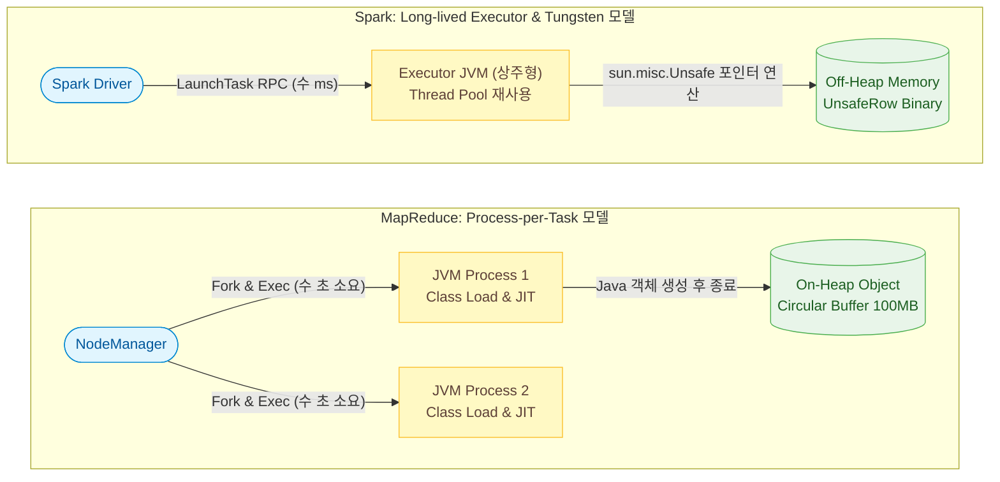
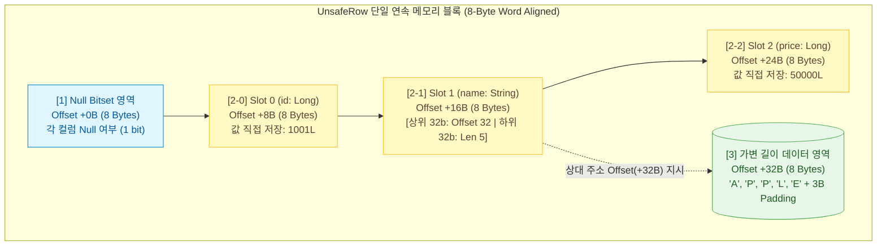
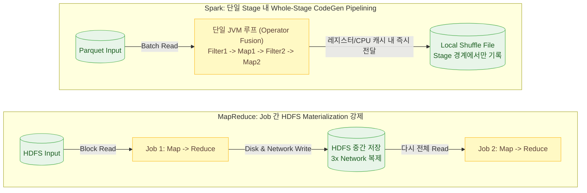
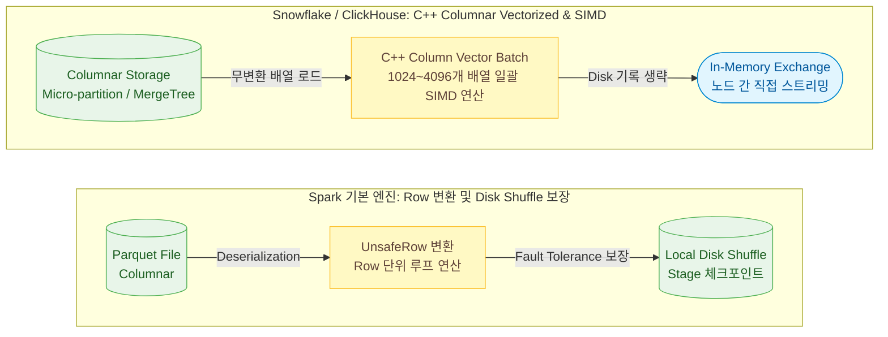
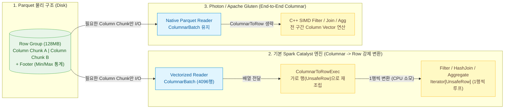
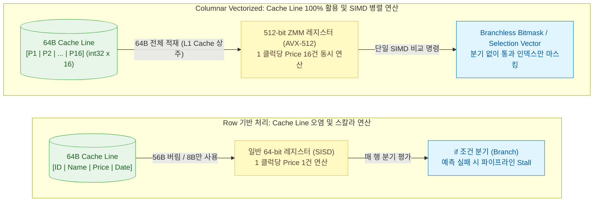

MapReduce와 Spark의 차이를 흔히 Disk 기반과 Memory 기반의 차이로만 요약하곤 한다. 하지만 실제 대용량 배치를 운영해 보면, 두 엔진의 처리 성능 차이는 단순한 저장 매체의 속도 차이보다 **JVM 프로세스 생명주기 관리**, **Memory Layout(On-Heap 대 Off-Heap)**, 그리고 **데이터 파이프라인(DAG) 실행 방식**의 구조적 차이에서 발생한다.

본 글에서는 JVM 실행 컨테이너와 In-Memory Pipelining 관점에서 MapReduce와 Spark의 내부 동작 원리를 대조하고, 나아가 Snowflake나 ClickHouse 같은 분산 분석 DB(MPP/OLAP)가 어떤 지점에서 Spark와 아키텍처적 지향점을 달리하는지 정리한다.

<!--truncate-->

---

## 1. JVM 및 메모리 관리 메커니즘 비교

두 엔진은 워커 노드에서 Task를 띄우고 메모리를 다루는 물리적 방식부터 다르다.


<p align="center"><em>Figure 1: MapReduce의 Process-per-Task 실행 모델과 Spark의 상주형 Executor 및 Off-Heap 메모리 구조 비교</em></p>

### 1.1 Task 실행 모델: Process-per-Task 대 Executor Thread Pool

#### MapReduce: Task당 독립 JVM 생성 및 소멸
MapReduce는 하나의 Map Task나 Reduce Task를 실행할 때마다 YARN의 `NodeManager`가 별도의 JVM 프로세스를 새로 Fork한다. Task가 끝나면 해당 JVM 프로세스는 즉시 종료된다.
- **장점**: 특정 Task에서 `OutOfMemoryError`가 발생해도 같은 노드의 다른 Task에 영향을 주지 않는 프로세스 수준의 Isolation을 보장한다. 프로세스가 단명하므로 장시간 구동에 따른 Garbage Collection(GC) 튜닝 부담이 적다.
- **단점**: 수만 개의 짧은 Task로 구성된 Job을 실행할 때, 매번 JVM을 기동하고 Class Loading을 수행하며 JIT Compiler가 워밍업하는 데 수 초씩 고정 Overhead가 소모된다.

#### Spark: 상주형 Executor JVM과 Thread Pool 재사용
Spark는 애플리케이션 시작 시점에 각 워커 노드에 `Executor`라는 상주형 JVM 프로세스를 띄워 둔다. Driver가 Task를 스케줄링하면 새로운 JVM을 띄우는 대신, 이미 떠 있는 Executor 내부의 **Thread Pool에서 유휴 Thread를 할당받아 실행**한다.
- **장점**: Task 기동 Latency가 수 밀리초(ms) 단위로 줄어든다. JIT Compiler의 네이티브 코드 최적화가 누적 적용되며, 동일 Executor 내의 여러 Task가 Broadcast 변수나 해시 테이블을 메모리에서 바로 공유할 수 있다.

### 1.2 메모리 관리: On-Heap 객체 의존 대 Project Tungsten

Spark가 상주형 JVM을 채택하면서 마주한 기술적 과제는 **Java 객체의 메모리 부풀림과 GC Stop-the-World**였다.

Java에서 4바이트 문자열(`"abcd"`) 하나를 `java.lang.String` 객체로 JVM Heap에 올리면, 객체 헤더(Mark Word, Klass Word 12~16B), `char` 배열 참조, 해시코드 캐시, 8바이트 정렬 패딩이 붙어 실제 메모리는 약 48바이트 이상을 점유한다. 수억 건의 레코드를 JVM On-Heap 객체로 적재하면 실제 데이터 크기 대비 2~5배의 메모리가 소모되고, Old Generation 영역이 차오르면서 수십 초 이상 멈추는 Full GC가 발생한다.

- **MapReduce의 접근**: JVM Heap 위에서 Java 객체를 생성해 `Writable` 인터페이스로 직렬화하고, 기본 100MB 크기의 순환 버퍼(`mapreduce.task.io.sort.mb`)가 차면 곧바로 Local Disk로 Spill한다. 메모리에 데이터를 오래 머물게 하지 않으므로 별도의 메모리 관리 엔진을 두지 않는다.
- **Spark의 접근 (`Project Tungsten`)**: Spark는 JVM GC의 한계를 우회하기 위해 RDBMS의 Buffer Pool과 유사한 자체 메모리 매니저(`MemoryManager`)를 도입했다.
  1. **`UnsafeRow` 바이너리 포맷**: 데이터를 Java 객체로 Deserialization하지 않고, 연속된 Byte Array 형태의 `UnsafeRow` 포맷으로 유지한다.
  2. **Off-Heap Memory 직접 제어**: `sun.misc.Unsafe` API를 통해 JVM GC의 추적 대상이 아닌 OS Native Memory 영역에 메모리를 직접 할당한다. 컬럼 값을 읽거나 쓸 때는 객체 참조가 아니라 **메모리 시작 주소와 Offset 포인터 연산**만 수행한다. 이를 통해 GC 대상을 제거하고 CPU L1/L2/L3 Cache Locality를 높였다.

#### 1.2.1 `UnsafeRow`의 3단 메모리 레이아웃과 `sun.misc.Unsafe` 포인터 연산 원리

일반적인 Java 애플리케이션에서 `(id: Long, name: String, price: Long)`으로 구성된 레코드 1건을 객체(POJO)로 메모리에 올리면, 바깥 객체와 `String` 객체, 내부 `byte[]` 배열 등이 JVM Heap 곳곳에 파편화되어 생성된다. 특정 컬럼을 읽을 때마다 참조 포인터를 타고 다른 메모리 주소로 점프하는 **Pointer Chasing(CPU Cache Miss 유발)**이 일어날 뿐 아니라, 객체를 만들고 부수는 Deserialization/Serialization 과정에서 막대한 CPU와 GC 비용이 발생한다.

Spark의 `UnsafeRow`는 이를 해결하기 위해 **1개의 행 전체를 8바이트 워드(Word) 단위로 정렬된 단일 연속 메모리 블록**에 배치한다. 물리적 메모리 레이아웃은 정확히 3개의 영역으로 나뉜다.


<p align="center"><em>Figure 2: (id=1001, name='APPLE', price=50000) 레코드의 UnsafeRow 3단 바이너리 메모리 레이아웃</em></p>

1. **[영역 1] Null Bitset Bitmap 영역**:
   - 각 컬럼이 `NULL`인지 아닌지를 1비트(`0` 또는 `1`)로 기록하는 비트맵이다.
   - 항상 8바이트(64비트) 단위로 할당되므로, 컬럼 개수가 64개 이하인 테이블은 맨 앞 **8바이트**만 차지한다. 특정 컬럼을 읽을 때 이 비트만 확인하면 `NULL` 여부를 즉시 판별할 수 있다.
2. **[영역 2] 고정 길이 8-Byte Slot 영역 (`컬럼 수 * 8 Bytes`)**:
   - 데이터 타입에 상관없이 **모든 컬럼에 무조건 8바이트 고정 슬롯**을 하나씩 배정한다.
   - **고정 길이 타입(`long`, `int`, `double`, `boolean` 등)**: 8바이트 슬롯 안에 **실제 값 자체**를 즉시 기록한다.
   - **가변 길이 타입(`String`, `Binary`, `Array` 등)**: 8바이트 안에 문자열 전체가 들어갈 수 없으므로, 8바이트(64비트) 정수를 반으로 쪼개어 **상위 32비트에는 실제 문자열이 위치한 상대 주소(Offset)**를, **하위 32비트에는 문자열 바이트 길이(Length)**를 합쳐서(`(offset << 32) | length`) 기록한다.
3. **[영역 3] 가변 길이 데이터(Variable-Length) 영역**:
   - 고정 길이 슬롯들이 끝난 바로 뒷부분(위 예시에서는 `+32B` 지점)부터 `String` 등의 실제 UTF-8 바이트 배열이 연속해서 기록되며, 8바이트 정렬을 맞추기 위해 남는 자리는 `0`으로 패딩(Padding)된다.

**왜 모든 컬럼 슬롯을 8바이트로 고정하고 `sun.misc.Unsafe`를 쓰는가?**

일반적인 직렬화 포맷(JSON, CSV, Protobuf 등)에서 2번째 컬럼(`price`)을 읽으려면, 0번째 컬럼과 1번째 가변 길이 컬럼(`name`)이 어디서 끝나는지 처음부터 끝까지 파싱(Deserialization)하며 지나가야 한다.
반면 `UnsafeRow`는 모든 컬럼의 슬롯 크기가 8바이트로 고정되어 있으므로, `i`번째 컬럼이 위치한 메모리 주소를 **단 한 번의 산술 연산(`baseOffset + bitSetWidthInBytes + i * 8L`)으로 `O(1)`에 즉시 계산**한다.

```java
// Spark UnsafeRow 내부에서 sun.misc.Unsafe(Platform)를 통해 2번째 컬럼(price)을 읽는 실제 원리
public long getLong(int ordinal) {
    // 1. i번째 컬럼의 정확한 메모리 주소 계산: 시작 주소 + Null비트셋(8B) + (컬럼순번 * 8B)
    final long offset = baseOffset + bitSetWidthInBytes + (ordinal * 8L);
    
    // 2. Java 객체 생성(Deserialization) 없이 C언어 포인터 역참조처럼 메모리에서 8바이트를 즉시 읽음
    return Platform.getLong(baseObject, offset); // 내부적으로 sun.misc.Unsafe.getLong() 호출
}
```

이 구조 덕분에 얻는 실무적 이점은 명확하다.
- **Zero Deserialization**: 네트워크나 디스크 버퍼에서 읽은 바이트 배열을 Java 객체로 변환하지 않고, 메모리 주소에 `UnsafeRow` 포인터(`baseObject`, `baseOffset`)만 씌워 즉시 컬럼 값을 읽고 수정한다.
- **고속 비교 및 해싱**: `GROUP BY`나 `JOIN`에서 두 Row가 같은지 비교하거나 Hash 값을 구할 때, 개별 컬럼을 하나씩 꺼내 비교하지 않고 **`UnsafeRow`의 시작 주소부터 끝 주소까지 전체 바이트 블록을 통째로 비교(`Murmur3` 해싱 및 워드 단위 메모리 비교)**하므로 CPU 연산 비용이 대폭 줄어든다.

---

## 2. In-Memory Pipelining과 Shuffle 메커니즘 비교

페타바이트 규모의 데이터를 처리할 때 모든 중간 데이터를 메모리에 올려두는 것은 물리적으로 불가능하다. MapReduce와 Spark의 파이프라인 차이는 중간 데이터를 메모리에 캐싱하느냐가 아니라, **중간 결과를 디스크나 메모리에 쌓지 않고 다음 연산으로 즉시 흘려보내는 Pipelining이 가능한가**에 있다.


<p align="center"><em>Figure 3: MapReduce의 단계별 HDFS 기록 구조와 Spark의 Whole-Stage CodeGen 기반 In-Memory Pipelining 비교</em></p>

### 2.1 실행 그래프와 연산 결합: 2-Stage 강제 분리 대 DAG Operator Fusion

`Filter -> Map -> Filter -> Map -> GroupBy`로 이어지는 처리 파이프라인을 가정해 본다.

#### MapReduce: Rigid Map-Reduce 패러다임
모든 비즈니스 로직을 반드시 `Map`과 `Reduce`라는 두 단계의 틀에 맞춰 쪼개야 한다. 복합 조인이나 다단계 집계를 수행하려면 여러 개의 MapReduce Job을 직렬로 연결해야 한다.
이때 **선행 Job이 끝나면 그 결과를 반드시 HDFS에 기록(3중 복제 네트워크 I/O 동반)하고, 후속 Job이 다시 HDFS에서 이를 읽어 들여야 한다.** 연산 단계가 늘어날수록 중간 결과물의 Disk 및 네트워크 I/O 비용이 선형적으로 증가한다.

#### Spark: DAG 기반 Stage 분할과 Whole-Stage Code Generation
Spark는 전체 연산을 DAG(Directed Acyclic Graph)로 구성한 뒤, 네트워크를 통한 데이터 재분배(Shuffle)가 필요 없는 **Narrow Dependency** 연산(`map`, `filter`, `flatMap`, `project`)을 하나의 Stage로 묶는다.
이후 Catalyst Optimizer의 **Whole-Stage Code Generation**이 동작하여, 여러 연산자의 가상 함수 호출(Virtual Function Call)을 제거하고 런타임에 단일 `while` 루프 형태의 Java 바이트코드로 합친다(Operator Fusion).

```java
// Spark Whole-Stage CodeGen이 런타임에 생성하는 합성 루프 개념도
while (inputIterator.hasNext()) {
    UnsafeRow row = inputIterator.next();
    // 별도의 중간 컬렉션이나 버퍼에 적재하지 않고 CPU 레지스터/캐시 수준에서 즉시 통과
    if (row.getLong(0) > 1000L) {               // Filter 1
        long price = row.getLong(1) * 110 / 100; // Map 1
        if (price >= 50000L) {                  // Filter 2
            shuffleWriter.write(row.getInt(2), price);
        }
    }
}
```

즉, Spark의 In-Memory Pipelining은 거대한 중간 테이블을 RAM에 적재해 두는 방식이 아니라, **단일 레코드가 CPU 캐시와 레지스터를 타고 Stage 끝단까지 멈추지 않고 흘러가는 Streaming 구조**다. 사용자가 명시적으로 `.cache()`나 `.persist()`를 호출하지 않는 한 중간 결과 자체를 메모리에 쌓아두지 않는다.

### 2.2 Shuffle 메커니즘의 물리적 차이

`GROUP BY`나 `JOIN`처럼 파티션 간 데이터 재분배가 필요한 **Wide Dependency** 구간에서는 Spark 역시 네트워크 전송 전에 **Local Disk에 Shuffle 파일을 기록**한다. 이는 노드 장애 시 Lineage 기반 재계산 범위를 격리하고 메모리 한계를 극복하기 위한 설계다. 다만 Shuffle을 처리하는 내부 정렬 방식에 차이가 있다.

- **MapReduce (무조건적인 Key 기반 Sort Shuffle)**:
  Map Task는 출력 데이터를 무조건 파티션 ID 및 Key 기준으로 정렬(In-Memory QuickSort 후 Disk MergeSort)한다. Reduce Task 역시 가져온 데이터를 Merge Sort하며 읽는다. `GROUP BY`처럼 단순 해시 집계만 필요한 경우에도 전체 Key 비교 연산과 정렬 CPU 비용이 강제된다.
- **Spark (Tungsten Sort Shuffle과 포인터 정렬)**:
  Spark는 `ORDER BY` 등이 명시되지 않은 일반 Shuffle에서는 레코드의 실제 Key 값을 기준으로 정렬하지 않고 **파티션 ID 기준으로만 분류**하여 단일 데이터 파일과 인덱스 파일로 병합한다.
  정렬이 필요한 경우에도 `Tungsten Sort Shuffle`은 가변 길이의 실제 데이터 본문(Record)을 메모리에서 복사·이동시키지 않는다. 대신 **8바이트 크기의 `[Partition ID (24bit) + Memory Page Number (13bit) + Offset (27bit)]` 포인터 배열만 정렬**하므로, CPU Cache Miss와 메모리 대역폭 소모가 현저히 적다.

---

## 3. Spark 대 분산 분석 DB(Snowflake, ClickHouse) 아키텍처 비교

Spark가 DataFrame API와 Spark SQL을 고도화하면서 Snowflake, ClickHouse 같은 분산 분석 DB(MPP/OLAP)와 활용 영역이 겹치게 되었다. 하지만 범용 분산 컴퓨팅 엔진인 Spark와 전용 분석 DB는 런타임 언어, 메모리 내 데이터 배치, 그리고 장애 복구 철학에서 뚜렷한 차이를 보인다.

| 구분 | Apache Spark | Snowflake | ClickHouse |
| :--- | :--- | :--- | :--- |
| **핵심 정체성** | 스토리지가 분리된 **범용 분산 연산 엔진** | 스토리지·컴퓨팅 분리형 **클라우드 MPP DW** | 로컬 스토리지 밀착형 **실시간 OLAP DB** |
| **런타임 및 엔진** | **JVM 기반** (Scala/Java) + 일부 Native 확장 | **C++ Native 엔진** (Vectorized) | **C++ Native 엔진** (SIMD 극대화) |
| **메모리 데이터 배치** | **Row 포맷(`UnsafeRow`)** 중심 파이프라인 | 순수 **Columnar Vectorized** 배열 | 순수 **Columnar Vectorized** 배열 |
| **스토리지 및 인덱스** | 외부 포맷 의존 (Parquet, Iceberg 등) | 자체 Micro-partition + 글로벌 메타데이터 | `MergeTree` 엔진 + Sparse Primary Index |
| **Stage 간 데이터 전달** | **Local Disk에 Shuffle 파일 영속화** | **네트워크 메모리 직접 스트리밍** (부족 시 Spill) | **네트워크 메모리 직접 스트리밍** |
| **노드 장애 시 복구** | 실패한 Stage의 **해당 Task만 부분 재실행** | **쿼리 전체 재실행** | **쿼리 전체 실패 후 재시도** |


<p align="center"><em>Figure 4: Spark의 Row 중심 안전 파이프라인과 분산 분석 DB(Snowflake/ClickHouse)의 C++ Columnar Vectorized 파이프라인 비교</em></p>

### 3.1 실행 엔진: JVM `UnsafeRow` 대 C++ Columnar Vectorized (SIMD)

- **Spark의 구조적 특성**:
  Spark는 디스크나 S3에 저장된 Parquet 같은 Columnar 파일을 읽더라도, 메모리에 올린 뒤 조인이나 집계를 수행할 때는 기본적으로 **`UnsafeRow`라는 행(Row) 단위 바이너리 포맷으로 변환**하여 처리한다(상용 Databricks Photon이나 Apache Gluten 같은 C++ Native 플러그인을 별도로 붙이지 않은 순수 오픈소스 Spark 기준).
  또한 JVM 바이트코드 위에서 동작하므로 하드웨어의 AVX-2, AVX-512 같은 **SIMD(Single Instruction, Multiple Data)** 명령어를 엔진 레벨에서 직접 제어하는 데 한계가 있다.
- **Snowflake와 ClickHouse의 접근**:
  두 DB는 처음부터 **C++로 작성된 Native Vectorized 엔진**이다. 스토리지에서 읽은 컬럼 데이터를 Row로 재조립하지 않고, 메모리상에서도 **동일 컬럼 값들의 연속된 배열(Column Vector Batch, 보통 1,024~4,096개 단위) 형태로 그대로 유지**한다.
  CPU 캐시 라인에 특정 컬럼의 숫자 배열만 연속으로 올라오므로 불필요한 컬럼 데이터를 읽는 메모리 대역폭 낭비가 전혀 없고, 단일 CPU 명령어로 8~16개의 배열 원소를 동시에 더하거나 비교하는 SIMD 연산이 100% 가동된다. 이로 인해 대규모 집계나 필터링에서 JVM 기반 엔진 대비 코어당 연산 처리량이 수 배 이상 높게 나타난다.

#### 3.1.1 Parquet 파일의 물리 구조와 Spark의 `ColumnarToRow` 변환 과정

흔히 "Spark에서 Parquet(컬럼형 파일)를 쓰니까 메모리 연산도 끝까지 컬럼형으로 동작할 것"이라고 생각하기 쉽다. 하지만 실제 Spark UI의 SQL 실행 계획(Physical Plan)을 열어보면 파일 스캔 직후에 **`ColumnarToRow`**라는 연산자가 자동으로 끼어드는 것을 볼 수 있다.


<p align="center"><em>Figure 5: Parquet 파일 스캔 이후 기본 Spark 엔진의 ColumnarToRow 변환 구조와 Native 엔진(Photon/Gluten)의 차이</em></p>

1. **Parquet 같은 Columnar 파일의 내부 구조**:
   CSV나 JSON 같은 Row 기반 파일은 한 줄에 한 사람의 모든 컬럼(`id, name, price, date`)을 이어서 기록한다. 반면 **Apache Parquet**나 **Apache ORC** 같은 Columnar 파일은 데이터를 다음과 같은 계층으로 쪼개어 저장한다.
   - **Row Group**: 전체 데이터를 가로로 수십만~수백만 행(보통 128MB~1GB) 단위로 먼저 나눈 큰 블록이다.
   - **Column Chunk & Page**: 하나의 Row Group 안에서는 데이터를 다시 **컬럼별로 완전히 분리**하여 `[id 100만 개 연속]`, `[name 100만 개 연속]`, `[price 100만 개 연속]` 형태의 `Column Chunk`로 모아서 저장한다(내부적으로는 1MB 단위의 `Page`로 쪼개어 압축).
   - **File Footer**: 파일 맨 끝에는 스키마 정보와 함께 각 Row Group 내 컬럼별 `Min/Max`, `Null Count` 같은 통계 메타데이터가 기록되어 있다.
   - **이점**: 같은 데이터 타입과 유사한 값들이 연속되어 있으므로 Dictionary Encoding이나 Run-Length Encoding(RLE) 압축률이 높고, 쿼리에 필요한 컬럼의 `Column Chunk`만 디스크에서 골라 읽는 **Column Projection**이 가능하다.

2. **Spark의 `VectorizedParquetRecordReader`와 `ColumnarToRow`의 한계**:
   Spark 2.0부터 도입된 **Vectorized Parquet Reader**는 Parquet 파일의 `Column Chunk`를 읽을 때 디스크 I/O와 압축 해제 속도를 높이기 위해, 메모리에 `ColumnarBatch`(기본 4,096개 행의 컬럼 배열 묶음) 형태로 한 번에 퍼 올린다.
   문제는 **그 다음 단계인 Catalyst/Tungsten 실행 엔진의 코어 연산자들**이다.
   - Spark의 기본 연산자(`FilterExec`, `ProjectExec`, `BroadcastHashJoinExec`, `SortMergeJoinExec`, `HashAggregateExec`, `TungstenExchange` 등)는 내부 인터페이스가 `ColumnarBatch`가 아니라 **행 단위 바이너리 포맷인 `UnsafeRow`를 1건씩 주고받는 `Iterator[UnsafeRow]`**로 설계되어 있다.
   - 그 결과 Parquet 리더가 4,096개짜리 컬럼 배열(`ColumnarBatch`)을 메모리에 올려놓자마자, 바로 뒷단에 붙은 **`ColumnarToRowExec` 연산자가 세로 방향의 컬럼 배열들을 가로 방향의 `UnsafeRow`로 1행씩 다시 조립(Transpose)**한 뒤 `while (iterator.hasNext())` 루프로 밀어 넣는다.
   - 즉, **"디스크 저장 포맷(Parquet)과 파일 리더만 Columnar일 뿐, Spark 기본 엔진의 실제 메모리 연산 파이프라인(Filter, Join, GroupBy)은 여전히 Row 단위 Iterator로 동작한다"**는 뜻이다. 이 과정에서 배열을 다시 행으로 쪼개고 합치는 `ColumnarToRow` / `RowToColumnar` 변환 자체가 전체 쿼리 CPU 시간의 20~40%를 소모하기도 한다.

3. **상용 Databricks Photon과 오픈소스 Apache Gluten의 역할**:
   이 병목을 근본적으로 없애기 위해 등장한 것이 Databricks의 상용 C++ 엔진인 **Photon**과, Intel·Meta 등이 주도하는 오픈소스 **Apache Gluten(내부 백엔드로 Meta의 C++ Velox 엔진이나 ClickHouse 엔진을 결합)**이다.
   이 엔진들은 Spark의 실행 계획에서 `ColumnarToRow`를 제거하고, Parquet에서 읽은 `ColumnarBatch`를 Row로 변환하지 않은 채 **Join, Aggregation, Shuffle까지 전 과정을 Snowflake·ClickHouse처럼 C++ Columnar Vectorized 연산으로 끝까지 처리**한다.

### 3.2 스토리지 결합도와 Data Skipping 수준

- **Spark (스토리지 비종속성에 따른 한계)**:
  Spark는 자체 스토리지 엔진이 없다. S3의 Parquet 파일을 읽을 때 파일 Footer의 Min/Max 통계를 보고 Row Group을 건너뛰는 Predicate Pushdown을 지원하지만, 파일을 열기 전에 어떤 파일에 어떤 데이터가 있는지 전역적으로 관리하는 중앙 인덱스가 없다. 이를 보완하기 위해 최근에는 Apache Iceberg나 Delta Lake 같은 테이블 포맷 계층을 얹어 Manifest 파일 단위의 Pruning을 수행한다.
- **Snowflake (Micro-partitions와 Cloud Services 메타데이터 계층)**:
  Snowflake는 데이터를 적재할 때 압축 전 기준 50~500MB 단위의 불변 파일인 `Micro-partition`으로 쪼개어 오브젝트 스토리지에 저장한다. 이때 각 파티션 내부의 모든 컬럼에 대한 Min/Max, Distinct Count, Null 여부 등의 통계를 추출하여 **독립된 Cloud Services 계층(FoundationDB 기반 분산 메타데이터 저장소)**에 기록한다.
  쿼리가 유입되면 컴퓨팅 노드(Virtual Warehouse)가 S3의 실제 파일을 열어보기도 전에, 컴파일 단계에서 메타데이터 서비스만 조회하여 읽어야 할 Micro-partition 목록을 수 밀리초 내에 확정한다.
- **ClickHouse (`MergeTree`와 Sparse Primary Index)**:
  ClickHouse는 클라우드 오브젝트 스토리지보다 워커 노드의 **로컬 NVMe SSD**에 데이터를 밀착 배치할 때 가장 높은 성능을 내도록 설계되었다. 데이터를 적재할 때 지정된 `ORDER BY` 키 기준으로 물리적 정렬을 강제하며, 기본 8,192개 행(`index_granularity`) 묶음인 Granule마다 대표 키 값 하나씩만 추출한 **Sparse Index**를 메모리에 상주시킨다.
  수십억 건의 데이터가 쌓여도 인덱스 크기가 수 메가바이트에 불과해 항상 RAM에 상주하며, 조건절 조회 시 필요한 파일 블록 Offset으로 즉시 Seek하여 읽어낸다.

### 3.3 장애 복구(Fault Tolerance)와 Shuffle의 트레이드오프

일반적인 조회 및 집계 쿼리에서는 Snowflake나 ClickHouse가 Spark보다 훨씬 빠른 응답 속도를 보여주지만, 수십 테라바이트 규모의 장시간 배치나 복잡한 비정형 데이터 가공에서는 여전히 Spark가 표준으로 사용된다. 그 이유는 **Stage 간 Shuffle 데이터의 영속화 여부와 장애 복구 비용의 차이** 때문이다.

- **분산 분석 DB (속도를 위한 Pipeline Streaming Exchange)**:
  Snowflake나 ClickHouse 같은 MPP DB는 대화형 쿼리 응답 시간(Latency)을 줄이기 위해, 노드 간 데이터를 주고받을 때 Disk에 체크포인트 파일을 남기지 않고 **네트워크 소켓을 통해 다음 노드의 메모리로 직접 스트리밍(Exchange Operator)**하는 방식을 기본으로 채택한다(메모리 한계 도달 시에만 임시 Spill 발생).
  만약 1시간 동안 수행되는 초대형 배치 쿼리가 55분째에 특정 워커 노드의 하드웨어 결함이나 OOM으로 중단되면, 중간 Stage의 결과물이 어디에도 남아있지 않으므로 **55분간의 작업을 모두 폐기하고 쿼리 전체를 처음부터 다시 실행**해야 한다. 특히 ClickHouse는 분산 대규모 테이블 간 Hash Join 시 우측 테이블을 메모리에 적재하다가 메모리 제한에 걸려 쿼리가 중단되는 일이 잦다.
- **Spark (완주 보장을 위한 Shuffle Materialization)**:
  Spark는 Stage가 끝날 때마다 Shuffle 데이터를 반드시 워커 노드의 Local Disk에 파일로 기록한다. 이 디스크 I/O 때문에 짧은 대화형 쿼리에서는 MPP DB보다 느리지만, 100대의 노드 중 1대가 55분째에 죽더라도 **쿼리 전체를 취소하지 않고 직전 Stage의 로컬 Shuffle 파일을 읽어 죽은 노드가 맡았던 Task 몇 개만 다른 노드에서 재실행(Re-compute)**하여 작업을 끝까지 완수한다.

---

## 4. Columnar Vectorized 실행 엔진과 하드웨어 SIMD 내부 원리

Snowflake와 ClickHouse 같은 최신 분석용 DB가 CPU 코어당 처리량에서 기존 엔진을 크게 앞서는 핵심 비결은 **Columnar Vectorized Execution**과 하드웨어 **SIMD(Single Instruction, Multiple Data)**의 결합에 있다. 이 아키텍처는 2005년 CIDR에 발표된 *MonetDB/X100: Hyper-Pipelining Query Execution* 논문에서 정립되었으며, 해당 연구를 주도한 Marcin Zukowski가 이후 Snowflake를 공동 창업하면서 현대 클라우드 MPP 엔진의 표준이 되었다.


<p align="center"><em>Figure 6: Row 기반 스칼라 실행 모델과 Columnar Vectorized SIMD 실행 모델의 CPU 캐시 및 레지스터 활용 비교</em></p>

### 4.1 기존 Volcano(Tuple-at-a-time) 모델의 CPU 병목

전통적인 RDBMS와 초기 쿼리 엔진은 `Scan -> Filter -> Project -> Aggregate`로 이어지는 연산자 트리에서 상위 연산자가 하위 연산자의 `next()` 함수를 호출해 레코드를 1건씩 끌어올리는 **Volcano Iterator 모델**을 사용했다.
- **가상 함수 호출 Overhead**: 1억 건의 행을 처리할 때 연산자 단계가 4단계라면 `next()` 가상 함수(Virtual Function Call)가 4억 번 호출된다.
- **CPU 파이프라인 효율 저하**: MonetDB/X100 논문이 TPC-H 쿼리 실행 시 CPU 사이클을 프로파일링한 결과, **실제 값을 더하거나 비교하는 순수 데이터 연산에는 전체 CPU 사이클의 10% 미만만 사용**되었고, 나머지 90% 이상은 루프 제어, 함수 호출 스택 관리, 포인터 역참조, Instruction Cache Miss에 소모되었다.

### 4.2 64-Byte CPU Cache Line과 Memory Layout 효율

현대 CPU는 메인 메모리(RAM)에서 데이터를 읽을 때 필요한 4바이트나 8바이트만 가져오지 않고, 항상 **64바이트 크기의 Cache Line** 단위로 묶어서 L1/L2/L3 캐시로 가져온다.

- **Row Layout의 Cache Pollution**:
  한 행이 `order_id(8B)`, `item_name(32B)`, `price(8B)`, `order_date(16B)`로 구성된 64바이트 레코드라고 가정한다. `SELECT SUM(price) FROM sales` 쿼리를 수행할 때, Row 기반 메모리 구조에서는 `price` 8바이트 하나를 읽기 위해 나머지 56바이트의 불필요한 컬럼 데이터까지 L1 캐시로 함께 끌고 들어온다. 결국 **메모리 대역폭과 CPU L1 캐시 공간의 87.5%(56/64)가 쓰이지도 않는 데이터로 채워지는 Cache Pollution**이 발생한다.
- **Columnar Layout의 100% 밀도**:
  컬럼형 메모리 구조에서는 `price` 값만 메모리 주소상에 연속된 배열로 배치된다. CPU가 64바이트 Cache Line 하나를 읽으면 4바이트 정수(`int32`) 기준 **16개의 `price` 값이 빈틈없이 L1 캐시에 적재**되며, Hardware Prefetcher가 다음 배열 주소를 정확히 예측해 메모리 지연(Memory Stall)을 숨겨준다.

### 4.3 왜 전체 컬럼이 아니라 1,024~4,096개 단위의 Vector Batch인가?

컬럼형 처리라고 해서 수천만 건의 컬럼 배열 전체를 한 번에 끝까지 연산(`Column-at-a-time`)하면 또 다른 병목이 발생한다.
- 첫 번째 연산자가 1억 개짜리 컬럼 배열을 계산해 만든 중간 결과 배열(수백 MB)은 **CPU L1/L2 캐시 용량(코어당 수십 KB ~ 수백 KB)을 초과하여 다시 느린 메인 메모리(RAM)로 밀려나기(Spill to RAM) 때문**이다.
- 따라서 Vectorized 실행 엔진은 `next()`를 호출할 때 1개의 행도 아니고 전체 컬럼도 아닌, **CPU L1/L2 캐시 크기에 정확히 들어맞는 1,024~4,096개 원소 묶음(Vector Batch)** 단위로 배열을 잘라서 전달한다.
- 이를 통해 `next()` 함수 호출 횟수를 기존의 1,000분의 1 이하로 줄이면서도, 연산 중간 결과가 RAM으로 내려가지 않고 **CPU L1 캐시 내부에서만 순환하며 다음 연산자로 즉시 넘어가도록 보장**한다.

### 4.4 하드웨어 SIMD 명령어와 Branchless 실행

메모리에 데이터가 1차원 연속 배열(Vector Batch)로 정렬되어 있으면, 컴파일러와 엔진은 CPU의 **SIMD 레지스터**와 **Branchless(분기 제거) 기법**을 사용할 수 있다.

#### (1) SISD(Scalar) 대 SIMD(Vector) 연산
일반 스칼라 연산(SISD)은 64비트 일반 레지스터에 값 1개를 넣고 1번의 CPU 명령어로 1쌍의 값만 더한다. 반면 최신 x86-64 CPU가 제공하는 `AVX-2`(256-bit `YMM` 레지스터)나 `AVX-512`(512-bit `ZMM` 레지스터)는 **단 1개의 레지스터에 32비트 정수(`int32`) 16개를 동시에 적재**한다.

```cpp
// 1. 일반 Scalar 루프 (1회 루프당 1개 원소 처리 + 조건 분기 발생)
for (int i = 0; i < 4096; ++i) {
    if (price[i] > 50000) { // 데이터 값에 따라 CPU 분기 예측 실패(Branch Misprediction) 발생
        total += price[i] * quantity[i];
    }
}

// 2. AVX-512 SIMD Vectorized 루프 개념 (1회 루프당 16개 원소를 분기 없이 동시 처리)
__m512i v_threshold = _mm512_set1_epi32(50000);
__m512i v_total = _mm512_setzero_si512();

for (int i = 0; i < 4096; i += 16) {
    __m512i v_price = _mm512_load_si512(&price[i]);       // 연속된 16개 price 일괄 로드 (64 Bytes)
    __m512i v_qty   = _mm512_load_si512(&quantity[i]);    // 연속된 16개 quantity 일괄 로드
    
    // if 분기문 없이 16개 원소를 동시 비교하여 16-bit Mask(예: 01011001...) 생성
    __mmask16 mask  = _mm512_cmpgt_epi32_mask(v_price, v_threshold);
    
    // 16개 원소 동시 곱셈 후, Mask가 1인 위치만 골라서 v_total에 누적 (Branchless)
    __m512i v_prod  = _mm512_mullo_epi32(v_price, v_qty);
    v_total         = _mm512_mask_add_epi32(v_total, mask, v_total, v_prod);
}
```

#### (2) Branchless Execution과 Selection Vector
CPU는 명령어 처리 속도를 높이기 위해 15~20단계의 파이프라인을 미리 채워 실행하며, `if` 조건문을 만나면 결과가 나오기 전에 어느 쪽으로 갈지 미리 추측하는 **Branch Prediction(분기 예측)**을 수행한다.
만약 `WHERE price > 50000` 조건의 참/거짓 비율이 50%에 가까워 무작위로 섞여 있다면, CPU의 분기 예측이 계속 빗나가면서 미리 실행해 둔 파이프라인을 전부 비우고 다시 시작하는 **Branch Misprediction Penalty(1회당 15~20 클럭 손실)**가 발생한다.

ClickHouse나 Snowflake의 Vectorized 엔진은 위 코드 예시처럼 `if` 문을 쓰지 않는다. 대신 SIMD 비교 명령어를 통해 조건을 만족하는 위치만 `1`로 표시한 **Bitmask**나 통과한 행의 인덱스 번호만 모아둔 **Selection Vector(예: `[1, 3, 4, 7]`)** 배열을 생성한다. 분기 자체가 사라지므로 CPU 파이프라인이 단 한 번도 멈추지 않고 최고 클럭 속도로 배열을 밀어낸다.

#### (3) 왜 순수 JVM에서는 SIMD 극대화가 어렵고 C++ Native 엔진이 유리한가?
JVM의 JIT Compiler(C2)도 단순 배열 루프를 SIMD로 바꿔주는 Auto-Vectorization 기능을 가지고 있다. 하지만 기본 Spark 엔진에서는 다음과 같은 이유로 SIMD 변환이 자주 무력화된다.
- Spark의 `UnsafeRow`는 모든 컬럼이 붙어 있는 Row 포맷이므로 동일 컬럼 값들이 메모리상에 연속된 배열로 놓여 있지 않다.
- 루프 내부에 Null 비트셋 확인, 가변 길이 Offset 계산, JVM SafePoint 폴링, 배열 경계 검사(Bounds Check) 같은 부가 명령이 끼어들면 JIT Compiler가 패턴 인식을 포기하고 일반 스칼라 명령어로 컴파일한다.

이러한 JVM의 구조적 한계를 극복하기 위해 최근 Spark 생태계에서도 기본 JVM 실행 엔진을 걷어내고, Snowflake·ClickHouse와 동일한 **C++ Columnar Vectorized 엔진을 JNI로 결합하는 아키텍처(상용 Databricks Photon 엔진, 오픈소스 Apache Gluten + Meta Velox 엔진)**가 빠르게 도입되고 있다.

---

## 5. 요약 및 워크로드별 선택 기준

세 가지 기술의 내부 메커니즘 차이를 실무 아키텍처 선택 기준으로 정리하면 다음과 같다.

1. **MapReduce에서 Spark로의 전환 이유**:
   MapReduce의 Task당 JVM 생성 비용과 Job 간 HDFS 강제 쓰기 병목을 해결하기 위해, Spark는 **상주형 Executor Thread Pool**, **Off-Heap 기반의 `UnsafeRow` 바이너리 메모리 관리**, 그리고 **Narrow Dependency 구간을 단일 루프로 합치는 In-Memory Pipelining**을 도입했다.
2. **Spark가 적합한 영역**:
   정형 SQL뿐만 아니라 비정형 텍스트·로그 파싱, 외부 API 호출, 머신러닝 파이프라인 등 **코드 수준의 유연한 제어**가 필요할 때, 그리고 수 시간 이상 소요되는 초대형 데이터 조인·변환 배치에서 **특정 노드 장애나 데이터 Skew가 발생해도 끝까지 작업을 완주(Task 단위 부분 복구)**해야 하는 ETL 파이프라인에 적합하다.
3. **Snowflake가 적합한 영역**:
   스토리지와 컴퓨팅(Virtual Warehouse)의 완전한 분리를 통해 워크로드별 격리와 즉시 스케일링이 필요할 때, 그리고 글로벌 메타데이터 Pruning과 C++ Vectorized 엔진을 바탕으로 **복잡한 다중 테이블 JOIN 및 전사 BI/Ad-hoc 분석 쿼리**를 운영 부담 없이 처리하고자 할 때 적합하다.
4. **ClickHouse가 적합한 영역**:
   복잡한 다중 테이블 JOIN보다는 넓게 비정규화된(Wide Table) 단일 테이블이나 소수 테이블 위에서, C++ SIMD 연산과 `MergeTree` Sparse Index를 활용해 **수억~수십억 건의 로그·이벤트·시계열 데이터를 서브초(Sub-second) 단위로 실시간 집계**해야 하는 대고객 대시보드 및 관측성(Observability) 시스템에 적합하다.
