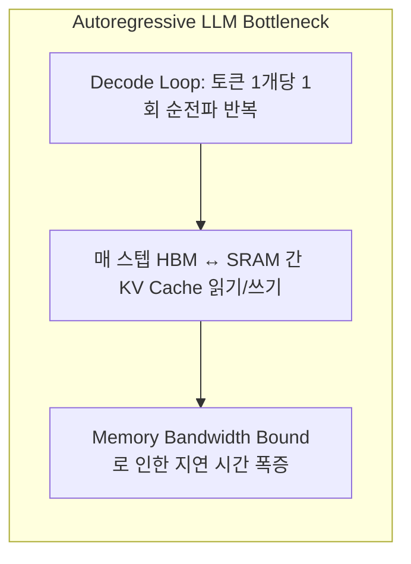
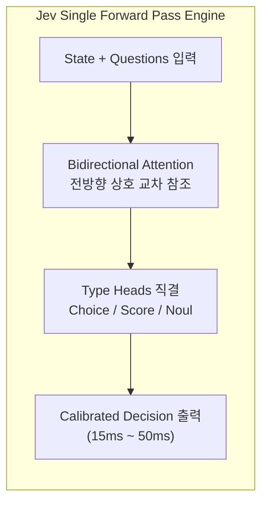
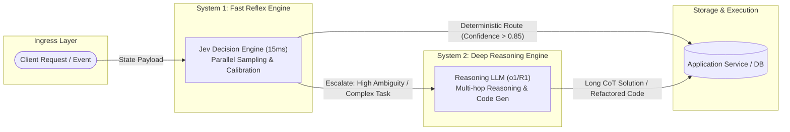

# jev의 등장으로 살펴본 기존 LLM 방식의 구체적인 과정과 jev와의 차이점

인공지능 생태계는 오랫동안 더 많은 토큰을 생성하고, 더 긴 사고 사슬(Chain-of-Thought)을 전개하는 방향으로 진화했다. OpenAI의 o1/o3나 DeepSeek-R1 같은 Reasoning LLM은 모델 내부에서 수천 개의 보이지 않는 추론 토큰을 순차 생성하며 복잡한 문제를 풀어내는 데 집중한다.

하지만 실무에서는 정작 깊은 추론보다는 빠른 분류가 더 필요할 때가 있다. 물론 AST 기반의 파싱으로 처리할 수 있지만 유연성이 필요할 때는 claude-Haiku 버전을 쓰면서 그나마 빠르게 반환을 유도하긴 했다. 그럼에도 너무 느려서 답답했던 적이 한두번이 아니었다.

2026년 9월 TypeSafe AI가 공개한 **Jev**는 이러한 생성형/추론형 LLM 중심의 흐름에 정면으로 질문을 던진 모델이다. 다니엘 카너먼(Daniel Kahneman)의 이중 처리 이론(Dual-Process Theory)을 빌려 표현하자면, 기존 LLM이 느리고 신중하게 숙고하는 **System 2**라면, Jev는 즉각적이고 직관적인 결정을 내리는 **System 1** 모델에 해당한다.

본 문서는 트랜스포머 1개 레이어 내부의 정밀한 물리적 텐서 연산 메커니즘부터 시작하여, 기존 LLM 방식이 안고 있던 구조적 병목과 한계, 그리고 Jev가 이를 어떤 방식으로 생략하고 혁신했는지를 엔지니어링 관점에서 종합적으로 분석한다.

---

## 1. 트랜스포머 1개 레이어의 물리적 연산 파이프라인

기존 LLM과 Jev의 물리적 차이를 이해하려면, 신경망 내부의 트랜스포머 블록 1개 안에서 데이터 텐서가 변환되는 과정을 단계별로 추적해야 한다.


<p align="center"><em>Figure 1: 트랜스포머 1개 레이어 내부 텐서 연산 및 RoPE 파이프라인</em></p>

### (1) 정적 임베딩 테이블과 런타임 활성화 벡터
사용자가 입력한 단어(예: "사과")는 토크나이저를 거쳐 고유 정수 ID(예: `4521`)로 변환된다. 모델의 GPU VRAM에는 수조 개의 토큰을 사전학습(Pre-training)하며 이미 최적화된 거대한 숫자 표인 **임베딩 테이블(Embedding Table)**이 영구 저장되어 있다.
* **임베딩 테이블 크기**: `[어휘 사전 크기 128,000 × 은닉 차원 4,096]`
* **임베딩 조회(Lookup)**: 4521번째 행에서 4,096개의 부동소수점 실수 배열을 읽어와 메모리에 런타임 활성화 벡터(Runtime Activation Vector)로 올린다. 이 벡터는 추론이 끝나면 메모리에서 즉시 해제된다.

### (2) Q, K, V 선형 관점 매핑 (Linear Projections)
입력 텐서 X는 세 개의 독립적인 가중치 행렬 W<sub>Q</sub>, W<sub>K</sub>, W<sub>V</sub>와 행렬 곱(MatMul)을 거쳐 세 갈래로 분기한다.
* **Query (Q = X · W<sub>Q</sub>)**: 다음 단어를 맞추기 위해 현재 토큰이 찾아야 할 상대방의 조건 벡터.
* **Key (K = X · W<sub>K</sub>)**: 자신이 어떤 정보(품사, 문맥적 특성)를 가졌는지 알리는 명패 벡터.
* **Value (V = X · W<sub>V</sub>)**: 궁합이 맞았을 때 상대방에게 넘겨줄 실제 정보 내용 벡터.

#### '선형 관점 매핑(Linear Projection)'의 물리적 의미
인공신경망에서 '관점 매핑(Projection)'은 거창한 개념이 아니라, **"원본 벡터 X에 가중치 행렬 W를 곱해(`Y = X · W`), 특정 목적을 가진 새로운 좌표계(공간)로 형태나 차원을 변환하는 작업"**을 의미한다.

1. **용도별 좌표 공간 변환 (관점 매핑)**:
   * 원본 단어 벡터 `X`는 그대로 둔 채 **어떤 가중치 행렬 `W`를 곱하느냐에 따라 전혀 다른 관점의 좌표 공간으로 변환**된다.
   * W<sub>Q</sub>를 곱하면 "문맥에서 무엇을 찾을 것인가"를 표현하는 질문 공간(**Query Space**)으로 관점 매핑되고, W<sub>K</sub>를 곱하면 "자신이 어떤 특성을 가졌는가"를 알리는 색인 공간(**Key Space**)으로 관점 매핑된다.
2. **소프트웨어 관점의 타입 변환 (Type Casting)**:
   * 객체지향 프로그래밍에서 동일한 `Token` 원본 객체를 용도에 맞게 `Token.toQuery()`, `Token.toKey()`, `Token.toValue()`로 인터페이스를 변환하는 형변환(Type Casting) 함수 역할을 가중치 행렬 `W`가 물리적으로 수행한다.
3. **차원의 확장과 축소 매핑 (Up / Down Projection)**:
   * FFN 계층처럼 4,096차원 벡터를 더 넓은 11,008차원 공간으로 확장하는 것을 **Up Projection(차원 확장 매핑)**, 넓은 차원에서 걸러낸 정보를 다시 4,096차원으로 압축하는 것을 **Down Projection(차원 축소 매핑)**이라고 부른다.

#### '순수 의미 벡터 상태'의 구체적 의미
이 단계까지 생성된 Q, K, V는 단어 자체의 사전적·개념적 의미만 압축되어 있을 뿐, 문장 안에서 이 단어가 몇 번째 순서로 등장했는지에 대한 위치 정보를 전혀 알지 못하는 **순서 불변(Permutation Invariant) 상태**다.
* 예를 들어 *"사과가 사람을 먹었다"*와 *"사람이 사과를 먹었다"*는 완전히 반대되는 사건이지만, 위치 정보를 주입하기 전의 Q, K, V 상태에서는 두 문장에 포함된 단어 벡터들의 집합(Bag of Words)이 사실상 동일하게 취급된다.
* 특히 한국어의 조사(`~이/가`, `~을/를`)를 해석할 때도 위치 각도는 필수적이다. 모델이 `[가]`라는 조사를 보았을 때, 이 조사가 바로 앞 1칸 떨어진 `[사과]`에 붙은 것인지 멀리 있는 `[사람]`에 붙은 것인지를 물리적 인접 거리(RoPE의 초단거리 회전각)로 감지해야만 비로소 올바른 명사에 조사를 결합해 주어와 목적어 관계를 성립시킬 수 있다. 나아가 조사가 없는 영어(`The dog bit the man` vs `The man bit the dog`)에서는 오직 단어의 순서(위치 각도)만으로 행위자와 피행위자가 결정된다.
* 따라서 단어의 개념적 의미만 온전히 보존된 이 상태를 '순수 의미 벡터 상태'라고 부르며, 올바른 문맥과 문법 관계를 형성하려면 반드시 다음 단계에서 위치 각도(RoPE)를 덧입혀 시공간 좌표를 부여해야 한다.

#### Next Token Prediction 관점에서 Key(K)가 반드시 존재해야 하는 이유
LLM의 물리적 존재 목적은 **"앞서 주어진 문맥을 근거로 바로 다음에 올 빈칸 토큰 [ ? ]을 맞추는 것(Next Token Prediction)"**이다. 이때 Key(K)는 다음 단어를 정확히 채워 넣기 위해 필수 불가결한 색인 역할을 수행한다.

1. **검색 조건(Query)과 검색 색인(Key)의 역할 분리**:
   * 직전까지 생성된 가장 최근 단어는 다음 단어를 추론하기 위해 과거 문맥을 향해 *"다음에 올 내용을 결정짓는 데 필요한 문법적/의미적 단서가 누구에게 있는가?"*라는 조건 벡터인 **Query**를 쏜다.
   * 이때 과거에 이미 지나간 단어들이 자신이 가진 원본 내용(Value) 자체를 그대로 내밀면 검색 매칭의 차원 공간이 뒤섞여 버린다.
   * 대신 각 단어가 *"나는 주어다"*, *"나는 목적어 후보다"*, *"나는 결제 실패 원인을 담은 명사다"*처럼 Query의 검색 조건에 최적화된 형태로 자신의 정체성을 압축해 둔 명패가 바로 **Key(K)**다.
2. **도서관 색인 카드와 본문의 관계**:
   * 도서관에서 책을 찾을 때 수만 권의 책 본문(Value)을 일일이 읽어보며 대조할 수 없듯이, 책 표지의 분류 색인(Key)을 먼저 대조해야 한다.
   * Key라는 독립된 검색 전용 벡터가 존재하기 때문에, Query는 과거 단어들의 색인(Key)만을 행렬 곱(내적)으로 빠르게 스캔하여 가장 연관성이 높은 단어를 정확하게 특정하고, 그 단어의 실제 내용(Value)만을 선별적으로 흡수할 수 있게 된다.

### (3) RoPE(Rotary Position Embedding)의 상대적 위치 주입
트랜스포머는 4,096차원의 숫자 배열을 순서대로 2개씩 묶어 **2,048개의 독립적인 2차원 평면 쌍**을 만든다. 
* 0번째 쌍: `(x`<sub>0</sub>`, x`<sub>1</sub>`)`
* 1번째 쌍: `(x`<sub>2</sub>`, x`<sub>3</sub>`)`
* ...
* 2,047번째 쌍: `(x`<sub>4094</sub>`, x`<sub>4095</sub>`)`

각 쌍은 단어가 1칸 이동할 때마다 회전하는 기본 회전 각도(θ)가 기하급수적으로 다르게 설정되어 있다 (θ<sub>i</sub> = 10000<sup>-2i/d</sup>). 
* **앞쪽 쌍들 (0~100번 쌍)**: 회전 각도가 매우 크다. 십진수의 '일의 자리'처럼 1칸, 2칸 차이의 초단거리 인접 단어 문법을 감지한다.
* **뒤쪽 쌍들 (1,900~2,047번 쌍)**: 회전 각도가 극도로 미세하다. '천의 자리'처럼 수백~수천 칸 떨어진 장거리 문서 문맥을 감지한다.

#### 앞쪽 쌍들의 회전 각도가 매우 큰 이유 (사전학습 목표와의 연계)
앞쪽 쌍들의 기본 회전 각도가 1라디안(약 57도)에 달할 정도로 크게 세팅된 이유는, 언어 모델의 **사전학습(Pre-training) 손실 함수가 바로 직전 인접 단어의 의존성을 가장 민감하게 학습해야 하기 때문**이다.
1. **자연어의 국소 의존성 (Local Dependency)**:
   * 수조 개의 문장에서 다음 단어를 맞추는 Next Token Prediction 과정에서, 다음에 올 단어를 결정짓는 통계적 힌트의 80~90%는 바로 직전 1~3칸(주어-조사, 동사-목적어, 수식 관계)에 압도적으로 집중되어 있다.
   * "사과" 바로 뒤에 "를"이 와야 할지, "가"가 와야 할지, "먹었다"가 와야 할지는 바로 앞 1칸 떨어진 단어와의 관계가 좌우한다.
2. **1칸 차이의 코사인 낙차 극대화**:
   * 만약 앞쪽 쌍의 각도가 아주 미세하다면(예: 1칸 갈 때 0.01도), 10번째 토큰과 바로 옆 11번째 토큰의 코사인 유사도는 `cos(0.01) ≈ 0.9999`가 되어 수학적으로 완전히 같은 위치로 겹쳐버린다. 모델은 인접 단어 간의 선후 관계를 전혀 구분하지 못해 기초적인 맞춤법과 어순을 파괴하게 된다.
   * 반면 앞쪽 쌍의 각도를 약 57도(`θ ≈ 1.0`) 수준으로 극단적으로 크게 꺾어두면, 단 1칸만 떨어져도 코사인 유사도가 `1.0`에서 `0.54`로 급격하게 떨어지는 **거대한 수치적 낙차(Sharp Gradient)**가 발생한다.
   * 모델은 사전학습 과정에서 이 큰 각도 차이를 지표 삼아, 바로 옆 단어 간의 엄밀한 문법 규칙과 결합 관계를 가장 빠르고 정확하게 가중치에 조각할 수 있게 된다.

토큰이 m번째 위치에 있다면, Query의 각 쌍은 m · θ<sub>i</sub> 각도만큼 회전되어 위치 정보가 각인된 Q<sub>rot</sub>이 된다. Key 역시 n · θ<sub>i</sub> 각도만큼 회전되어 K<sub>rot</sub>이 된다. Value는 위치를 비교하는 용도가 아니므로 회전시키지 않고 대기한다.

### (4) 상대적 거리 내적의 계산 (Q<sub>rot</sub> · K<sub>rot</sub><sup>T</sup>)
회전된 Query 텐서와 회전된 Key 텐서가 대규모 행렬 곱을 수행하는 그 순간, 삼각함수 공식에 의해 절대 위치 번호 m과 n은 소거되고 **오직 두 단어의 각도 차이인 상대적 거리 (m - n)만이 코사인 유사도로 환산**되어 어텐션 점수 행렬에 기록된다. 토큰이 상대 거리를 미리 저장해 들고 다니는 것이 아니라, 행렬 곱을 치는 찰나에 온더플라이(On-the-fly)로 계산된다.

#### 왜 절대 좌표 대신 '상대적 거리'를 계산해야 하는가?
신경망이 단어의 절대 위치 번호(1번인지 500번인지) 대신 두 단어 사이의 '상대적 간격(m - n)'을 계산하는 이유는 언어의 구조적 특성과 모델의 확장성 때문이다.

1. **문맥 이동 불변성 (Shift Invariance / Translation Invariance)**:
   * *"철수가 사과를 먹었다"*라는 문장이 문서의 맨 처음(1~4번째 토큰)에 위치하든, 문서 한가운데(500~503번째 토큰)에 위치하든, "철수가"와 "사과를", "먹었다" 사이의 문법적·의미적 관계는 **완전히 동일**해야 한다.
   * 만약 절대 좌표만을 기준으로 학습한다면, 모델은 1번째 줄에 나온 "사과-먹었다"와 500번째 줄에 나온 "사과-먹었다"를 서로 다른 패턴으로 암기해야 하는 비효율이 발생한다.
   * 반면 상대적 거리로 계산하면 문장이 문서의 어느 위치에 배치되든 **"두 단어가 정확히 1칸 떨어져 있다"는 상대적 기하 관계가 불변(Shift-Invariant)**으로 유지되므로, 위치에 구애받지 않는 일반화된 언어 규칙을 학습할 수 있게 된다.
2. **미지의 긴 문맥으로의 외삽(Extrapolation) 가능성**:
   * 절대 위치 인코딩은 4,000 토큰까지만 학습했다면 4,001번째 절대 좌표 벡터가 아예 존재하지 않아 길이가 조금만 늘어나도 모델이 즉시 붕괴한다.
   * 반면 상대적 거리를 계산하면 문서가 32,000 토큰으로 길어져도 "내 바로 앞 단어는 1칸 차이, 그 앞 단어는 2칸 차이"라는 상대적 거리 연산은 4,000 토큰 때와 완벽히 동일한 방식으로 동작하므로 컨텍스트 확장이 수학적으로 가능해진다.
3. **자연스러운 거리 감쇠(Distance Decay) 유도**:
   * 자연어는 물리적으로 가까이 붙어 있는 단어일수록 문법적 결합도가 높고, 멀리 떨어질수록 관련성이 서서히 낮아지는 특성을 띈다.
   * 상대적 거리를 기반으로 내적을 계산해야만, 거리가 멀어질수록 코사인 유사도가 완만하게 감소하도록 주의력(Attention)의 포커스를 자연스럽게 조절할 수 있다.

### (5) Causal Mask와 Softmax 정규화
생성형 모델은 아직 오지 않은 미래 단어를 미리 컨닝하지 못하도록 상삼각 영역에 음의 무한대(`-inf`)를 강제로 더하며, Softmax를 통해 이를 확률 가중치로 변환한다.

#### 1. 미래 단어를 미리 컨닝하지 못하게 막아야 하는 이유
학습(Training) 환경과 실제 추론(Inference) 환경 사이의 근본적인 차이 때문에 Causal Mask가 반드시 필요하다.

* **실제 추론(Inference) 환경**: 모델은 단어를 순차적으로 1개씩 지어낸다. 5번째 단어를 만드는 순간에는 6번째 이후의 단어가 **아직 세상에 존재하지도 않는 미래 상태**다. 모델은 오직 과거의 1~4번째 단어만을 보고 5번째 단어를 추론해야 한다.
* **학습(Training) 환경**: 학습 효율을 높이기 위해 이미 완성된 전체 문장(예: 1~10번째 단어)을 GPU에 한 번에 병렬로 밀어넣는다(Teacher Forcing).
* **컨닝 방지의 필연성**:
  * 만약 미래를 가리지 않는다면(No Causal Mask), 4번째 단어 위치의 Query는 바로 뒤 5번째 단어의 정답을 그대로 훔쳐보고(Information Leakage) 손쉽게 정답을 맞추게 된다.
  * 이러면 모델은 "과거 문맥을 논리적으로 종합해 다음 단어를 유추하는 능력"을 전혀 배우지 않고, 단순히 "오른쪽 단어를 그대로 베껴 쓰기"만 하는 치트키를 학습한다.
  * 결과적으로 학습 손실(Loss)은 0이 되지만, 실제 운영 환경에 배포되어 미래 단어가 주어지지 않으면 1글자도 생성하지 못하고 모델이 완전히 붕괴한다.

#### 2. Softmax의 기본 원리: 점수를 '확률 분포'로 변환
어텐션 내적 곱(Q · K<sup>T</sup>)의 결과는 `-3.5`, `12.8`처럼 임의의 실수 범위를 갖는 거친 점수(Logits)다. Softmax는 이 점수들을 **"모든 값의 합이 정확히 1.0(100%)인 확률 분포"**로 변환한다.

1. **지수 함수(e<sup>x</sup>)를 통한 비선형 증폭**:
   * 점수에 지수를 취해 음수를 모두 양수로 바꾼다.
   * 점수가 조금만 높아도 지수적으로 폭발하여(차이 극대화), 중요한 단어에는 높은 비중을 몰아주고 덜 중요한 단어는 0에 가깝게 누른다.
2. **합산 정규화(Normalization)**:
   * 모든 원소의 e<sup>x</sup> 값을 더한 총합으로 각 원소를 나눈다.
   * 그 결과 모든 단어의 어텐션 가중치는 `0.0 ~ 1.0` 사이의 비율이 되며, 전체 합은 항상 `1.0 (100%)`이 된다.

#### 3. 4×4 매트릭스 예시로 보는 구체적 변환 과정

4개의 단어로 구성된 문장에서 Causal Mask와 Softmax가 작동하는 실제 텐서 변환 과정이다.

```text
[1단계: 원래 어텐션 내적 점수 행렬 (Scores = Q · K^T / sqrt(d))]
         (1번 단어)  (2번 단어)  (3번 단어)  (4번 단어)
(1번 단어) [   1.2        0.5        2.1       -0.3   ]  ← 1번이 미래(2, 3, 4번)를 보고 있음
(2번 단어) [   0.8        1.5        0.2        1.1   ]  ← 2번이 미래(3, 4번)를 보고 있음
(3번 단어) [   2.0        0.1        1.8        0.9   ]  ← 3번이 미래(4번)를 보고 있음
(4번 단어) [   0.4        1.2        0.7        2.3   ]

                    ↓  (상삼각에 -inf를 채운 Causal Mask 덧셈)

[2단계: 마스크가 적용된 점수 행렬 (Masked Scores = Scores + Mask)]
         (1번 단어)  (2번 단어)  (3번 단어)  (4번 단어)
(1번 단어) [   1.2       -inf       -inf       -inf   ]  ← 미래 위치가 전부 -inf로 덮임
(2번 단어) [   0.8        1.5       -inf       -inf   ]
(3번 단어) [   2.0        0.1        1.8       -inf   ]
(4번 단어) [   0.4        1.2        0.7        2.3   ]

                    ↓  (Softmax 통과: e^(-inf) = 0.0)

[3단계: 최종 어텐션 가중치 확률 행렬 (Attention Weights)]
         (1번 단어)  (2번 단어)  (3번 단어)  (4번 단어)     (행별 총합)
(1번 단어) [  1.00       0.00       0.00       0.00   ]  =  1.0 (100%)
(2번 단어) [  0.33       0.67       0.00       0.00   ]  =  1.0 (100%)
(3번 단어) [  0.45       0.08       0.47       0.00   ]  =  1.0 (100%)
(4번 단어) [  0.10       0.25       0.15       0.50   ]  =  1.0 (100%)
```

* 1번 단어는 미래 단어(2, 3, 4번)에 대한 가중치가 정확히 **`0.00`**으로 소멸하여 자기 자신만 100% 참조한다.
* 3번 단어는 과거와 현재인 1, 2, 3번 단어만 참조하고, 미래인 4번 단어는 완전히 차단된다.
* 결과적으로 모델은 미래를 전혀 보지 못한 채 순수하게 과거의 문맥만으로 다음 단어를 생성하도록 강제된다.

### (6) Value 가중치 합산, 출력 관점 매핑 및 1차 변화량 덧셈

Softmax를 거쳐 산출된 어텐션 확률 가중치 행렬과 Value 행렬을 결합하여 문맥 벡터를 생성하고, 출력 관점 매핑과 변화량 덧셈을 통해 입력 정보를 유지한다.

#### 1. Value 가중치 합산: 어텐션 확률 기반 벡터 선형 결합
* **구체적 예시**:
  * 3개 토큰으로 구성된 문장: `[x`<sub>1</sub>`: "서버가", x`<sub>2</sub>`: "응답을", x`<sub>3</sub>`: "반환했다"]`
  * 3번째 토큰 `"반환했다"`의 Query가 Softmax를 거쳐 산출한 어텐션 확률 벡터:
    * `A[3] = [0.10, 0.70, 0.20]` (1번 10%, 2번 70%, 3번 20%)
  * 각 토큰의 Value 벡터를 V<sub>1</sub>, V<sub>2</sub>, V<sub>3</sub> (`[128]`)라고 할 때, 3번 토큰의 문맥 벡터는 다음과 같이 선형 결합(Linear Combination)된다.
    * Context<sub>3</sub> = (0.10 · V<sub>1</sub>) + (0.70 · V<sub>2</sub>) + (0.20 · V<sub>3</sub>)
* **물리적 연산 과정**:
  * 각 단어의 Value 벡터를 정규화된 확률 비율로 곱해 합산한다.
  * 70%의 지분을 가진 V<sub>2</sub>("응답을")의 의미 특성이 지배적으로 반영되고, 10%의 V<sub>1</sub>("서버가") 특성이 결합된 `[128]` 크기의 합성 문맥 벡터(`Context`)가 생성된다.
* **행렬 연산 수식 및 차원**:
  * `Context = Attention_Weights · V`
  * `[Sequence Length, Sequence Length] × [Sequence Length, Head Dim] = [Sequence Length, Head Dim]`

#### 2. 멀티헤드(Multi-Head)의 개념: 왜 단일 헤드가 아닌 여러 헤드로 나누는가?
* **어텐션 헤드(Head)의 물리적 정의**:
  * 입력 시퀀스 전체를 대상으로 Query와 Key 간의 코사인 유사도를 계산하고, 그 확률(Softmax) 가중치에 따라 Value 벡터를 합성하는 **독립된 1개의 어텐션 연산 슬롯(단위)**을 의미한다.
* **단일 헤드(Single Head)의 언어학적 한계 (Softmax 100% 제약)**:
  * Softmax 함수는 모든 가중치의 합이 항상 1.0(100%)이어야 한다.
  * 단일 헤드로 4,096차원 전체를 한 번에 처리하면, 확률 분포가 특정 단어에 쏠리는 순간 다른 단어와의 관계는 0%에 수렴하여 소외된다.
  * 예시 문장: `"서버가 데이터베이스에서 응답을 성공적으로 반환했다"`에서 마지막 동사 `"반환했다"` 토큰은 다음 관계들을 동시에 파악해야 문맥이 완성된다.
    1. 목적어-동사 호응: `"응답을"`
    2. 주어-동사 호응: `"서버가"`
    3. 장소/출처 부사구: `"데이터베이스에서"`
    4. 상태/방식 부사: `"성공적으로"`
  * 단일 헤드 환경에서는 Softmax 가중치 70~80%가 바로 앞의 인접 목적어인 `"응답을"`에 집중되는 순간, 원거리 주어인 `"서버가"`나 부사구 `"데이터베이스에서"`에 할당될 가중치는 5% 미만으로 질식한다. 즉, **단 1회의 어텐션으로는 동시에 여러 종류의 언어학적 관계를 포착할 수 없다**.
* **멀티헤드의 병렬 분업 메커니즘**:
  * 어텐션 연산 슬롯(헤드)을 32개로 병렬 복제하여, 각 헤드가 서로 다른 관점 매핑 가중치 행렬 W<sub>Q</sub><sup>(i)</sup>, W<sub>K</sub><sup>(i)</sup>, W<sub>V</sub><sup>(i)</sup>를 학습하도록 격리한다.
    * `Head 1`: 인접 목적어-동사 결합("응답을" - "반환했다") 관계를 분석하여 Context<sup>(1)</sup> 생성.
    * `Head 2`: 원거리 주어-동사 호응("서버가" - "반환했다") 관계를 분석하여 Context<sup>(2)</sup> 생성.
    * `Head 3`: 장소/출처 부사구 수식("데이터베이스에서" - "반환했다") 관계를 분석하여 Context<sup>(3)</sup> 생성.
    * ... `Head 32`까지 각기 다른 언어학적 패턴을 동시에 독립 추적한다.

#### 3. 왜 헤드 수는 32개이고 헤드 차원은 128인가? (수학적·하드웨어적 근거)
* **핵심 분할 공식**:  
  `Hidden Dim (d = 4,096) = Head Count (h = 32) × Head Dim (d_k = 128)`

1. **총 연산량(FLOPs)과 파라미터 수의 불변성 (Computation Invariance)**:
   * 4,096차원 공간을 32개 헤드로 쪼개어 각각 128차원으로 연산하면, 단일 헤드로 4,096차원을 연산할 때와 비교하여 **총 파라미터 수와 행렬곱 연산량(FLOPs)이 수학적으로 정확히 일치**한다.
     * 단일 헤드 Q-K 내적: `[S, 4096] × [4096, S] = O(S² · 4096)`
     * 32개 멀티헤드 Q-K 내적: `32 × ([S, 128] × [128, S]) = 32 × O(S² · 128) = O(S² · 4096)`
   * 즉, 추가적인 연산 비용이나 하드웨어 자원의 소모 없이 **32가지의 다각도 문맥 분석 슬롯을 확보**하는 선형대수학적 분할 구조다.
2. **벡터 표현력(Capacity)과 관점 다양성의 최적 균형점 (Trade-off)**:
   * 만약 헤드 차원이 64라면 (`h = 64, d_k = 64`):
     * 64개의 관점을 동시에 볼 수 있지만, 64차원이라는 협소한 공간에서는 개별 헤드가 복잡한 의미적 뉘앙스를 담아내지 못해 언더피팅(Underfitting)이 발생하고, 헤드 수 증가로 인한 커널 오버헤드가 커진다.
   * 만약 헤드 차원이 256이라면 (`h = 16, d_k = 256`):
     * 개별 헤드의 벡터 표현력은 풍부해지지만, 동시에 추적할 수 있는 언어학적 관점의 수(헤드 개수)가 16개로 줄어들어 다양한 문법적 호응을 놓치게 된다.
   * 실험적으로 **128차원이 개별 관계의 의미를 왜곡 없이 압축하면서도 충분한 수(32개)의 병렬 관점을 확보할 수 있는 최적의 균형점(Pareto Optimum)**으로 입증되었다.
3. **GPU Tensor Core 및 SRAM 타일링(Tiling) 물리 최적화**:
   * **Power-of-Two 메모리 정렬**: NVIDIA GPU(A100, H100)의 Tensor Core는 행렬 타일 크기가 16, 32, 64, **128**과 같은 2의 거듭제곱 규격일 때 메모리 뱅크 충돌(Bank Conflict) 없이 최대 처리량(Peak FLOPs)을 달성한다.
   * **FlashAttention 캐시 적재 한계**: FlashAttention 계열 커널은 GPU 고대역폭 메모리(HBM) 대신 온칩 SRAM(192~228KB)에 Q, K, V 블록을 올려 연산한다. FP16/BF16(원소당 2바이트) 기준 1개 토큰 벡터는 `128 × 2B = 256 Byte`가 되어 SRAM의 타일 블록(`128 × 128`)에 완벽하게 패킹되는 물리적 규격이다.
4. **실제 물리 텐서 분할 과정 (GPU 연산 관점)**:
   * 실제 PyTorch나 CUDA 구현에서는 32번의 작은 MatMul을 개별 실행하지 않는다.
   * `X [Seq, 4096]`에 가중치 `W_Q [4096, 4096]`를 1회의 단일 대규모 행렬곱(GEMM)으로 계산하여 `[Seq, 4096]`을 산출한다.
   * 그 후 메모리 상에서 `[Seq, 32, 128]`로 Reshape하고 차원을 맞교환(Transpose)하여 `[32, Seq, 128]` 텐서로 재배열함으로써 32개의 128차원 헤드를 생성한다.

#### 4. 멀티헤드 결합(Concat) 및 출력 관점 매핑 (Output Projection)
* **결합(Concat) 및 선형 관점 매핑**:
  * 32개 헤드의 출력을 가로로 이어붙여 원래 은닉 차원 크기로 결합한다.
    * MultiHead = Concat(Context<sup>(1)</sup>, Context<sup>(2)</sup>, ..., Context<sup>(32)</sup>) (`[Seq, 4096]`)
  * 출력 가중치 행렬 W<sub>O</sub> (`[4096, 4096]`)와의 행렬곱을 수행한다.
    * `Output = MultiHead · W`<sub>O</sub> (`[Seq, 4096]`)
  * 32개 헤드별로 분할되어 있던 상이한 문맥 특성들이 W<sub>O</sub>와의 행렬곱을 통해 선형 결합되며 단일 은닉 벡터 공간으로 정렬·융합된다.

#### 5. 1차 변화량 덧셈 (Attention Residual Add)
* **연산 수식**: `X_mid = X + Output`
* **엔지니어링 목적 및 수학적 원리**:
  * 입력 텐서 `X`에 어텐션 블록의 연산 변위값(`Output = ΔX`)을 덧셈한다.
  * 32~80층에 이르는 심층 구조에서 역전파 시 발생하는 기울기 소실(Vanishing Gradient) 문제를 억제한다. 
  * 손실 함수에 대한 기울기 전파 수식에서 항등 행렬(`I`) 성분이 보장되어(`∂X_mid / ∂X = I + ∂Output / ∂X`), 층이 깊어져도 입력 원본의 기초 특징이 훼손되지 않고 전달된다.

---

### (7) FFN(Feed-Forward Network / SwiGLU): 기억 인출과 비선형 가공

어텐션 계층을 통과한 텐서는 토큰 간 상호작용이 배제된 독립 신경망 계층인 FFN으로 진입한다.

#### 1. Attention과 FFN의 물리적 분업
* **Attention (Token-to-Token Communication 계층)**:
  * 문장 내 다른 토큰들의 상대적 위치와 관계를 파악하여 문맥 벡터를 합성하는 통신 단계다. 토큰 간 관계를 재구성하지만, 모델 가중치에 내장된 일반 사실 지식을 새로 주입하지는 못한다.
* **FFN (Position-wise Computation & Fact Memory 계층)**:
  * 다른 토큰을 일절 참조하지 않고, 개별 토큰 벡터를 독립적으로 변환한다 (Position-wise).
  * 사전학습(Pre-training) 과정에서 가중치 행렬에 각인된 정적 사실 지식(Fact Memory)을 인출하여 벡터에 결합한다.

#### 2. 은닉 차원을 4,096에서 11,008로 확장(Up)한 뒤 축소(Down)하는 원리
* **차원 확장(Up-projection: 4,096 → 11,008)**:
  * 4,096차원 은닉 공간에서는 다양한 의미 속성이 밀집 벡터(Dense Vector) 형태로 압축되어 있어 속성 간 간섭이 발생한다.
  * 가중치 행렬 W<sub>up</sub>, W<sub>gate</sub>를 통해 차원을 11,008차원으로 확장하면, 잠재 속성들이 고차원 공간에서 직교(Orthogonal)에 가깝게 분리되는 희소 표현(Sparse Representation) 상태가 된다.
* **차원 축소(Down-projection: 11,008 → 4,096)**:
  * 고차원 공간에서 비선형 활성화 함수를 통해 불필요한 속성을 0으로 필터링한 뒤, 가중치 행렬 W<sub>down</sub>을 곱해 다시 모델 기본 차원인 4,096차원으로 압축 복원한다.

#### 3. SwiGLU 연산 단계 및 게이팅 메커니즘
현대 LLM은 비선형 게이트 제어 메커니즘을 적용한 SwiGLU 구조를 표준으로 채택한다.

```text
[입력 X_mid] → RMSNorm 정규화
      │
      ├─── Gate Projection: Gate = X_norm · W_gate  [Seq, 4096] × [4096, 11008] = [Seq, 11008]
      │         ↓
      │      Swish(Gate) = Gate · Sigmoid(Gate) 비선형 제어 벡터 생성
      │         ↓
      ├─── Up Projection:   Up   = X_norm · W_up    [Seq, 4096] × [4096, 11008] = [Seq, 11008]
      │         │
      │         └─── 원소별 곱셈 (Hadamard Product, ⊙): H = Swish(Gate) ⊙ Up
      │                                                     │
      └──────────────────────────────── Down Projection ───┘
                                          Output_ffn = H · W_down
                                          [Seq, 11008] × [11008, 4096] = [Seq, 4096]
                                          ↓
                                    2차 변화량 덧셈: X_next = X_mid + Output_ffn
```

1. **Gate Projection (MatMul)**: 가중치 행렬 W<sub>gate</sub> (`[4096, 11008]`)를 곱해 11,008차원의 게이트 제어 신호를 생성한다.
2. **Up Projection (MatMul)**: 가중치 행렬 W<sub>up</sub> (`[4096, 11008]`)를 곱해 11,008차원의 잠재 지식 벡터를 생성한다.
3. **비선형 활성화 및 아다마르 곱 (Gating)**:
   * 활성화 함수 `Swish(x) = x · Sigmoid(x)`를 적용하여 Gate 신호를 비선형 변환한다.
   * `H = Swish(Gate) ⊙ Up` 원소별 곱셈을 수행한다.
   * **수치 제어 예시**:
     * 특정 차원 `j`에서 Gate<sub>j</sub> = -5.0인 경우, `Swish(-5.0) ≈ -0.03`으로 0에 수렴하여 해당 차원의 Up<sub>j</sub> 신호가 차단된다.
     * 특정 차원 `j`에서 Gate<sub>j</sub> = +4.0인 경우, `Swish(+4.0) ≈ 3.93`으로 신호가 증폭되어 통과한다.
     * 즉, Gate 벡터가 Up 벡터의 11,008개 차원별 활성화 강도를 비선형적으로 제어한다.
4. **Down Projection (MatMul)**: 활성화된 11,008차원 벡터에 W<sub>down</sub> (`[11008, 4096]`)을 곱해 원래 은닉 차원인 4,096차원으로 관점 매핑한다.
5. **2차 변화량 덧셈 (FFN Residual Add)**: 산출된 Output<sub>ffn</sub>을 FFN 입력 전 상태인 X<sub>mid</sub>에 덧셈하여(X<sub>next</sub> = X<sub>mid</sub> + Output<sub>ffn</sub>), 지식이 결합된 텐서를 다음 레이어로 전달한다.

---

### (8) [종합] 레이어 1개 내부의 7대 행렬곱(MatMul) 물리 맵

트랜스포머 레이어 1개에서 소모되는 GPU 연산량(FLOPs)의 99% 이상은 덧셈이나 활성화 함수가 아니라 바로 **대규모 행렬곱(MatMul: Matrix Multiplication)**에 집중되어 있다.

#### 1. 행렬곱(MatMul)은 어떻게 물리적으로 연산되는가?
행렬곱 `C = A · B`는 앞 행렬 `A`의 행(Row) 벡터와 뒤 행렬 `B`의 열(Column) 벡터 간의 **내적(Dot Product: 대응하는 원소끼리 곱한 뒤 총합 누적)**을 전수 계산하는 연산이다.
* **GPU 텐서 코어(Tensor Core)의 하드웨어 가속**: GPU는 이 수조 번의 곱셈-누적(MAC: Multiply-Accumulate) 연산을 단일 코어로 순차 계산하지 않는다. 수천 개의 코어가 16×16 또는 32×32 크기의 텐서 타일(Tiling GEMM) 단위로 쪼개어 병렬로 동시 처리한다.
* **차원 일치 규칙**: 행렬곱이 성립하려면 반드시 앞 행렬의 열 크기와 뒤 행렬의 행 크기가 일치해야 한다 (`[M, K] × [K, N] = [M, N]`).

#### 2. 레이어 1개에서 일어나는 7대 행렬곱 종합 요약 표

다음 표는 입력 시퀀스 길이 `S`, 은닉 차원 `d=4,096`, 헤드 차원 `d_k=128`, 헤드 개수 `h=32`, FFN 중간 차원 `d_ff=11,008` 기준의 물리 연산 맵이다.

| 순서 | 행렬곱 명칭 | 연산 수식 | 입력 텐서 Shape | 가중치/피연산 텐서 Shape | 출력 텐서 Shape | 물리적 역할 및 목적 |
| :--- | :--- | :--- | :--- | :--- | :--- | :--- |
| **1** | **Query 관점 매핑** | X · W<sub>Q</sub> | `[S, 4096]` | `[4096, 4096]` | `[S, 4096]` | 현재 단어가 찾을 검색 조건 벡터 생성 |
| **2** | **Key 관점 매핑** | X · W<sub>K</sub> | `[S, 4096]` | `[4096, 4096]` | `[S, 4096]` | 과거 문맥에 알릴 검색 색인 명패 벡터 생성 |
| **3** | **Value 관점 매핑** | X · W<sub>V</sub> | `[S, 4096]` | `[4096, 4096]` | `[S, 4096]` | 상대방에게 넘겨줄 실제 정보 내용 벡터 생성 |
| **4** | **Attention 점수** | Q<sub>rot</sub> · K<sub>rot</sub><sup>T</sup> | `[h, S, 128]` | `[h, 128, S]` | `[h, S, S]` | 시퀀스 내 모든 단어 쌍 간의 코사인 유사도 상호작용 계산 |
| **5** | **Value 가중치 합산** | Attn_Weights · V | `[h, S, S]` | `[h, S, 128]` | `[h, S, 128]` | 확률 가중치(%)에 따라 실제 의미 내용 벡터를 선별 흡수 |
| **6** | **Output 관점 매핑** | Concat<sub>H</sub> · W<sub>O</sub> | `[S, 4096]` | `[4096, 4096]` | `[S, 4096]` | 32개 헤드가 수집한 다양한 관점의 문맥을 단일 공간으로 융합 |
| **7-A**| **FFN Gate 관점 매핑** | X<sub>norm</sub> · W<sub>gate</sub> | `[S, 4096]` | `[4096, 11008]` | `[S, 11008]` | 지식 통과량을 제어할 비선형 게이트 제어 신호 생성 |
| **7-B**| **FFN Up 관점 매핑** | X<sub>norm</sub> · W<sub>up</sub> | `[S, 4096]` | `[4096, 11008]` | `[S, 11008]` | 11,008개 고차원 지식 데이터베이스 후보 벡터 생성 |
| **7-C**| **FFN Down 관점 매핑**| H<sub>gated</sub> · W<sub>down</sub> | `[S, 11008]` | `[11008, 4096]` | `[S, 4096]` | 검증된 지식을 원래 모델 은닉 차원(4,096)으로 압축 복원 |

이처럼 트랜스포머 1개 레이어 내부에서는 **어텐션 파트에서 6회(관점 매핑 3회 + 점수 계산 1회 + 가중치 합산 1회 + 출력 관점 매핑 1회)**, **FFN 파트에서 3회(Gate, Up, Down)** 등 총 **9회의 대규모 행렬곱(MatMul)**이 톱니바퀴처럼 맞물려 실행된다. 이 거대한 행렬곱 체인이 매 레이어(통상 32~80개 레이어)마다 연속적으로 반복되는 것이 LLM 추론의 실제 물리적 실체다.

#### 3. 행렬곱을 '관점 매핑(Projection)'이라 부르는 이유와 엔지니어링 직관

위 요약 표에서 보듯 거의 모든 행렬곱 연산에 **'관점 매핑(Projection)'**이라는 개념이 반복된다. 선형대수학의 Projection은 엔지니어링 관점에서 **"원본 벡터 X를 그대로 둔 채, 특정 목적을 가진 새로운 좌표 공간으로 변환하는 작업(`Y = X · W`)"**을 의미한다.

1. **용도별 좌표 공간 변환 (View Transformation)**:
   * 원본 단어 벡터 `X`는 하나지만, **어떤 가중치 행렬 `W`를 곱하느냐에 따라 전혀 다른 관점의 좌표 공간으로 변환**된다.
2. **소프트웨어 엔지니어 관점의 타입 변환(Type Casting)**:
   * 객체지향 프로그래밍에서 동일한 `Token` 원본 객체(`X`)를 상황에 맞게 `toQuery()`, `toKey()`, `toValue()`로 형변환하는 **어댑터(Adapter) 함수** 역할을 가중치 행렬 `W`가 물리적으로 수행한다.
3. **표에서 나타나는 2가지 관점 매핑 유형**:
   * **목적에 따른 의미 공간 분기 (차원 유지: `4096 → 4096`)**:
     * W<sub>Q</sub> 관점 매핑: 문맥에서 "무엇을 찾을 것인가"를 나타내는 질문 공간(Query Space)으로 매핑.
     * W<sub>K</sub> 관점 매핑: 자신이 "어떤 특성을 가졌는가"를 알리는 색인 공간(Key Space)으로 매핑.
     * W<sub>V</sub> 관점 매핑: 상대방에게 "어떤 본문 데이터를 넘겨줄 것인가"를 담는 내용 공간(Value Space)으로 매핑.
     * W<sub>O</sub> 관점 매핑: 32개 헤드가 수집한 다양한 관점의 정보를 하나의 통합된 공간으로 융합 매핑.
   * **해상도 및 차원 크기 변경 (차원 확장 및 축소: `4096 ↔ 11008`)**:
     * **Up Projection (`4096 → 11008`)**: 좁은 공간에서 개념들이 엉키지 않도록 11,008차원의 고차원 공간으로 넓게 펼쳐 매핑한다.
     * **Down Projection (`11008 → 4096`)**: 고차원 공간에서 비선형 게이트로 검증된 지식만을 걸러낸 뒤, 모델의 표준 규격인 4,096차원 공간으로 다시 압축 매핑한다.

---

## 2. 기존 생성형 LLM 방식의 구조적 한계와 병목

위와 같은 정밀한 트랜스포머 파이프라인에도 불구하고, 토큰을 하나씩 순차 생성하는 Autoregressive 생성형 LLM은 다음과 같은 물리적 한계에 부딪힌다.


<p align="center"><em>Figure 2: 생성형 LLM의 반복 디코딩 루프와 메모리 병목 구조</em></p>

### (1) Decode 루프와 메모리 대역폭 병목 (Memory Bandwidth Bound)
생성형 LLM은 프롬프트를 읽는 Prefill 단계에서는 1회의 병렬 순전파로 빠르게 처리하지만, 답변을 출력할 때는 **토큰 1개를 생성할 때마다 매번 1회의 순전파를 반복 실행**한다. 2,000개 토큰을 생성하려면 2,000번의 순전파 루프가 돌면서 매번 GPU 고대역폭 메모리(HBM)에서 이전 토큰들의 KV Cache를 로드해야 한다. GPU의 연산 코어는 놀고 메모리 전송 속도에 발목이 잡히는 메모리 대역폭 병목이 발생하여 수 초에서 수십 초의 지연 시간이 유발된다.

### (2) Softmax 100% 제약과 Attention Sink
레이어 내부의 수십 개 어텐션 헤드 중에는 특정 문맥에서 전담할 패턴이 없어 "아무 단어도 주목하지 않고 통과(No-op)"시켜야 하는 헤드들이 발생한다. 그러나 Softmax는 수학적으로 가중치의 총합이 항상 1.0(100%)이어야 하므로 아무도 선택하지 않는 선택지(0%)를 허용하지 않는다. 

문맥 벡터를 오염시키지 않기 위해 모델은 학습 과정에서 **아무 의미 없는 문장 맨 앞의 시작 토큰(`<s>`, `[BOS]`)에 잉여 가중치 30~50%를 몰아넣어 버리는 자구책(Attention Sink)**을 터득했다.

### (3) 중간 정보 유실 (Lost in the Middle)
Softmax의 100% 파이 제약 속에서, 맨 앞의 쓰레기통(Attention Sink)이 40%를 가져가고, 맨 뒤의 질문(Query)과 최근 단어들이 물리적 인접성 때문에 40%를 독점한다. 

남은 파이는 고작 20% 남짓인데, 문서의 중간(30%~70% 지점)에는 수천~수만 개의 단어가 들어차 있다. 남은 20%의 지분을 수만 개 단어가 잘게 쪼개 가지면서, 중간에 아무리 결정적인 팩트가 적혀 있어도 가중치가 `0.00001%` 수준으로 질식해버리는 정보 유실 현상이 일어난다.

### (4) 변화량 덧셈 누적으로 인한 오버스무딩 (Over-smoothing)
변화량 덧셈 수식 X<sub>L</sub> = X<sub>0</sub> + Σ F<sub>l</sub>(X)에 따라, 레이어가 32층, 64층, 80층을 통과하는 동안 가중치 합산 연산이 수십 번 덧셈으로 누적된다. 서로 다른 단어 벡터들이 끝없이 섞이면서, 깊은 층으로 갈수록 모든 단어 벡터가 문서 전체의 평균 잡음 벡터로 수렴해버린다. 단어 간 코사인 유사도가 0.95 이상으로 치솟아 서로를 변별하지 못하는 이방성(Anisotropy)이 발생한다.

### (5) 단순 컨텍스트 확장 시의 국소 문법 파괴
학습 길이를 초과하는 긴 문서를 소화하기 위해 회전 각도를 단순하게 일괄 감속(Linear Interpolation)시키면, 바로 옆 단어(1칸 차이) 사이의 각도 차이마저 1/8로 좁혀져 코사인 유사도가 0.992로 겹쳐버린다. 그 결과 인접 단어를 구별하지 못해 맞춤법과 조사가 깨지는 문법 에러가 발생한다. 

이를 막기 위해 Anthropic의 Claude 등은 고주파 차원은 원래 속도(1.0)로 유지하고 저주파 차원만 선택 감속하는 **YaRN** 차등 스케일링을 도입하여 문제를 완화했다.

### (6) 주요 프론티어 모델별 RoPE 아키텍처 비교 및 물리적 확장 원리

시퀀스 길이가 200K에서 최대 2M 토큰으로 확장되면서, 프론티어 모델들은 단어 간의 상대적 거리를 왜곡 없이 보존하고 GPU 메모리(KV Cache) 병목을 극복하기 위해 서로 다른 RoPE 엔지니어링 기법을 발전시켰다.

#### 1. 주요 모델별 RoPE 아키텍처 비교 요약 표

| 모델 | 기본 RoPE 계열 | Base Theta (θ<sub>base</sub>) | 주파수 스케일링 기법 | 핵심 특화 메커니즘 | 최적화 목표 |
| :--- | :--- | :--- | :--- | :--- | :--- |
| **Claude Opus 4.8 / Sonnet 4.8** | Standard YaRN RoPE | 10,000 ~ 500,000 | Static YaRN (대역별 차등 주파수 보간) | 고주파(인접 문법) 보존, 저주파(장거리)만 보간 | 200K 안정적 국소 문법 유지 |
| **Claude Sonnet 5.0** | Dynamic YaRN RoPE | 500,000 ~ 1,000,000 | Dynamic Context-Aware YaRN | RMSNorm + RoPE Fused Kernel 일체화 | 500K~1M 에이전트 코딩 Latency 절감 |
| **Claude Opus 5.5** | Hybrid RoPE-NoPE | 1,000,000+ | LongRoPE 2.0 / Multi-Scale | 심층 레이어 NoPE 혼합 (Attention Sink 억제) | 1M+ 장기 추론 및 복합 아키텍처 |
| **Claude Fable** | Truncated Low-Rank RoPE | 10,000 ~ 50,000 | Fast Linear Interpolation | 회전 평면 수 축소 (고주파 평면 위주 배치) | 128K 빠른 TTFT 및 실시간 생성 |
| **Gemini Flash 3.8** | Extreme Theta + 3D RoPE | 10,000,000 (10M) | Log-linear Frequency Decay | 비디오·음성 시공간 분할 (Time-Space Split) | 1M~2M 네이티브 멀티모달 고속 서빙 |
| **OpenAI Sol (GPT-6 Sol)** | Decoupled RoPE (MLA) | 500,000 | Attention Temperature Scaled RoPE | 512차원 의미(NoPE)와 64차원 위치(RoPE) 분리 | KV Cache 10배 압축 및 1M+ 추론 |

#### 2. RoPE 4대 핵심 확장 메커니즘과 물리적 동작 원리

##### ① YaRN의 대역 분할(Band-wise)과 어텐션 템퍼러처 보정 (Claude 4.8 / 5.0)
* **문제의식**: 단순히 모든 차원의 회전 각도를 일괄적으로 감속(Position Interpolation)시키면, 1~2칸 차이를 감지하는 앞쪽 고주파수 평면(초단거리 문법)의 각도 차이마저 둔해져 인접 단어의 조사와 맞춤법이 붕괴한다.
* **3분할 대역 주파수 제어**: 차원별 파장(λ<sub>i</sub> = 2π · θ<sub>base</sub><sup>2i/d</sup>)과 훈련 시퀀스 길이(L)의 비율에 따라 2,048개 평면을 차등 분할한다.
  * **고주파 대역 (λ < L)**: 이미 충분히 회전 주기를 학습했으므로 보간을 일체 적용하지 않고(No Scaling) 국소 문법 해상도를 100% 보존한다.
  * **저주파 대역 (λ >> L)**: 문서 전체 동안 거의 돌지 않는 차원들이므로 선형 보간(Linear Scaling)을 적용해 장거리 위상 충돌을 방지한다.
  * **전이 대역 (λ ≈ L)**: 두 대역을 부드러운 램프 함수(Smooth Ramp)로 이어 주파수 급변에 따른 왜곡을 차단한다.
* **어텐션 템퍼러처(Temperature) 스케일링**: 시퀀스가 1M으로 늘어나면 Softmax 분모의 합산 대상이 폭증하여 확률 분포가 평평하게 퍼지는 엔트로피 붕괴(Entropy Collapse)가 발생한다. 어텐션 점수 행렬에 템퍼러처 보정 계수(`sqrt(t)`)를 곱해 확률 분포의 뾰족함(Sharpness)을 인위적으로 복원한다.

##### ② Decoupled RoPE의 KV Cache 90% 저순위 압축 원리 (OpenAI Sol)
* **기존 RoPE의 한계**: Key 벡터 전체에 회전 행렬 R<sub>n</sub>을 곱해버리면, 회전 연산과 행렬 곱셈의 비가환성(R<sub>n</sub> · W ≠ W · R<sub>n</sub>) 때문에 저순위 행렬 압축(Low-Rank Compression)이 수학적으로 불가능해져 1M 컨텍스트 유지 시 수십 GB의 VRAM이 KV Cache로 잠긴다.
* **분리(Decoupling) 메커니즘**: Key 벡터를 '순수 의미 벡터(K<sub>NoPE</sub>, 512차원)'와 '위치 전용 벡터(K<sub>RoPE</sub>, 64차원)'로 물리 분리한다.
  * 의미 벡터는 128차원의 작은 Latent 공간으로 초고압축하여 VRAM에 캐싱한다.
  * 위치 벡터(64차원)에만 RoPE 회전을 적용하고 별도로 유지한다.
  * 내적 계산 시 (Q<sub>NoPE</sub> · K<sub>NoPE</sub><sup>T</sup>) + (Q<sub>RoPE</sub> · K<sub>RoPE</sub><sup>T</sup>)로 분리 합산하여 상대 거리를 완벽히 보존하면서도 KV Cache 메모리를 10분의 1 수준으로 절감한다.

##### ③ Hybrid RoPE-NoPE의 계층별 비대칭 배치 원리 (Claude Opus 5.5)
* **모든 층 누적의 부작용**: 80개 레이어 전체에서 매 층마다 RoPE 회전 벡터를 변화량 덧셈으로 누적하면, 깊은 층으로 갈수록 모든 단어 벡터가 특정 방향으로 쏠리는 이방성(Anisotropy)과 Attention Sink 현상이 심해져 중간 정보 유실(Lost in the Middle)이 촉발된다.
* **계층별 분업**:
  * **하위 레이어 (1 ~ 24층)**: 문법 파싱, 어순 인식, 조사 결합을 위해 RoPE를 강력하게 적용한다.
  * **심층 레이어 (48 ~ 80층)**: 위치 회전을 완전히 제거한 순수 의미 계층(NoPE)을 교차 배치한다. 고차원 논리 추론 단계에서는 단어의 물리적 순서보다 '개념 간의 인과 그래프 매칭'이라는 순서 불변 의미가 핵심이기 때문에, 위치 잡음을 소거하여 장기 기억 보존력을 극대화한다.

##### ④ Extreme Base Theta와 3D Spatiotemporal RoPE의 시공간 분할 (Gemini Flash 3.8)
* **파장 전개와 위상 충돌(Phase Collision) 방지**: 기본 θ<sub>base</sub> = 10,000일 때 가장 긴 파장은 약 62,800 토큰에 불과하여, 1M 컨텍스트에서는 1번째 토큰과 62,801번째 토큰의 회전 각도가 동일해지는 위상 중복(Aliasing)이 일어난다. θ<sub>base</sub>를 10,000,000(천만)으로 높여 가장 긴 파장을 수억 토큰 단위로 늘림으로써 200만 토큰에서도 고유한 단조 회전각을 확보한다.
* **3D 시공간 분할 메커니즘**: 동영상 프레임과 오디오가 혼재된 네이티브 멀티모달 처리를 위해 2,048개 평면을 시간 축(`t`, 1,024개), 가로 축(`x`, 512개), 세로 축(`y`, 512개)으로 분할한다. 내적 계산 시 `cos(Δt) + cos(Δx) + cos(Δy)`로 동시 합성되어 "3초 전 화면 우측 상단에서 발생한 시각적 이벤트"의 시공간 상대 거리를 정확하게 포착한다.

---

## 3. Jev (TypeSafe AI)의 물리적 아키텍처와 혁신

TypeSafe AI의 Jev는 텍스트를 한 글자씩 지어내는 생성형 방식을 완전히 버리고, 소프트웨어 코드의 조건문(`if / switch`)을 직접 대체하는 결정 엔진으로 아키텍처를 재설계했다.


<p align="center"><em>Figure 3: Jev의 단일 순전파 및 타입 헤드 직결 아키텍처</em></p>

### (1) Prefill 특성을 계승한 단일 순전파 (Non-autoregressive)
Jev에는 Decode 루프가 없다. 입력된 `State`와 질의할 `Questions` 스키마를 한 번의 행렬로 묶어 GPU Tensor Core에 밀어 넣고, **단 1회의 순전파(Single Forward Pass)**로 연산을 끝낸다. 메모리 대역폭 병목 없이 GPU 연산 성능(Compute Bound)을 100% 활용하므로 15ms~50ms 수준의 극저지연(Ultra-low Latency)을 달성한다.

### (2) KV Cache 제로화와 출력 토큰 비용 0원
이후에 단어를 하나씩 이어붙일 일이 없으므로, 모든 입력 토큰에 대한 Key와 Value를 VRAM에 적재하는 무거운 I/O 작업을 수행하지 않는다. 연산 직후 활성화 메모리를 즉시 반환하므로 VRAM 점유율이 극히 낮으며, 출력 토큰 생성에 따른 과금이 전혀 없다.

### (3) Bidirectional Attention 채택
Causal Mask를 씌우지 않고 전체 문맥을 앞뒤로 동시에 교차 참조한다. 입력된 시스템 상태(State)의 단어들과 뒤쪽에 위치한 질문(Questions)의 단어들이 서로를 완전히 인지한 상태에서 상호작용하므로, Causal 모델 대비 문맥 파악력이 높고 중간 정보 유실 현상이 대폭 억제된다. 단, 미래 단어를 다 보기 때문에 ChatGPT처럼 말을 길게 지어내는 순차적 텍스트 생성은 불가능하다.

### (4) Type Heads 직결
128,000개에 달하는 어휘 사전 확률을 계산하지 않는다. 신경망 끝단에 위치한 경량 분류/회귀 헤드로 직접 연결되어, 사전 정의된 타입 프리미티브만을 즉시 반환한다.
* `Choice`: 고정된 선택지 목록 중 최적 인덱스 1개 선택
* `Score`: 정해진 루브릭 기준의 스칼라 수치 점수 도출
* `Noul`: Boolean(Yes/No)에 대한 정밀 확률값 산출

---

## 4. 평가 기준(Evaluation Criteria)과 보상 방식(Reward Mechanism)의 대조

기존 LLM과 Jev의 가장 심오한 차이는 **무엇을 성공으로 정의하고, 강화학습 과정에서 어떤 손실 함수로 보상을 부여했는가**에 있다.

| 비교 축 | 일반 생성형 LLM (GPT-4o, Llama 3) | 추론형 Reasoning LLM (o1, DeepSeek-R1) | TypeSafe AI Jev (System 1) |
| :--- | :--- | :--- | :--- |
| **추구하는 본질** | 유창하고 친절한 문장 생성 | 복잡한 수학/코딩 증명 및 해결 | **코드 제어문에 직결되는 타입 안전한 결정** |
| **출력 포맷** | 자유 텍스트 (Free-form Text) | Hidden CoT 텍스트 + 최종 텍스트 | **Typed Primitives (`Choice`, `Score`, `Noul`)** |
| **핵심 평가 지표** | 인간 선호도 점수, 유창성, 지시 준수율 | Unit Test 통과율, 단계별 논리 타당성 | **결정 정확도 + ECE(기대 캘리브레이션 오차)** |
| **강화학습 보상** | **RLHF / DPO (Bradley-Terry)**<br/>답변 쌍대 비교 선호도 점수 | **ORM + PRM + Rule Verifier**<br/>최종 정답 및 사고 단계별 참/거짓 | **RLCD (Proper Scoring Rules)**<br/>정확도 보상 + 확률 캘리브레이션 오차 패널티 |
| **확률의 신뢰성** | **Uncalibrated (신뢰 불가)**<br/>99% 확신이어도 거짓말 다수 | **Uncalibrated**<br/>사고 경로 탐색에 집중, 확률 보정 부재 | **Well-Calibrated (통계적으로 정직)**<br/>확률 85% = 실제 100건 중 85건 정답 |
| **지연 시간 / 비용** | 수 초 단위 / 입출력 토큰 과금 | 수십 초 단위 / 수만 토큰 고비용 | **15ms ~ 50ms / 출력 토큰 비용 0원** |
| **소프트웨어 연동** | 파싱 에러 위험, if 조건문 사용 불가 | 응답 지연으로 실시간 연동 부적합 | **`if prob > 0.85` 직접 주입 가능** |

### RLCD(Reinforcement Learning for Calibrated Decisions)의 동작 메커니즘
기존 RLHF는 사람이 긴 문장이나 당당한 어조에 높은 점수를 주는 경향이 있어, 모델이 틀린 사실도 그럴듯하게 우겨대는 과잉 확신(Overconfidence)을 학습하는 부작용이 있었다.

Jev의 **RLCD**는 Brier Score나 음의 로그 우도(NLL) 같은 통계적 채점 규칙(Proper Scoring Rules)을 보상 함수에 직접 결합했다.
```text
보상 = 결정 정확도 보상 - λ · (확률 캘리브레이션 오차 패널티)
```

1. 정답을 맞추고 높은 확신도(예: 0.95)를 제출했을 때: **최대 보상 지급**
2. 모호한 상태에서 솔직하게 중간 확률(예: 0.50)을 제출했을 때: **감점 방어 (정직성 보상)**
3. 오답인데 높은 확신도(예: 0.99)로 우겼을 때: **치명적인 감점 패널티 부여**

이 보상 체계를 통해 Jev는 모르면 모른다고 정직한 수치를 출력하도록 강제되었으며, 개발자가 `if result.probability > 0.85`와 같이 수치적 임계값을 프로그래밍 제어문 안에서 통계적 오차 없이 신뢰하고 사용할 수 있게 되었다.

---

## 5. 프로덕션 아키텍처: 계층형 파이프라인과 관심사의 분리

실제 프로덕션 환경에서 Jev는 Reasoning LLM을 대체하는 경쟁자가 아니다. Reasoning LLM 앞단에서 트래픽을 선별하고 가드레일을 치는 **초고속 문지기(Gatekeeper)**로 결합된다.


<p align="center"><em>Figure 4: System 1(Jev)과 System 2(Reasoning LLM)의 계층형 파이프라인 연계 아키텍처</em></p>

### 관심사의 분리 (Separation of Concerns) 4대 기준
Jev와 같은 모델을 호출할 때 여러 관점의 질문을 하나의 호출에 무작정 몰아넣으면 어텐션 희석(Attention Dilution)과 표현 간섭이 발생해 정확도가 떨어진다. 실무에서는 다음 네 가지 기준으로 관심사를 분리해 개별 호출해야 한다.

1. **상호 직교성 (Orthogonality)**: 보안 공격 여부 판별과 고객 감정 분석처럼 서로 인과관계나 데이터 종속성이 없는 질문은 반드시 분리하여 독립적으로 병렬 질의한다.
2. **소비자 계층 (Consumer Layer)**: API Gateway(차단)가 쓰는 지표와 백엔드 DB 서비스(정산)가 쓰는 지표는 호출 위치와 시점이 다르므로 분리한다.
3. **지연 시간 SLA (Latency SLA)**: 즉시 처리가 필요한 50ms 미만의 라우팅 작업과 수십 초가 소요되는 심층 RCA 분석 작업을 같은 호출에 묶지 않는다.
4. **단일 책임 원칙 (SRP)**: 보안 정책 변경으로 인해 기준이 바뀌는 평가와 비즈니스 환불 규정 변경으로 인해 바뀌는 평가는 변경 이유가 다르므로 분리한다.

---

## 6. 결론 및 엔지니어링 교훈

* **LLM의 물리적 본질**: 사람이 보기에 챗봇은 지능을 가지고 대화하는 것처럼 보이지만, 하드웨어 내부의 물리적 실체는 **단어 사전에 완벽히 조각된 4,096차원의 분산 표상 벡터를 읽어와 위치 각도(RoPE)를 입히고, 다음 글자의 확률을 맞추는 빈칸 채우기(Next Token Prediction) 연산 루프**에 불과하다.
* **아키텍처의 트레이드오프**:
  * Autoregressive 생성형 LLM은 말을 길게 지어내는 유연성을 얻은 대가로, 메모리 대역폭 병목, Attention Sink로 인한 중간 정보 유실, 느린 응답 속도를 떠안았다.
  * Jev는 말을 지어내는 생성 능력을 과감히 포기한 대신, 단일 순전파와 양방향 어텐션을 통해 소프트웨어 엔지니어링에 필요한 **극저지연(15ms), 타입 안전성, 통계적으로 정직한 확률 보정(RLCD)**을 얻어냈다.
* **시스템 설계의 시사점**: 모든 AI 작업을 하나의 거대한 생성형 LLM으로 해결하려는 것은 단일 데이터베이스 테이블에 모든 비즈니스 로직을 몰아넣는 것과 같은 안티패턴이다. 즉각적인 상태 판별과 라우팅은 **System 1(Jev)**에 맡겨 즉시 처리하고, 다단계 인과관계 추적과 가설 검증이 필요한 난제에만 **System 2(Reasoning LLM)**를 호출하는 계층형 아키텍처를 구성할 때, 시스템 전체의 처리 성능과 비용 효율성을 동시에 극대화할 수 있다.
