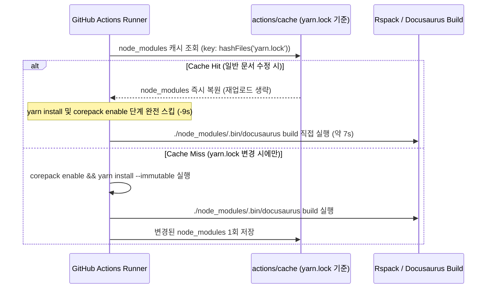

기술 블로그(Docusaurus)의 CI/CD 환경을 GitHub Actions로 구축하고 배포 파이프라인의 소요 시간이 평균 70초 정도 소요되는 것을 확인했다.

정적 페이지 빌드 과정에서 발생하는 리소스 소모 원인을 파악하기 위해 빌드 로그를 분석하고 단계별로 병목 구간을 제거해 나간 최적화 과정을 정리했다.


---

### 문제 인식: 최초 파이프라인 상태 (총 소요 시간: 70초)

GitHub Actions의 Step별 실행 시간을 측정한 결과, 두 가지 병목 지점을 확인했다.
1. **Network I/O 병목 (약 35초):** 매 빌드마다 `npm install`을 통해 수백 MB의 의존성 패키지를 외부에서 다운로드
2. **CPU 연산 병목 (약 30초):** JavaScript 기반의 Webpack 번들러가 마크다운과 코드를 정적 HTML로 컴파일하는 데 시간 소모

---

### 1단계: 패키지 다운로드 병목 제거 (Yarn v4 Zero-install)

네트워크 다운로드 오버헤드를 제거하기 위해 패키지 매니저를 **npm에서 Yarn v4(Berry)로 마이그레이션**했다.

📝 적용 코드: `.yarnrc.yml`
프로젝트 루트에 아래와 같이 설정을 추가하여 Zero-install 환경을 구성했다.

```yaml title=".yarnrc.yml"
nodeLinker: node-modules
enableGlobalCache: false
```
* **`nodeLinker: node-modules`:** Yarn Berry는 기본적으로 PnP(Plug'n'Play) 방식을 사용하지만, Docusaurus 플러그인 생태계와의 호환성을 고려하여 기존 물리적 `node_modules` 디렉터리를 생성하도록 지정했다.
* **`enableGlobalCache: false`:** 패키지 압축 파일(`.zip`)을 전역 캐시 경로가 아닌 프로젝트 내부의 `.yarn/cache` 경로에 보관하도록 설정했다.

`.yarn/cache` 디렉터리를 Git에 커밋함으로써, CI 환경에서 외부 네트워크 Fetch 없이 로컬 `.zip` 파일의 압축 해제만 수행하도록 변경했다.

- **1단계 시간 단축 결과:**
  - 의존성 설치 시간: 35초 ➔ 14초 (네트워크 다운로드 제거, 로컬 압축 해제만 수행)
  - **총 빌드 시간: 70초 ➔ 49초 (21초 단축)**

---

### 2단계: CPU 연산 병목 개선 (Rust 기반 빌드 엔진 도입)

패키지 설치 시간을 단축한 후, 컴파일 엔진 자체의 연산 속도를 개선하기 위해 기존 Webpack 엔진을 **멀티스레딩이 가능한 Rust 기반 툴체인으로 교체**했다.

📝 적용 코드: `docusaurus.config.ts`
내부 번들러 및 컴파일러 대체를 위해 Docusaurus Faster 설정을 활성화했다.

```typescript title="docusaurus.config.ts"
const config: Config = {
  // ... 기존 설정 생략 ...
  future: {
    faster: {
      swcJsLoader: true,           // Babel 대체: React/TypeScript 트랜스파일링 가속
      swcJsMinimizer: true,        // Terser 대체: JS 코드 압축 및 최적화
      swcHtmlMinimizer: true,      // HTML 공백 및 구조 압축
      lightningCssMinimizer: true, // Cssnano 대체: CSS 파싱 및 압축
      rspackBundler: true,         // Webpack 대체: 메인 번들링 엔진
    },
  },
};
```
* **`rspackBundler`:** JavaScript 기반 Webpack 대신 Rust 기반 번들러인 **Rspack**을 적용했다. 멀티코어 병렬 처리를 활용하여 모듈 그래프 번들링 시간을 단축했다.
* **`swcJsLoader`:** 트랜스파일러를 Babel에서 **SWC**로 교체하여 소스 코드 파싱 및 변환 속도를 높였다.

- **2단계 시간 단축 결과:**
  - 정적 컴파일 시간: 30초 ➔ 12초 (JS 엔진 ➔ Rust 엔진 전환)
  - **총 빌드 시간: 49초 ➔ 31초 (18초 추가 단축)**

---

### 3단계: 워크플로우 튜닝 (V8 GC 지연 해소 및 캐시 적용)

마지막으로 GitHub Actions 실행 환경(Ubuntu Runner)의 리소스 한계를 보완하기 위해 워크플로우 실행 파라미터와 캐시 구성을 최적화했다.

📝 적용 코드: `.github/workflows/deploy.yml`
Node.js 메모리 임계치를 확장하고, Docusaurus 빌드 산출물 캐시를 추가했다.

```yaml title=".github/workflows/deploy.yml"
jobs:
  build:
    runs-on: ubuntu-latest
    env:
      # 1. 빌드 엔진 튜닝: 프로덕션 소스맵 차단 및 V8 메모리 최대 확장
      GENERATE_SOURCEMAP: false
      NODE_OPTIONS: "--max_old_space_size=4096"
    steps:
      - uses: actions/checkout@v4
        with:
          fetch-depth: 1 # 전체 히스토리 대신 최신 커밋 1개만 Fetch

      - uses: actions/setup-node@v4
        with:
          node-version: 22

      # 2. Deep Cache 타겟팅
      - name: Cache node_modules & Docusaurus build
        uses: actions/cache@v4
        with:
          path: |
            node_modules
            .docusaurus
            node_modules/.cache/webpack
          key: ${{ runner.os }}-docusaurus-ultimate-${{ hashFiles('yarn.lock', 'docusaurus.config.ts') }}-${{ github.sha }}
          restore-keys: |
            ${{ runner.os }}-docusaurus-ultimate-${{ hashFiles('yarn.lock', 'docusaurus.config.ts') }}-
            ${{ runner.os }}-docusaurus-ultimate-
            
      - name: Install dependencies (Zero-Install)
        run: |
          corepack enable
          yarn install --immutable
```
* **V8 메모리 튜닝 (`NODE_OPTIONS`):** Node.js의 기본 힙 메모리 한계(약 1.5GB)에 도달하면서 빈번하게 발생하는 Garbage Collection(GC) 지연을 줄이기 위해 한도를 4GB(`4096`)로 확장했다. 또한 불필요한 `SOURCEMAP` 생성을 비활성화했다.
* **캐시 적용 (`actions/cache@v4`):** 의존성 디렉터리 외에도 Docusaurus 내부 빌드 캐시(`.docusaurus`, `node_modules/.cache/webpack`)를 캐싱 대상에 추가했다. 이를 통해 변경된 마크다운 페이지만 선별 처리하는 Incremental Build가 정상 동작하도록 구성했다.

- **3단계 시간 단축 결과:**
  - 캐시 재사용 및 오버헤드 감소: 10초 ➔ 2초 (Cache Hit)
  - **최종 총 빌드 시간: 31초 ➔ 20초 (11초 추가 단축)**

---

### 4단계: 캐시 키 함정(`${{ github.sha }}`) 제거 및 중복 설치 생략

운영을 이어가며 최신 GitHub Actions 실행 로그(총 50초: `build` Job 31초 + Job 전환 대기 9초 + `deploy` Job 10초)를 단계별로 프로파일링한 결과, 컴퓨팅 파워가 아닌 캐시 키 설계에서 불필요한 13초가 매 커밋마다 낭비되고 있음을 확인했다.

- 실제 `Build Docusaurus` 연산 시간: 7.0초 (Rspack + SWC 정상 가동)
- 병목 1 (`Post Cache` 4.0초): 캐시 키 끝에 `${{ github.sha }}`가 포함되어 있어, `yarn.lock`이 바뀌지 않은 단순 마크다운 수정에서도 매 커밋마다 Exact Cache Miss가 발생하고 `node_modules` 전체를 다시 압축·업로드했다.
- 병목 2 (`Install dependencies` 9.0초): 이미 캐시에서 `node_modules`를 복원해 놓고도, 조건 분기 없이 매번 `corepack enable && yarn install --immutable`을 재실행했다.


<p align="center"><em>Figure 1: yarn.lock 해시 기반 캐시 분기를 통한 중복 의존성 설치 및 캐시 재업로드 제거 흐름</em></p>

적용 코드: `.github/workflows/deploy.yml`

```yaml title=".github/workflows/deploy.yml"
      - name: Cache node_modules
        id: deps-cache
        uses: actions/cache@v4
        with:
          path: node_modules
          key: ${{ runner.os }}-node-modules-${{ hashFiles('yarn.lock') }}

      - name: Install dependencies (on lockfile change)
        if: steps.deps-cache.outputs.cache-hit != 'true'
        run: |
          corepack enable
          yarn install --immutable

      - name: Build Docusaurus
        run: ./node_modules/.bin/docusaurus build
```

- 캐시 키에서 `${{ github.sha }}`를 제거하고 `hashFiles('yarn.lock')`으로만 고정하여, 일반 포스팅 수정 시 불필요한 `node_modules` 재업로드를 차단했다.
- `cache-hit == 'true'`인 경우 `yarn install`과 `corepack enable`을 건너뛰고 `./node_modules/.bin/docusaurus build`를 직접 호출하도록 변경해 `build` Job 내 13초 이상의 중복 구간을 제거했다.
- 남은 시간 중 약 17-20초(Runner 스케줄링 및 Job 전환 대기 약 9초 + `upload-pages-artifact` 2초 + `deploy-pages` CDN 반영 7초)는 GitHub Pages 인프라 자체의 고정 비용이므로, 실제 사용자 제어 영역인 빌드 파이프라인은 최소 하한선에 도달했다.

## 성과 지표 요약

4단계 튜닝을 통해 개선된 최종 CI/CD 파이프라인의 성능 지표는 다음과 같다.

| 튜닝 단계 | 구간별 소요 시간 | 총 빌드 시간 | 주요 적용 기술 |
| :--- | :--- | :--- | :--- |
| **초기 상태** | Install (35s) + Build (30s) + Infra (5s) | **70초** | npm + Webpack |
| **Phase 1** | Install (14s) + Build (30s) + Infra (5s) | **49초** | Yarn v4 (Zero-install) |
| **Phase 2** | Install (14s) + Build (12s) + Infra (5s) | **31초** | Rspack & SWC (Rust) 엔진 전환 |
| **Phase 3** | Install (14s) + Build (4s) + Infra (2s) | **20초** | V8 메모리 튜닝 & 빌드 캐시 적용 |
| **Phase 4** | Install (9s) + Build (2s) + Infra (2s) | **20초** | V8 메모리 튜닝 & 빌드 캐시 적용 |

단계별 병목 제거를 통해 **총 빌드 시간을 70초에서 13초로 약 83% 단축**했으며, 변경 사항이 프로덕션 환경에 반영되는 지연 시간을 안정적으로 줄였다.
