MapReduce와 Spark의 차이를 흔히 Disk 기반과 Memory 기반의 차이로만 요약하곤 한다. 하지만 실제 대용량 배치를 운영해 보면, 두 엔진의 처리 성능 차이는 단순한 저장 매체의 속도 차이보다 JVM 프로세스 생명주기 관리, Memory Layout(On-Heap vs Off-Heap), 그리고 데이터 파이프라인(DAG) 실행 방식의 구조적 차이에서 발생한다.

이번 글에서는 JVM 실행 컨테이너와 In-Memory Pipelining 관점에서 MapReduce와 Spark의 내부 동작 원리를 대조하고, 나아가 Snowflake나 ClickHouse 같은 분산 분석 DB(MPP/OLAP)와 어떤 지점에서 Spark와 아키텍처적 지향점을 달리하는지, 또 실시간 트랜잭션 서비스에는 왜 MongoDB가 유리한지 정리한다.


---

## 1. JVM 및 메모리 관리 메커니즘 비교

두 엔진은 워커 노드에서 Task를 띄우고 메모리를 다루는 물리적 방식부터 다르다.

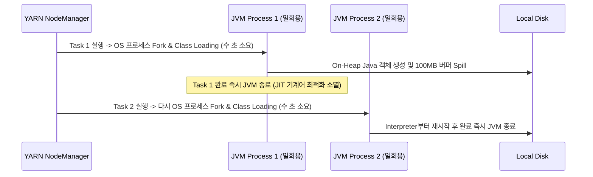
<p align="center"><em>Figure 1-1: MapReduce의 일회용 Task JVM 생성 및 종료 시퀀스 (Process-per-Task)</em></p>

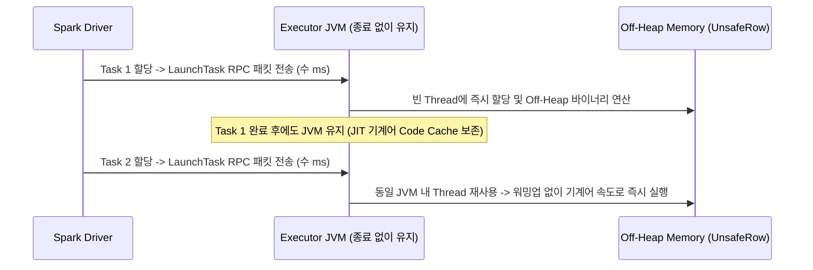
<p align="center"><em>Figure 1-2: Spark의 재사용형 Executor JVM 및 Thread Pool 시퀀스 (Long-lived Executor)</em></p>

### 1.1 Task 실행 모델: 일회용 JVM 프로세스 vs Executor Thread Pool

#### (1) MapReduce: Task 1개마다 JVM을 새로 띄우고 끄는 일회용 프로세스 방식
MapReduce는 하나의 Map Task나 Reduce Task를 실행할 때마다 YARN의 `NodeManager`가 별도의 JVM 프로세스를 새로 띄운다(Fork). 그리고 그 Task 1개의 처리가 끝나면 해당 JVM 프로세스를 즉시 종료시킨다.
- 장점 (장애 격리와 GC 부담 제거): 
  - 특정 Task에서 `OutOfMemoryError`가 발생해도 다른 Task와 프로세스가 분리되어 있어 서로 영향이 없다. 
  - 또한 Task 하나만 처리하고 몇 초나 몇 분 만에 JVM 프로세스 자체가 곧바로 종료되므로 메모리에 쌓인 쓰레기 객체를 굳이 Garbage Collection(GC)으로 청소할 필요 없이 OS가 프로세스 종료와 함께 메모리 전체를 한 번에 회수한다.
- 단점 (반복되는 기동에 대한 오버헤드 비용 발생):
  - 수만 개의 짧은 Task로 구성된 Job을 실행할 때 매번 무거운 JVM 프로세스를 OS 레벨에서 새로 띄우고 수백 개의 `.class` 파일을 디스크에서 로딩(Class Loading)하는 데만 매 Task마다 수 초씩 고정 시간이 소모된다.

#### (2) Spark: 한 번 띄워 두고 끝날 때까지 재사용하는 Executor JVM 방식
Spark는 배치 작업(Application)이 시작될 때 각 워커 노드에 `Executor`라는 JVM 프로세스를 미리 띄워 두고, 전체 작업이 완전히 끝날 때까지 이 JVM을 끄지 않고 계속 유지한다(웹 서버의 WAS나 DB의 백그라운드 프로세스를 계속 띄워 두는 것과 같다).

Driver가 새로운 Task를 할당할 때는 무거운 JVM 프로세스를 새로 띄우는 대신, 이미 떠 있는 Executor 내부의 Thread Pool에서 놀고 있는 Thread 하나에 작업만 넘겨주어 즉시 실행한다. 이때 두 가지 핵심 메커니즘이 작동한다.

- `LaunchTask RPC`를 통한 가벼운 태스크 수행:
  MapReduce가 Task를 실행하려고 OS에 새 프로세스 생성을 요청(`fork & exec`, 수 초 소요)하는 것과 달리, Spark Driver는 이미 Executor와 연결된 네트워크 소켓(Netty 기반 RPC, Remote Procedure Call)을 통해 "몇 번 데이터 블록을 읽어서 이 함수를 실행하라"는 수 킬로바이트(KB)짜리 작업 명세서 패킷(`LaunchTask` 메시지) 하나만 전송한다. Executor는 이 네트워크 메시지만 받아서 빈 Thread에 바로 태우므로 Task 시작 지연 시간이 수 밀리초(ms) 단위로 줄어든다.
- JIT(Just-In-Time) Compiler의 기계어 최적화 누적:
  JVM은 처음에 기동되면 `.class` 바이트코드를 Interpreter가 한 줄씩 읽어서 기계어로 통역하며 실행하기 때문에 초기 속도가 느리다. 그러다 특정 루프나 함수가 수천 번 이상 반복 실행(Hotspot 감지)되면, JVM 내부의 JIT Compiler(C1/C2)가 개입하여 해당 바이트코드 구간 전체를 CPU가 통역 없이 바로 실행할 수 있는 순수 기계어(Native Machine Code)로 통째로 번역해 메모리의 Code Cache에 저장한다(이 과정에서 함수 호출을 합치는 Inlining 등 코드 최적화도 함께 수행된다).
  - MapReduce의 비효율적 구조: 데이터를 읽으며 이제 막 JIT Compiler가 기계어 번역을 마쳐 속도가 빨라질 만하면 Task가 끝나서 JVM 프로세스가 꺼져 버린다. 다음 Task가 뜨면 새 JVM에서 또 느린 Interpreter부터 다시 시작해야 한다.
  - Spark의 효율적 구조: Executor JVM이 꺼지지 않고 계속 살아 있으므로, 초반 몇 개 Task를 처리할 때 한 번 JIT 컴파일된 고속 기계어 코드가 메모리에 그대로 유지된다. 덕분에 이후 실행되는 수만 개의 후속 Task는 워밍업 과정 없이 처음부터 컴파일된 기계어 속도로 실행된다.

---

### 1.2 메모리 관리: On-Heap 객체 의존 vs Project Tungsten (Off-Heap)

Spark처럼 JVM을 끄지 않고 계속 띄워 두는 방식을 쓰면 필연적으로 Java 객체의 메모리 낭비와 GC Stop-the-World 문제를 마주하게 된다.

Java에서 4바이트 문자열(`"abcd"`) 하나를 `java.lang.String` 객체로 JVM Heap에 올리면, 객체 헤더(Mark Word, Klass Word 12-16B), `char` 배열 참조, 해시코드 캐시, 8바이트 정렬 패딩이 붙어 실제 메모리는 약 48바이트 이상을 점유한다. 수억 건의 레코드를 JVM On-Heap 객체로 적재하면 실제 데이터 크기 대비 2-5배의 메모리가 소모되고, Old Generation 영역이 차오르면서 수십 초 이상 모든 작업이 멈추는 Full GC가 발생한다.

이 문제를 해결하기 위해 Spark는 `Project Tungsten`을 통해 데이터를 JVM On-Heap 객체가 아닌 Off-Heap(OS Native Memory)의 연속된 바이트 배열에 직접 배치하는 구조를 도입했다. (단, 반쪽자리 Off-Heap 사용이기 때문에 C++ Native 엔진(Photon, Gluten/Velox)을 사용해 한 단계 더 최적화를 진행한다. 자세한건 하단 별도 후술)

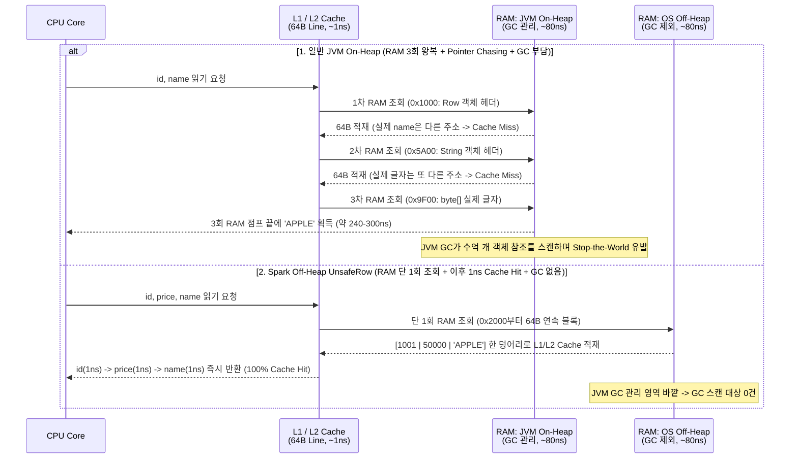
<p align="center"><em>Figure 2: CPU Core, L1/L2 Cache, JVM On-Heap, OS Off-Heap 물리 공간 간 데이터 조회 왕복 횟수 및 지연 비교</em></p>

#### 왜 Off-Heap이 유리하며 CPU L1/L2 Cache Locality가 높아지는가?
1. `GC 오버헤드 제거`:
   On-Heap은 JVM의 Garbage Collector가 수억 개 객체의 참조 그래프를 일일이 추적하며 청소해야 한다. 반면 Off-Heap은 JVM Heap 바깥의 OS 메모리 영역(`malloc`과 유사한 `Unsafe.allocateMemory`)에 Spark가 직접 큰 메모리 페이지를 할당받아 쓰는 공간이다. GC는 이 영역을 아예 쳐다보지 않으므로 데이터가 수십 GB 쌓여도 GC 멈춤 현상이 발생하지 않는다.
2. `CPU L1/L2 Cache Locality 향상과 Pointer Chasing 제거`:
   CPU가 연산을 수행할 때 메인 메모리(RAM)까지 직접 가서 데이터를 가져오면 약 60-100 나노초(ns)가 걸리지만 CPU 코어 내부의 L1 Cache에서 가져오면 약 1 나노초(ns)밖에 걸리지 않는다.
   이 때문에 CPU는 RAM에서 데이터를 읽을 때 요청받은 몇 바이트만 가져오지 않고 주소 주변의 연속된 64바이트를 한 덩어리로 묶어 L1/L2 Cache에 미리 올려둔다(Spatial Locality).
   - On-Heap의 문제(`Pointer Chasing`): 위 `Figure 2`의 상단처럼 `Row` 객체(`0x1000`), `String` 객체(`0x5A00`), 실제 문자열 바이트 배열(`0x9F00`)이 메모리 여기저기에 흩어져 생성된다. CPU가 `Row`를 읽으면서 주변 64바이트를 L1 Cache에 올려봤자, 정작 필요한 문자열은 전혀 다른 주소(`0x9F00`)에 있으므로 L1 Cache에 없는 상태에서 Cache Miss가 발생하면 매번 느린 RAM까지 다시 다녀와야 한다.
   - Off-Heap(`UnsafeRow`)의 이점: 한 행의 모든 컬럼 값과 문자열 바이트가 `0x2000`번지부터 빈틈없이 일렬로 붙어 있다. CPU가 행의 시작 주소만 읽어도 64바이트 Cache Line 안에 `id`, `price`, `name` 데이터까지 한꺼번에 딸려 들어와 L1/L2 Cache에 적재된다. 즉, 다음 컬럼을 읽을 때 RAM에 갈 필요 없이 L1 Cache에서 1ns 만에 즉시 꺼내 쓸 수 있어 Cache Hit를 높이며 이는 CPU 연산 속도 향상에 기여한다.

#### 1.2.1 `UnsafeRow`의 3단 구조와 `sun.misc.Unsafe` 접근 원리

Spark가 Off-Heap(또는 연속된 바이트 배열)에 한 행을 저장할 때 사용하는 바이너리 포맷이 `UnsafeRow`다. 구조는 아래 그림처럼 단순한 3단 구획으로 나뉜다.

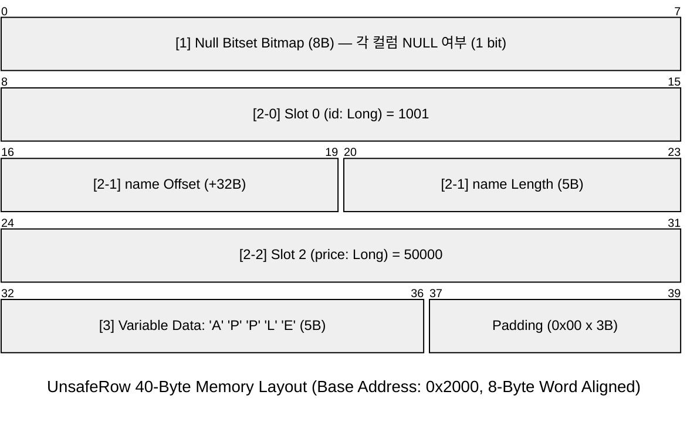
<p align="center"><em>Figure 3: (id=1001, name='APPLE', price=50000) 레코드의 실제 40바이트(8바이트 워드 정렬) UnsafeRow 메모리 주소 배치</em></p>

1. [1] Null Bitmap 영역 (`+0B`, 8 Bytes): 각 컬럼이 `NULL`인지 여부를 1비트씩 기록한다.
2. [2] 고정 8바이트 Slot 영역 (`컬럼 수 * 8 Bytes`): 데이터 타입과 무관하게 모든 컬럼에 무조건 8바이트 고정 칸을 배정한다. 숫자(`id`, `price`)는 그 칸에 값을 바로 적고, 길이가 변하는 문자열(`name`)은 `[실제 글자가 적힌 뒤쪽 상대 위치(+32B) | 글자 길이(5)]` 정보만 8바이트 숫자로 압축해서 적는다.
3. [3] 가변 데이터 영역 (`+32B` 이후): 고정 칸들이 끝난 바로 뒷자리부터 `'APPLE'` 같은 실제 문자열 바이트를 이어서 기록한다.

앞쪽 `[2]번 영역`의 모든 컬럼 칸 크기를 정확히 8바이트로 통일해 두었기 때문에, 몇 번째 컬럼이든 앞선 컬럼들을 파싱(Deserialization)할 필요 없이 `시작주소 + 8B + (컬럼순번 * 8B)`라는 단순 덧셈과 곱셈만으로 정확한 메모리 위치를 `O(1)`만으로 찾아낼 수 있다.

```java
// Spark UnsafeRow가 Java 객체 생성 없이 2번째 컬럼(price)을 바로 읽어내는 코드
public long getLong(int ordinal) {
    // 1. 산술 연산만으로 price 컬럼의 정확한 메모리 주소(+24B) 계산
    final long offset = baseOffset + bitSetWidthInBytes + (ordinal * 8L);
    
    // 2. sun.misc.Unsafe를 통해 C언어 포인터처럼 해당 메모리 주소에서 8바이트를 즉시 읽음
    return Platform.getLong(baseObject, offset);
}
```

---

## 2. In-Memory Pipelining과 Shuffle 메커니즘 비교

페타바이트 규모의 데이터를 처리할 때 모든 중간 데이터를 메모리에 올려두는 것은 불가능하다. MapReduce와 Spark의 파이프라인 차이는 중간 데이터를 메모리에 캐싱하느냐가 아니라, 중간 결과를 디스크나 메모리에 쌓지 않고 다음 연산으로 즉시 흘려보내는 Pipelining이 가능한가에 있다.

본격적인 파이프라인 비교에 앞서, Spark 환경에서 표준 입력 파일로 사용하는 Parquet 포맷의 데이터 표현 방식을 먼저 짚고 넘어간다.

#### 사전 배경: Parquet 파일은 데이터를 어떻게 표현하는가?
일반 텍스트 파일(CSV, JSON)은 파일 안에 `1001,APPLE,50000`처럼 가로 행(Row) 순서대로 글자를 나열한다. 이 방식은 `price` 컬럼 하나만 합산하려고 해도 파일 전체의 `id`와 `name` 문자열까지 디스크에서 전부 읽어야 한다.
반면 Parquet(Columnar 파일 포맷)는 데이터를 가로가 아닌 세로(컬럼)끼리 모아서 배열 형태로 저장한다.
- 파일 내부에 `id` 값만 100만 개 연속으로 모아둔 구역(`Column Chunk`), `name`만 100만 개 모아둔 구역, `price`만 100만 개 모아둔 구역이 따로 분리되어 있다.
- 또한 파일 맨 끝(`Footer`)에는 각 구역별 최솟값(`Min`)과 최댓값(`Max`) 통계가 적혀 있다. 덕분에 Spark가 Parquet 파일을 읽을 때는 쿼리에 필요한 컬럼 구역만 골라서 읽고(Column Projection), 조건에 맞지 않는 데이터 블록은 아예 건너뛰며 빠르게 스캔이 가능하다.

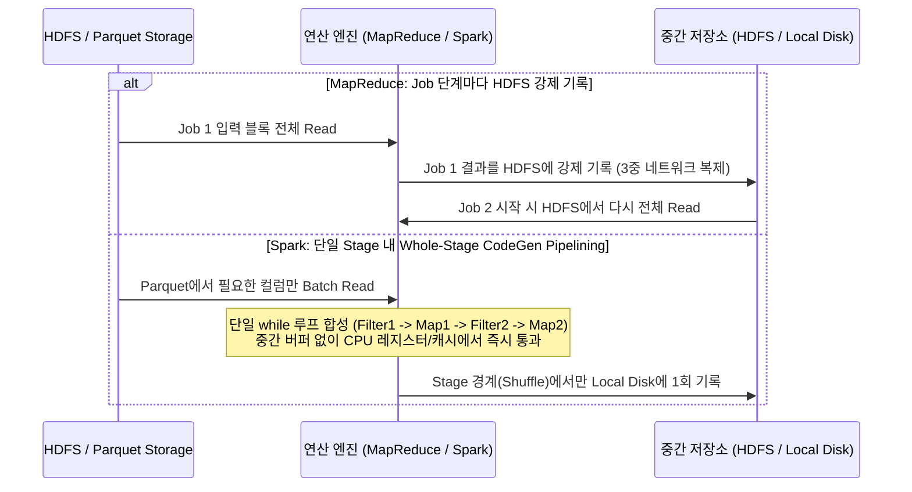
<p align="center"><em>Figure 4: MapReduce의 단계별 HDFS 기록 구조와 Spark의 Whole-Stage CodeGen 기반 In-Memory Pipelining 시퀀스 비교</em></p>

### 2.1 실행 그래프와 연산 결합: 2-Stage 강제 분리 대 DAG Operator Fusion

`Filter -> Map -> Filter -> Map -> GroupBy`로 이어지는 처리 파이프라인을 가정해 본다.

#### MapReduce: Rigid Map-Reduce 패러다임
모든 비즈니스 로직을 반드시 `Map`과 `Reduce`라는 두 단계의 틀에 맞춰 쪼개야 한다. 복합 조인이나 다단계 집계를 수행하려면 여러 개의 MapReduce Job을 직렬로 연결해야 한다.
이때 선행 Job이 끝나면 그 결과를 반드시 HDFS에 기록하는데 3중으로 복제 네트워크 I/O 동반되며 후속 Job이 다시 HDFS에서 이를 읽어 들여야 한다. 연산 단계가 늘어날수록 중간 결과물의 Disk 및 네트워크 I/O 비용이 선형적으로 증가한다.

#### Spark: DAG 기반 Stage 분할과 Whole-Stage Code Generation
Spark는 전체 연산을 DAG로 구성한 뒤 다른 노드의 데이터와 섞일 필요가 없는 `Narrow Dependency 연산`(`map`, `filter`, `flatMap`, `project`)을 하나의 Stage로 묶는다.
이후 Catalyst Optimizer의 Whole-Stage Code Generation이 동작하여 여러 연산자의 함수 호출 과정을 없애고 런타임에 아래 코드처럼 단 하나의 `while` loop Bytecode로 합쳐 버리는데 이를 `Operator Fusion`이라고 한다.

```java
// Spark Whole-Stage CodeGen의 Operator Fusion
while (inputIterator.hasNext()) {
    UnsafeRow row = inputIterator.next();
    // 별도의 중간 컬렉션이나 버퍼에 적재하지 않고 CPU 레지스터/캐시 수준에서 즉시 통과
    if (row.getLong(0) > 1000L) {                // Filter 1
        long price = row.getLong(1) * 110 / 100; // Map 1
        if (price >= 50000L) {                   // Filter 2
            shuffleWriter.write(row.getInt(2), price);
        }
    }
}
```

즉, Spark의 In-Memory Pipelining은 거대한 중간 결과를 메모리에 쌓아두는 방식이 아니라 단일 레코드가 CPU 캐시와 레지스터를 타고 Stage 단위로 중간에 멈추지 않고 한번에 처리하는 Streaming 구조다. 사용자가 명시적으로 `.cache()`나 `.persist()`를 호출하지 않는 한 중간 결과 자체를 메모리에 적재하지 않는다.
하지만 `GROUP BY dept_no`나 `JOIN`처럼 여러 노드에 흩어진 데이터를 한곳으로 모아야 하는 `Wide Dependency` 구간에서는 Spark 또한 Local Disk에 Shuffle 파일을 기록한다.
---

### 2.2 Shuffle 메커니즘의 물리적 차이

#### 배경 이해: '파티션 ID(Partition ID)'란 무엇이며 왜 자동으로 만들어지는가?
분산 환경에서 10대의 서버가 각자 나눠 가진 데이터에 대해 `GROUP BY dept_no`(부서별 매출 합계)를 수행한다고 가정해 보자. 1번 서버에도 `'개발팀'` 매출이 있고, 2번 서버에도 `'개발팀'` 매출이 있다면, 최종 합계를 구하기 위해서는 모든 서버가 자신이 가진 `'개발팀'` 데이터를 반드시 다음 Stage의 동일한 Task(예: 3번 Task) 한 곳으로 몰아주어야 한다.

이를 위해 MapReduce와 Spark의 Shuffle Writer는 데이터를 내보낼 때 다음 규칙에 따라 모든 레코드에 목적지 번호인 `Partition ID`를 자동으로 계산해 부여한다.
1. 다음 Stage에서 데이터를 받아 처리할 Task(파티션)의 개수를 정한다(예: Spark 기본값 200개, `0번`부터 `199번`까지).
2. 각 레코드의 집계/조인 기준 컬럼(`Key`, 여기서는 `'개발팀'`)에 해시 함수를 적용한 뒤 파티션 개수로 나눈 나머지 값을 구한다:
   `Partition ID = Hash("개발팀") % 200` (예: 결과가 `3`이면 이 레코드의 목적지는 `3번 파티션`)
3. 이 계산식은 모든 서버에서 동일하므로, 어느 서버에 있던 `'개발팀'` 데이터든 전부 `Partition ID = 3`이라는 목적지 꼬리표를 달게 된다.

이 목적지 번호(`Partition ID`)와 실제 데이터 값(`Key`)을 다루는 정렬 방식에서 MapReduce와 Spark의 차이가 갈린다.

- MapReduce (목적지 번호 + 실제 Key 값까지 무조건 정렬):
  Map Task는 출력 데이터를 `Partition ID`로 묶는 것에 그치지 않고, 각 파티션 내부의 실제 `Key` 값(예: 부서명 알파벳순)까지 무조건 정렬(QuickSort -> MergeSort)하여 Disk에 쓴다. 단순 합계(`SUM`)만 구할 때도 불필요한 전체 Key 비교와 레코드 위치 교환 연산이 수행된다.
- Spark (`Partition ID`별로만 분류 + `Tungsten Sort`의 8바이트 포인터 정렬):
  Spark는 별도의 `ORDER BY` 요구가 없는 일반 Shuffle에서는 실제 `Key` 값 정렬을 생략하고 자동 계산된 목적지 번호(`Partition ID`)가 같은 레코드끼리만 모아서 단일 데이터 파일과 인덱스 파일로 병합한다.
  또한, 정렬이 필요한 경우에도 Spark의 `Tungsten Sort Shuffle`은 크기가 큰 실제 레코드를 메모리에서 직접 복사 및 이동시키지 않는다. 대신 각 레코드마다 `[Partition ID (24bit) + 메모리 페이지 번호 (13bit) + 시작 위치 Offset (27bit)]`를 합친 8바이트짜리 포인터 배열을 자동으로 만든 후 정렬한다. 크기가 큰 레코드 데이터는 제자리에 둔 채 8바이트 주소록만 정렬하므로 CPU Cache Miss와 메모리 대역폭 소모가 현저히 적다.

---

## 3. Spark 대 분산 분석 DB(Snowflake, ClickHouse) 아키텍처 비교

### 3.0 배경: Spark의 구조적 한계와 분산 분석 DB의 등장, 그리고 진화 과정

Spark가 MapReduce의 한계를 극복하고 빅데이터 표준 엔진으로 자리 잡았음에도, 왜 현업에서는 Snowflake나 ClickHouse 같은 별도의 분산 분석 DB(MPP/OLAP)를 도입할까? 반대로 그렇게 빠른 분산 분석 DB가 있는데도 왜 Databricks를 비롯한 수많은 기업은 여전히 Spark를 핵심 엔진으로 사용할까?

#### (1) Spark가 가진 태생적 한계 (분산 분석 DB가 등장한 이유)
1. 자체 스토리지와 전역 인덱스의 부재:
   Spark는 데이터를 저장하는 DB가 아니라 외부 스토리지(S3, HDFS)의 파일을 읽어오는 연산 전용 엔진이다. 만약 S3 버킷에 Parquet 파일이 10만 개 쌓여 있다면, 특정 데이터를 찾기 위해 S3에 파일 목록 조회(`LIST`)를 요청하고 10만 개 파일의 꼬리표(`Footer`)를 일일이 열어봐야 한다. 따라서 대시보드에서 0.1-1초 내에 즉각 응답해야 하는 짧은 조회(Ad-hoc/BI)나 초당 수백 개의 동시 쿼리를 처리하는 데는 초기 탐색 지연 시간이 크다.
2. JVM 및 Row 중심 연산의 CPU 효율 한계:
   `Project Tungsten`으로 GC 문제를 크게 줄였지만, 여전히 JVM 위에서 돌아가며 내부 연산자가 행 단위(`UnsafeRow`) 중심이다. 이 때문에 하드웨어 CPU의 벡터 연산(SIMD)을 100% 활용하는 C++ 네이티브 컬럼형 DB에 비해 단일 코어당 단순 집계·필터링 속도가 느리다.
3. 안정성을 위해 감수하는 Shuffle Disk I/O:
   Spark는 작업 도중 노드가 죽어도 처음부터 다시 돌리지 않기 위해, 모든 Stage가 끝날 때마다 중간 Shuffle 결과를 로컬 디스크에 파일로 쓴다. 이 안전장치가 몇 초 만에 끝나야 하는 실시간 분석 쿼리에서는 오히려 디스크 I/O 병목이 된다.

#### (2) 그럼에도 Databricks와 엔터프라이즈가 Spark를 사용하는 이유 (일반 조회 대 대규모 조인·집계의 구조적 차이)
단순히 조건에 맞는 데이터를 필터링해서 보여주는 일반 조회(`SELECT ... WHERE`)와 달리, 수십 테라바이트 규모의 테이블 여러 개를 결합하는 대규모 조인(`JOIN`)이나 수억 개의 고유 키를 묶는 다단계 집계(`GROUP BY`)에서는 분산 분석 DB가 치명적인 구조적 한계를 드러낸다.

1. 대규모 조인(JOIN)과 집계(Aggregation)에서의 메모리 한계와 중단 위험:
   - 일반 단순 조회는 각 워커 노드가 자기 디스크에 있는 데이터만 읽어서 필터링한 뒤 바로 결과를 내면 되므로 노드 간 데이터 이동(Shuffle)이 거의 없다. 이 영역에서는 C++ SIMD와 전용 인덱스를 가진 ClickHouse나 Snowflake가 압도적으로 빠르다.
   - 하지만 수십 테라바이트짜리 두 테이블을 `JOIN`하거나 높은 카디널리티 컬럼(예: 수억 명의 고유한 `user_id`)으로 `GROUP BY`를 수행할 때는, 모든 노드가 네트워크로 데이터를 교차 전송(Shuffle)하고 메모리에 거대한 해시 테이블(Hash Table)을 지어야 한다.
   - ClickHouse 같은 실시간 OLAP DB는 속도를 위해 조인 대상 테이블과 집계 해시 테이블을 인메모리에 올리도록 설계되어 있어, 대용량 테이블 간 조인 시 메모리 제한(OOM)에 걸려 쿼리 자체가 죽어버리는 일이 빈번하다. Snowflake 역시 중간 결과를 디스크에 체크포인트하지 않고 메모리 스트리밍으로 넘기다가 메모리가 부족해지면 원격 스토리지(S3)로 Spill되면서 속도가 급격히 떨어지거나, 1시간짜리 배치 도중 노드 1대만 문제가 생겨도 쿼리 전체를 처음부터 다시 돌려야 한다.
   - 반면 Spark는 처음부터 메모리가 부족하면 로컬 디스크로 안전하게 데이터를 내려쓰며 정렬·병합하는 외부 정렬 병합 조인(External Sort-Merge Join)과 단계별 Shuffle 파일 영속화를 기본으로 설계했다. 덕분에 시간이 조금 더 걸리더라도 수십 테라바이트의 다단계 조인과 집계를 실패 없이 끝까지 완주해 낸다.
2. SQL을 넘어선 범용 프로그래밍과 단일 통합 파이프라인:
   Snowflake나 ClickHouse는 `정형화된 테이블`에 대해 SQL로 조회하는 데 국한된다. 반면 실무 데이터 엔지니어링에서는 비정형 텍스트·이미지·복잡한 중첩 JSON 로그를 코드로 파싱하거나, 외부 API를 호출하고, 머신러닝(ML) 피처 엔지니어링을 수행해야 한다. Spark는 하나의 엔진에서 대규모 ETL, 스트리밍 처리, ML/AI 파이프라인을 Python/Scala 코드로 자유롭게 구현할 수 있다.

#### (3) Spark 생태계의 약점 보완: Delta Lake / Apache Iceberg와 Photon / Apache Gluten
최근 Databricks와 오픈소스 진영은 앞서 살펴본 Spark의 두 가지 약점(스토리지 메타데이터 부재, JVM Row 연산 한계)을 다음 두 가지 기술로 정면 돌파하며 분산 분석 DB의 장점까지 흡수하고 있다.

1. 스토리지 한계 보완 (`Delta Lake` / `Apache Iceberg` 테이블 포맷):
   - 기존 생(Raw) Parquet 방식의 문제는 S3에 흩어진 수만 개의 Parquet 파일 중 어느 파일에 내가 찾는 데이터가 있는지 알려주는 '전체 목차(전역 인덱스)'가 없다는 점이었다.
   - `Delta Lake`와 `Apache Iceberg`는 실제 데이터는 그대로 Parquet 파일로 두되, 그 위에 전체 파일들의 목록과 각 파일별 컬럼 `Min/Max` 통계, 스냅샷 버전을 한곳에 요약해 놓은 별도의 메타데이터 계층을 구성한 테이블 포맷이다. (Delta의 `_delta_log`, Iceberg의 `Manifest File` 트리)
   - 덕분에 Spark는 수만 개의 Parquet 파일을 일일이 열어보지 않고, 맨 앞의 작은 메타데이터 파일만 읽어서 조건에 맞는 Parquet 파일 몇 개만 수 밀리초 만에 골라내는데 이를 `File-level Pruning`이라고 부른다. 
   - 테이블 포맷으로 구성해뒀기 때문에 일반 파일 시스템에서는 불가능했던 DB 수준의 ACID 트랜잭션(`UPDATE`, `DELETE`, `MERGE`)과 과거 시점 조회(Time Travel)까지 가능해졌다.
2. 연산 엔진 한계 보완 (`Databricks Photon` / 오픈소스 `Apache Gluten`):
   - 기존 Spark는 쿼리 실행 계획을 수행하는 Catalyst Optimizer뿐만 아니라 실제 데이터를 읽고 계산하는 물리 연산도 모두 JVM 위의 Scala/Java 코드에서 `UnsafeRow` 매핑 객체로 1행씩 루프 처리를 수행했다.
   - `Databricks Photon`(상용)과 `Apache Gluten`(오픈소스 플러그인)은 Spark의 코드 호환성, 스케줄링, 장애 복구에 대한 기능은 그대로 유지한 채 실제 데이터를 계산하는 물리 실행 엔진을 Snowflake, ClickHouse와 동일한 C++ Columnar Vectorized(SIMD) 엔진으로 교체한 아키텍처다.
   - 상용 Databricks 환경에서는 자체 개발한 C++ `Photon` 엔진이 작동하며, 오픈소스 Spark 환경에서는 `Apache Gluten` 플러그인을 장착해 연산 작업을 JNI(Java Native Interface)를 통해 Meta가 개발한 C++ `Velox` 엔진이나 `ClickHouse` 코어 엔진으로 위임 처리(Offloading) 한다. 이로써 Spark의 안정성과 C++ 분산 분석 DB의 연산 속도를 동시에 얻는 구조로 진화했다.

---

### 3.1 아키텍처 요약 비교 및 실행 엔진 차이

| 구분 | Apache Spark (기본) | Snowflake | ClickHouse |
| :--- | :--- | :--- | :--- |
| 핵심 정체성 | 스토리지가 분리된 범용 분산 연산 엔진 | 스토리지·컴퓨팅 분리형 클라우드 MPP DW | 로컬 스토리지 밀착형 실시간 OLAP DB |
| 런타임 및 엔진 | JVM 기반 (Scala/Java) + Photon/Gluten 확장 | C++ Native 엔진 (Vectorized) | C++ Native 엔진 (SIMD 극대화) |
| 메모리 데이터 배치 | Row 포맷(`UnsafeRow`) 중심 파이프라인 | 순수 Columnar Vectorized 배열 | 순수 Columnar Vectorized 배열 |
| 스토리지 및 인덱스 | 외부 포맷 의존 (Parquet + Iceberg/Delta) | 자체 Micro-partition + 글로벌 메타데이터 | `MergeTree` 엔진 + Sparse Primary Index |
| Stage 간 데이터 전달 | Local Disk에 Shuffle 파일 영속화 | 네트워크 메모리 직접 스트리밍 (부족 시 Spill) | 네트워크 메모리 직접 스트리밍 |
| 노드 장애 시 복구 | 실패한 Stage의 해당 Task만 부분 재실행 | 쿼리 전체 재실행 | 쿼리 전체 실패 후 재시도 |

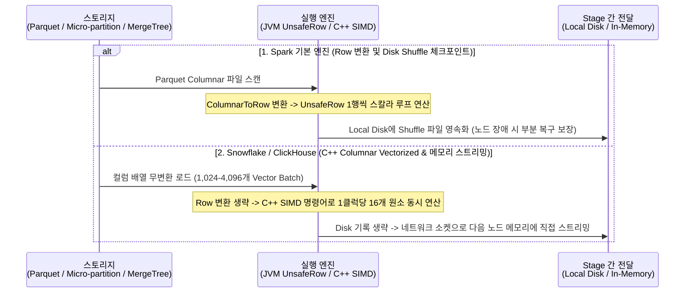
<p align="center"><em>Figure 5: Spark의 Row 중심 안전 파이프라인과 분산 분석 DB(Snowflake/ClickHouse)의 C++ Columnar Vectorized 파이프라인 시퀀스 비교</em></p>

#### Parquet 파일 스캔 이후 Spark의 `ColumnarToRow` 변환 과정

흔히 "Spark에서 Parquet(컬럼형 파일)를 쓰니까 메모리 연산도 끝까지 컬럼형으로 동작할 것"이라고 생각하기 쉽다. 하지만 순수 오픈소스 Spark의 SQL 실행 계획(Physical Plan)을 열어보면 파일 스캔 직후에 `ColumnarToRow`라는 연산자가 자동으로 끼어드는 것을 볼 수 있다.

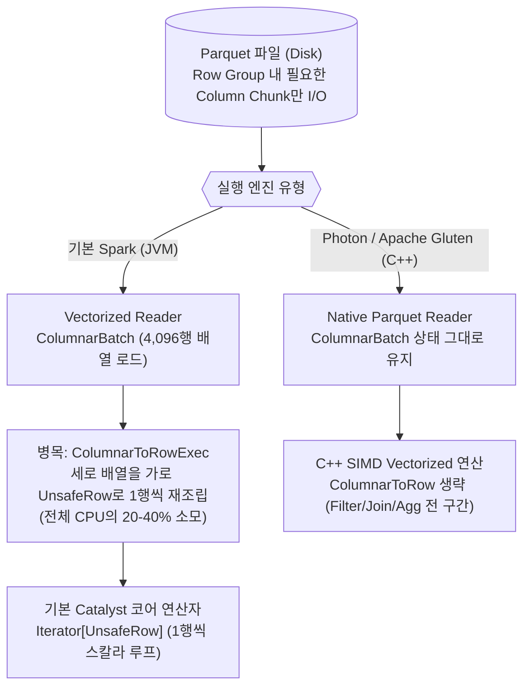
<p align="center"><em>Figure 6: Parquet 파일 스캔 이후 기본 Spark 엔진(ColumnarToRow)과 Native 엔진(Photon/Gluten)의 실행 분기</em></p>

- 기본 Spark의 `VectorizedParquetRecordReader`는 Parquet 파일의 `Column Chunk`를 읽을 때 메모리에 `ColumnarBatch`(4,096개 행의 컬럼 배열 묶음) 형태로 빠르게 퍼 올린다.
- 그러나 그 다음 단계인 기본 Catalyst 코어 연산자(`FilterExec`, `BroadcastHashJoinExec`, `HashAggregateExec` 등)는 입력과 출력이 행 단위 포맷인 `UnsafeRow`를 1건씩 주고받는 `Iterator[UnsafeRow]`로 설계되어 있다.
- 그 결과 리더가 세로 배열(`ColumnarBatch`)로 잘 읽어온 데이터를, 바로 뒷단의 `ColumnarToRowExec`가 개입해 가로 방향의 `UnsafeRow`로 1행씩 다시 조립(Transpose)한 뒤 루프로 밀어 넣는다. 이 변환 과정에만 전체 쿼리 CPU 시간의 20-40%가 소모되곤 하며, 앞서 설명한 `Photon`과 `Apache Gluten`은 바로 이 `ColumnarToRow` 단계를 없애고 C++ 컬럼 배열 상태로 끝까지 연산하기 위해 도입된 것이다.

---

### 3.2 디스크 저장 구조와 Data Skipping(Pruning) 메커니즘 비교

세 엔진이 디스크(또는 오브젝트 스토리지)에 데이터를 실제로 어떻게 저장하고, 조건절(`WHERE`) 조회 시 불필요한 디스크 블록을 어떻게 건너뛰는지(Data Skipping)를 비교하면 아래 그림과 같다.

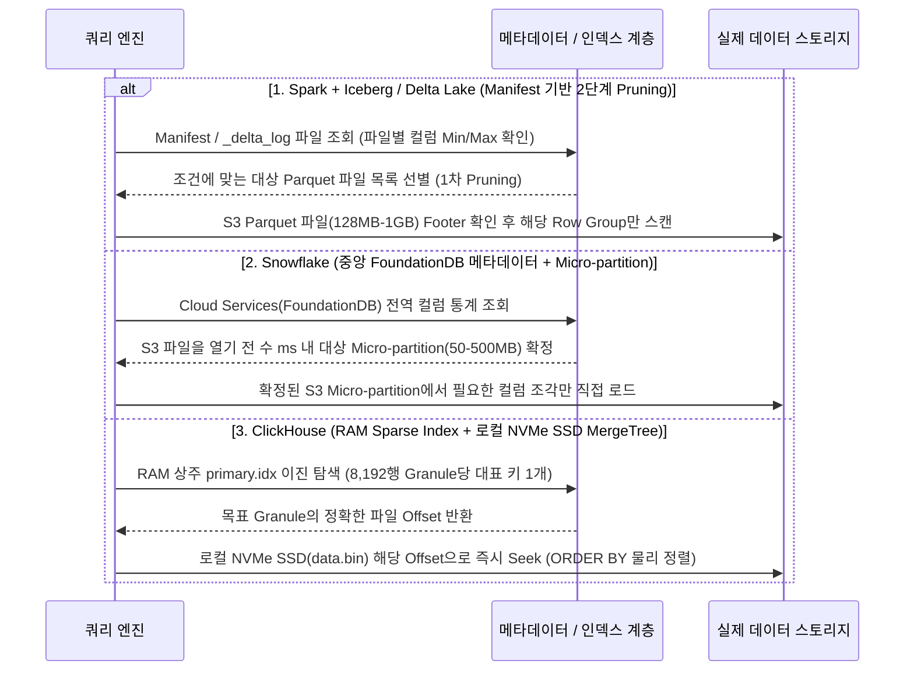
<p align="center"><em>Figure 7: Spark(Iceberg/Delta), Snowflake, ClickHouse의 메타데이터 조회 및 디스크 Data Skipping 시퀀스 비교</em></p>

1. Spark + Apache Iceberg / Delta Lake (Manifest 파일 기반 Pruning):
   - 저장 방식: S3 같은 오브젝트 스토리지에 128MB-1GB 크기의 Parquet 파일들을 저장하고, 별도의 메타데이터 파일(`Manifest File` 또는 `_delta_log`)에 각 Parquet 파일의 컬럼별 `Min/Max` 통계를 기록해 둔다.
   - 탐색 과정: 쿼리가 들어오면 먼저 Manifest 파일을 읽어 조건에 해당하지 않는 Parquet 파일들을 통째로 제외(1차 파일 Pruning)하고, 선택된 Parquet 파일 안에서도 하단 `Footer`를 읽어 조건에 맞는 `Row Group`과 `Column Chunk`만 디스크에서 읽어 들인다.
2. Snowflake (Cloud Services 전역 메타데이터 + Micro-partition):
   - 저장 방식: 데이터를 적재할 때 압축 전 기준 50-500MB 크기의 작은 불변 컬럼 파일인 `Micro-partition`으로 자동 분할해 S3에 저장한다. 이때 파일 내부에 통계를 두는 것이 아니라, 컴퓨팅 노드 바깥의 독립된 중앙 데이터베이스(`FoundationDB` 기반 Cloud Services 계층)에 모든 Micro-partition의 컬럼별 `Min/Max`, `Distinct Count`, `Null` 여부를 전부 추출해 저장해 둔다.
   - 탐색 과정: 워커 노드가 S3에 접근하기도 전에, 쿼리 컴파일 단계에서 중앙 메타데이터 DB만 조회하여 수만 개의 Micro-partition 중 실제로 읽어야 할 파일 목록을 수 밀리초(ms) 내에 확정한다.
3. ClickHouse (`MergeTree` 물리 정렬 스토리지 + RAM Sparse Primary Index):
   - 저장 방식: 느린 원격 오브젝트 스토리지 대신 워커 노드의 로컬 NVMe SSD에 데이터를 직접 저장한다. 테이블 생성 시 지정한 `ORDER BY` 키를 기준으로 실제 디스크상의 데이터를 물리적으로 완벽히 정렬해서 기록(`data.bin`)하며, 기본 8,192개 행 묶음(Granule)마다 첫 번째 행의 키 값 하나씩만 뽑아 만든 희소 인덱스(`primary.idx`, Sparse Index)를 생성한다.
   - 탐색 과정: 8,192행마다 대표 값 1개만 인덱스에 넣기 때문에 테이블이 수십억 건이어도 인덱스 크기는 수 메가바이트에 불과해 항상 RAM에 100% 상주한다. 조회 조건이 들어오면 RAM의 Sparse Index에서 이진 탐색(Binary Search)으로 목표 Granule의 디스크 위치(Offset)를 찾아낸 뒤, 로컬 SSD의 해당 위치로 즉시 점프(Seek)해 필요한 8,192행 블록만 읽어낸다.

---

### 3.3 장애 복구(Fault Tolerance)와 Shuffle 파일 체크포인트의 내부 원리

일반적인 조회 및 집계 쿼리에서는 Snowflake나 ClickHouse가 Spark보다 훨씬 빠른 응답 속도를 보여주지만, 수십 테라바이트 규모의 장시간 배치에서는 여전히 Spark가 표준으로 사용된다. 그 결정적인 이유는 Stage 간 데이터를 넘길 때 작동하는 Shuffle 파일 체크포인트(Shuffle File Checkpointing / Materialization) 메커니즘에 있다.

쉽게 비유하면, 게임에서 다음 스테이지(보스방)로 넘어가기 직전에 지금까지 진행한 상태를 로컬 디스크에 강제로 세이브(Save)해 두는 안전장치다.

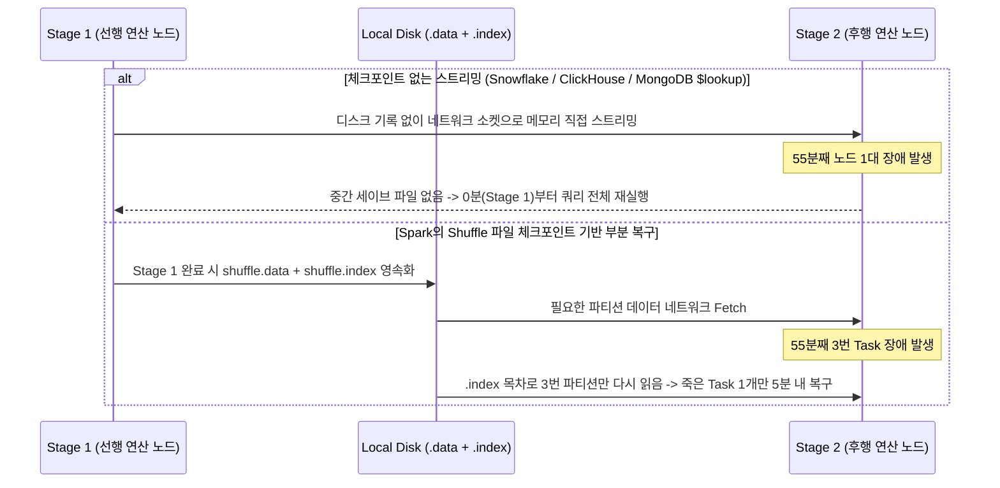
<p align="center"><em>Figure 8: 55분째 노드 장애 시 메모리 직송 엔진의 전체 재실행과 Spark Shuffle 체크포인트 기반 부분 복구 시퀀스 비교</em></p>

1. 물리적 동작 — Stage가 끝날 때 로컬 디스크에 무엇을 기록하는가?
   Spark에서 `Filter -> Map`까지는 다른 서버로 데이터를 보낼 필요가 없으므로 메모리에서 쭉 흘러간다. 그러다 `JOIN`이나 `GROUP BY`처럼 다른 서버의 데이터와 섞어야 하는 경계선(Shuffle)을 만나면, 앞 단계(`Stage 1`)의 모든 서버는 계산 결과를 다음 단계(`Stage 2`) 서버의 메모리로 바로 쏘지 않고 무조건 자기 로컬 디스크에 두 개의 파일로 내려쓴다.
   - `shuffle_0_0_0.data` (실제 데이터 파일): 다음 단계의 몇 번 서버(Task)로 갈지 목적지 번호(`Partition ID`)별로 분류된 실제 데이터(`UnsafeRow` 바이트 덩어리)들을 하나의 파일에 순서대로 이어서 기록한다.
   - `shuffle_0_0_0.index` (위치 목차 파일): 각 목적지 번호(`Partition ID`)의 데이터가 `.data` 파일의 몇 바이트 위치(Offset)부터 시작해서 어디서 끝나는지 적어둔 목차 파일이다(예: "0번 파티션은 0-1024바이트, 1번 파티션은 1024-4096바이트").

2. 장애 복구 비교 — 1시간짜리 배치의 55분째에 서버 1대가 죽었을 때:
   - 세이브 파일이 없는 경우 (Snowflake, ClickHouse, MongoDB `$lookup`):
     응답 속도를 높이기 위해 디스크에 중간 파일을 남기지 않고 네트워크 소켓으로 다음 노드의 메모리에 바로 쏘는 방식을 쓴다. 만약 100대의 서버가 3단계 조인을 55분간 수행하다가 마지막 단계에서 서버 1대가 죽으면, 그 서버가 받던 중간 데이터가 디스크 어디에도 남아있지 않다. 결국 죽은 서버의 데이터를 다시 만들려면 이미 끝난 앞 단계들까지 거슬러 올라가 100대 서버 전체가 0분부터 쿼리 전체를 다시 실행해야 한다.
   - 세이브 파일이 있는 경우 (Apache Spark):
     Spark에서는 55분째에 3번 서버가 죽더라도 앞선 단계들을 다시 계산하지 않는다. 직전 Stage가 끝날 때 모든 서버의 로컬 디스크에 `.data`와 `.index` 파일이 고스란히 세이브되어 있기 때문이다. Spark는 살아 있는 다른 서버 하나에게 "직전 Stage 디스크 파일들의 `.index` 목차를 보고 3번 파티션 위치만 다시 읽어서, 죽은 3번 Task 하나만 재실행해라"라고 지시한다. 나머지 99대의 서버가 한 일은 그대로 보존된 채 몇 분 만에 복구가 끝난다.

3. 메모리 한계 극복 (Out-of-Core 처리):
   서버 메모리가 64GB인데 조인해야 할 중간 데이터가 200GB로 불어나는 상황에서도 차이가 난다. 인메모리 처리에 의존하는 DB들은 이때 `OutOfMemory(OOM)` 에러를 뱉고 멈추지만, Spark는 200GB든 10TB든 로컬 디스크의 Shuffle 파일로 나누어 기록하고 디스크에 정렬된 파일을 조금씩 스트리밍으로 읽어 병합(`Sort-Merge Join`)하므로 메모리보다 훨씬 큰 데이터도 죽지 않고 처리한다.

---

## 4. Columnar Vectorized 실행 엔진과 하드웨어 SIMD 내부 원리

Snowflake와 ClickHouse, 그리고 Spark의 Photon/Gluten 엔진이 CPU 코어당 처리량에서 기존 JVM 엔진을 크게 앞서는 핵심 비결은 Columnar Vectorized Execution과 하드웨어 SIMD(Single Instruction, Multiple Data)의 결합에 있다. 이 아키텍처는 2005년 CIDR에 발표된 *MonetDB/X100: Hyper-Pipelining Query Execution* 논문에서 정립되었으며, 해당 연구를 주도한 Marcin Zukowski가 이후 Snowflake를 공동 창업하면서 현대 클라우드 MPP 엔진의 표준이 되었다.

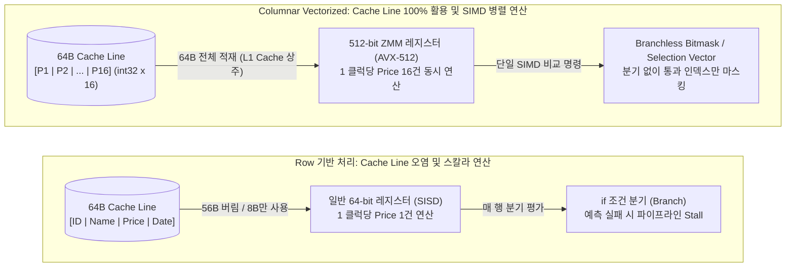
<p align="center"><em>Figure 9: Row 기반 스칼라 실행 모델과 Columnar Vectorized SIMD 실행 모델의 CPU 캐시 및 레지스터 활용 비교</em></p>

### 4.1 기존 Volcano(Tuple-at-a-time) 모델의 CPU 병목

전통적인 RDBMS와 초기 쿼리 엔진은 `Scan -> Filter -> Project -> Aggregate`로 이어지는 연산자 트리에서 상위 연산자가 하위 연산자의 `next()` 함수를 호출해 레코드를 1건씩 끌어올리는 Volcano Iterator 모델을 사용했다.
- 가상 함수 호출 Overhead: 1억 건의 행을 처리할 때 연산자 단계가 4단계라면 `next()` 가상 함수(Virtual Function Call)가 4억 번 호출된다.
- CPU 파이프라인 효율 저하: MonetDB/X100 논문이 TPC-H 쿼리 실행 시 CPU 사이클을 프로파일링한 결과, 실제 값을 더하거나 비교하는 순수 데이터 연산에는 전체 CPU 사이클의 10% 미만만 사용되었고, 나머지 90% 이상은 루프 제어, 함수 호출 스택 관리, 포인터 역참조, Instruction Cache Miss에 소모되었다.

### 4.2 64-Byte CPU Cache Line과 Memory Layout 효율

현대 CPU는 메인 메모리(RAM)에서 데이터를 읽을 때 필요한 4바이트나 8바이트만 가져오지 않고, 항상 64바이트 크기의 Cache Line 단위로 묶어서 L1/L2/L3 캐시로 가져온다.

- Row Layout의 Cache Pollution:
  한 행이 `order_id(8B)`, `item_name(32B)`, `price(8B)`, `order_date(16B)`로 구성된 64바이트 레코드라고 가정한다. `SELECT SUM(price) FROM sales` 쿼리를 수행할 때, Row 기반 메모리 구조에서는 `price` 8바이트 하나를 읽기 위해 나머지 56바이트의 불필요한 컬럼 데이터까지 L1 캐시로 함께 끌고 들어온다. 결국 메모리 대역폭과 CPU L1 캐시 공간의 87.5%(56/64)가 쓰이지도 않는 데이터로 채워지는 Cache Pollution이 발생한다.
- Columnar Layout의 100% 밀도:
  컬럼형 메모리 구조에서는 `price` 값만 메모리 주소상에 연속된 배열로 배치된다. CPU가 64바이트 Cache Line 하나를 읽으면 4바이트 정수(`int32`) 기준 16개의 `price` 값이 빈틈없이 L1 캐시에 적재되며, Hardware Prefetcher가 다음 배열 주소를 정확히 예측해 메모리 지연(Memory Stall)을 숨겨준다.

### 4.3 왜 전체 컬럼이 아니라 1,024-4,096개 단위의 Vector Batch인가?

컬럼형 처리라고 해서 수천만 건의 컬럼 배열 전체를 한 번에 끝까지 연산(`Column-at-a-time`)하면 또 다른 병목이 발생한다.
- 첫 번째 연산자가 1억 개짜리 컬럼 배열을 계산해 만든 중간 결과 배열(수백 MB)은 CPU L1/L2 캐시 용량(코어당 수십 KB에서 수백 KB)을 초과하여 다시 느린 메인 메모리(RAM)로 밀려나기(Spill to RAM) 때문이다.
- 따라서 Vectorized 실행 엔진은 `next()`를 호출할 때 1개의 행도 아니고 전체 컬럼도 아닌, CPU L1/L2 캐시 크기에 정확히 들어맞는 1,024-4,096개 원소 묶음(Vector Batch) 단위로 배열을 잘라서 전달한다.
- 이를 통해 `next()` 함수 호출 횟수를 기존의 1,000분의 1 이하로 줄이면서도, 연산 중간 결과가 RAM으로 내려가지 않고 CPU L1 캐시 내부에서만 순환하며 다음 연산자로 즉시 넘어가도록 보장한다.

### 4.4 하드웨어 SIMD 명령어와 Branchless 실행

메모리에 데이터가 1차원 연속 배열(Vector Batch)로 정렬되어 있으면, 컴파일러와 엔진은 CPU의 SIMD 레지스터와 Branchless(분기 제거) 기법을 사용할 수 있다.

#### (1) SISD(Scalar) 대 SIMD(Vector) 연산
일반 스칼라 연산(SISD)은 64비트 일반 레지스터에 값 1개를 넣고 1번의 CPU 명령어로 1쌍의 값만 더한다. 반면 최신 x86-64 CPU가 제공하는 `AVX-2`(256-bit `YMM` 레지스터)나 `AVX-512`(512-bit `ZMM` 레지스터)는 단 1개의 레지스터에 32비트 정수(`int32`) 16개를 동시에 적재한다.

```cpp
// 1. 일반 Scalar 루프 (1회 루프당 1개 원소 처리 + 조건 분기 발생)
for (int i = 0; i < 4096; ++i) {
    if (price[i] > 50000) { // 데이터 값에 따라 CPU 분기 예측 실패(Branch Misprediction) 발생
        total += price[i] * quantity[i];
    }
}

// 2. AVX-512 SIMD Vectorized 루프 개념 (1회 루프당 16개 원소를 분기 없이 동시 처리)
__m512i v_threshold = _mm512_set1_epi32(50000);
__m512i v_total = _mm512_setzero_si512();

for (int i = 0; i < 4096; i += 16) {
    __m512i v_price = _mm512_load_si512(&price[i]);       // 연속된 16개 price 일괄 로드 (64 Bytes)
    __m512i v_qty   = _mm512_load_si512(&quantity[i]);    // 연속된 16개 quantity 일괄 로드
    
    // if 분기문 없이 16개 원소를 동시 비교하여 16-bit Mask(예: 01011001...) 생성
    __mmask16 mask  = _mm512_cmpgt_epi32_mask(v_price, v_threshold);
    
    // 16개 원소 동시 곱셈 후, Mask가 1인 위치만 골라서 v_total에 누적 (Branchless)
    __m512i v_prod  = _mm512_mullo_epi32(v_price, v_qty);
    v_total         = _mm512_mask_add_epi32(v_total, mask, v_total, v_prod);
}
```

#### (2) Branchless Execution과 Selection Vector
CPU는 명령어 처리 속도를 높이기 위해 15-20단계의 파이프라인을 미리 채워 실행하며, `if` 조건문을 만나면 결과가 나오기 전에 어느 쪽으로 갈지 미리 추측하는 Branch Prediction(분기 예측)을 수행한다.
만약 `WHERE price > 50000` 조건의 참/거짓 비율이 50%에 가까워 무작위로 섞여 있다면, CPU의 분기 예측이 계속 빗나가면서 미리 실행해 둔 파이프라인을 전부 비우고 다시 시작하는 Branch Misprediction Penalty(1회당 15-20 클럭 손실)가 발생한다.

ClickHouse나 Snowflake의 Vectorized 엔진은 위 코드 예시처럼 `if` 문을 쓰지 않는다. 대신 SIMD 비교 명령어를 통해 조건을 만족하는 위치만 `1`로 표시한 Bitmask나 통과한 행의 인덱스 번호만 모아둔 Selection Vector(예: `[1, 3, 4, 7]`) 배열을 생성한다. 분기 자체가 사라지므로 CPU 파이프라인이 단 한 번도 멈추지 않고 최고 클럭 속도로 배열을 밀어낸다.

#### (3) 왜 기본 JVM 엔진보다 C++ Native 엔진(Photon, Gluten/Velox)이 훨씬 빠른가?
단순히 언어를 Java에서 C++로 바꾸었기 때문이 아니다. JVM이라는 가상 머신이 안전을 위해 강제하는 물리적 제약들을 C++ 네이티브 수준에서 걷어내고, 100% 순수 Off-Heap 메모리 위에서 하드웨어를 직접 통제하기 때문이다.

1. 앞단(Scan -> Filter -> Project)에서 `ColumnarToRow` 변환 완전 제거:
   쿼리에서 데이터가 가장 많은 구간은 파일을 막 읽어들인 직후다. 기본 JVM Spark는 Parquet에서 1억 건을 읽자마자 무조건 가로 행(`UnsafeRow`) 1억 개로 재조립한 뒤 `WHERE` 조건을 검사한다. 반면 Photon과 Velox는 세로 배열 상태 그대로 SIMD 필터링을 먼저 끝내버리고, 살아남은 소수의 데이터만 다음 단계로 넘긴다.
2. JVM의 안전장치(Bounds Check, SafePoint) 제거와 SIMD 강제 실행:
   JVM JIT Compiler(C2)도 단순 루프를 SIMD로 바꿔주는 Auto-Vectorization 기능이 있다. 하지만 JVM은 메모리 침범을 막기 위해 루프마다 배열 인덱스 경계 검사(Array Bounds Check)와 GC를 위한 SafePoint 폴링 코드를 강제로 끼워 넣는다. 여기에 `NULL` 체크 분기까지 섞이면 JIT 컴파일러는 패턴 인식을 포기하고 1번에 1개씩만 계산하는 일반 스칼라 명령어로 컴파일한다. 반면 C++ 엔진은 `_mm512_add_epi32` 같은 CPU 하드웨어 SIMD 명령어(Intrinsics)를 코드에서 직접 호출하여 항상 1클럭에 16개씩 강제로 묶어서 처리한다.
3. 런타임 코드 생성(Whole-Stage CodeGen) 및 JIT 워밍업 지연 제거:
   기본 Spark는 쿼리가 들어올 때마다 수천 줄의 Java 소스 코드를 즉석에서 문자열로 조립해 컴파일(Janino)하고, 생성된 함수가 너무 길어지면(JVM의 64KB 바이트코드 제한 초과) 최적화가 아예 풀려버린다. 반면 Photon과 Velox는 이미 C++ 컴파일러(`-O3`)로 최고 수준으로 번역해 둔 벡터 연산 함수(Pre-compiled Vectorized Kernels)들을 조합해 워밍업 없이 첫 블록부터 최고 속도로 실행한다.
4. 100% 순수 Off-Heap(Native Memory) 사용과 Zero-Copy, 64-Byte 메모리 정렬:
   - 진정한 100% Off-Heap 동작: 기본 Spark는 `Tungsten`을 써도 연산을 돌리는 주체가 JVM이라 실행 도중 수많은 제어용 객체가 On-Heap에 생성된다(심지어 기본 설정인 `offHeap.enabled=false`에서는 `UnsafeRow`조차 On-Heap의 `byte[]` 배열 안에 만들어진다). 반면 Photon과 Gluten(Velox)은 파일 읽기부터 컬럼 배열, 조인 해시 테이블, Shuffle 버퍼까지 전 과정을 C++ 전용 메모리 풀(Arena Allocator)을 통해 100% OS Native Memory(Off-Heap)에서만 만들고 바로 해제한다. JVM GC가 스캔할 객체 자체가 아예 생기지 않는다.
   - Zero-Copy 연동: Spark(JVM)가 작업을 지시하고 Velox(C++)가 연산할 때도 데이터를 복사해서 주고받지 않는다. Off-Heap에 표준화된 컬럼 메모리 규격(Apache Arrow 포맷)으로 올려두고 메모리 시작 주소(포인터 숫자 하나)만 넘겨주므로 복사 비용이 0(Zero-Copy)이다.
   - 64-Byte Alignment 고정과 CPU Prefetch 제어: JVM On-Heap에서는 GC가 청소 도중 객체 위치를 마음대로 옮겨버리므로(Compaction) 메모리 주소가 64바이트 단위로 맞아떨어지지 않는다. 반면 C++ Off-Heap은 GC가 건드리지 못하므로 처음부터 메모리 주소를 CPU 캐시 라인 크기인 64바이트 배수(`alignas(64)`)에 칼같이 고정해 SIMD 속도를 극대화한다. 나아가 해시 테이블을 뒤질 때도 CPU에게 "10번째 뒤에 처리할 메모리 주소를 지금 미리 RAM에서 L1 캐시로 퍼 올려놔라"라는 하드웨어 프리페치 명령어(`__builtin_prefetch`)를 직접 내려 CPU 대기 시간(Memory Stall)을 지워버린다.

---

### 4.5 반대로 인메모리에서 컬럼 단위(Columnar)로만 처리할 때의 비효율과 하이브리드 전환

그렇다면 인메모리에서도 무조건 컬럼 단위(Columnar)로 처리하는 것이 만능일까? 그렇지 않다. 만약 Columnar가 모든 상황에서 완벽했다면 모든 엔진이 Row 포맷을 완전히 폐기했을 것이다.

메모리에서 데이터를 세로 배열(Columnar)로 들고 있을 때는 "한 행(Row)에 속한 여러 컬럼을 동시에 묶어서 다뤄야 하는 순간"에 오히려 심각한 비효율이 발생한다.

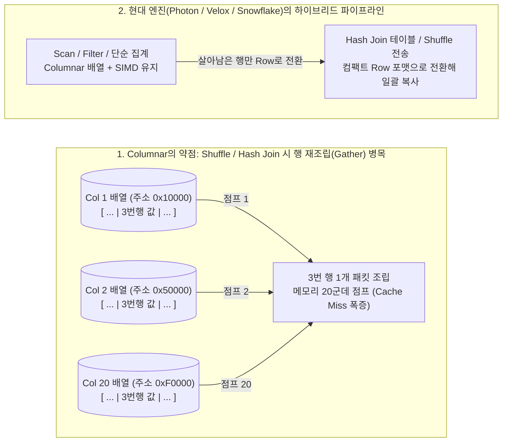
<p align="center"><em>Figure 10: 인메모리 Columnar 구조에서 행 재조립(Gather) 시 발생하는 Cache Miss 병목과 현대 엔진의 하이브리드 전환 구조</em></p>

1. Shuffle, Hash Join, Sort 구간에서 발생하는 행 재조립(Gather) 병목:
   - 단순 필터링(`WHERE price > 50000`)이나 단일 컬럼 합계(`SUM(price)`)는 `price` 배열 하나만 쭉 훑으면 되므로 Columnar가 압도적으로 빠르다.
   - 하지만 네트워크 Shuffle이나 Hash Join 단계로 넘어가면 상황이 정반대가 된다. 네트워크로 데이터를 보낼 때는 "1번 서버로는 3번 행, 2번 서버로는 4번 행"처럼 행(Row) 단위로 묶어서 보내야 한다.
   - 만약 20개 컬럼을 가진 테이블이 메모리에 20개의 세로 배열로 흩어져 있다면, 조건에 통과한 `3번 행` 하나를 패킷으로 묶기 위해 서로 멀리 떨어진 20개의 컬럼 배열 주소(`0x10000`, `0x50000`, ..., `0xF0000`)를 일일이 찾아다니며 값을 하나씩 뽑아와야(Gather / Tuple Reconstruction) 한다.
   - 컬럼 개수가 많은 테이블(Wide Table)일수록 이 과정에서 메모리 20군데를 랜덤하게 찔러대느라 CPU L1/L2 Cache Miss가 폭증한다. 반면 Spark의 `UnsafeRow`는 한 행의 20개 컬럼이 이미 한 덩어리로 붙어 있으므로 그 메모리 블록 하나만 통째로 복사(`memcpy`)하면 끝난다.
2. 필터링 이후 배열 중간에 생기는 구멍(희소성)과 가변 길이 데이터 관리 비용:
   - 1,000개의 배열 원소 중 `WHERE` 조건을 통과한 데이터가 딱 2개뿐이라면, Row 방식은 통과한 2개의 행만 넘기면 끝난다. 반면 Columnar 방식은 20개 컬럼 배열 전체에 대해 살아남은 인덱스 번호표(`Selection Vector`)를 계속 들고 다니거나, 살아남은 원소만 모아서 새 배열로 다시 복사(Compaction)해야 한다.
   - 또한 길이가 들쭉날쭉한 문자열(`String`)이나 중첩 구조(`Array`, `Map`, `JSON`)를 Columnar로 다룰 때는 `[Null 비트맵 배열] + [글자 시작 위치 Offset 배열] + [실제 글자 바이트 배열]`이라는 3중 배열 구조를 컬럼마다 유지하고 싱크를 맞춰야 하므로 메모리 관리가 훨씬 복잡하다.
3. 결론 — 현대 엔진들의 해법(하이브리드 실행 파이프라인):
   결국 인메모리에서도 Row 방식과 Columnar 방식은 각자 잘하는 구간이 명확히 다르다.
   - Scan / Filter (`WHERE`) / 단일 컬럼 집계 (`SUM`, `AVG`): Columnar 압승 (캐시 밀도 100% + SIMD)
   - Hash Join / 다중 키 Group By / Sort / Shuffle 전송: Row (`UnsafeRow`) 유리 (한 덩어리 복사 및 비교)
   이 때문에 최신 아키텍처인 Snowflake, Databricks `Photon`, `Apache Gluten(Velox)`은 무조건 하나만 고집하지 않는다. 데이터가 가장 많은 앞단(Scan, Filter, 단순 집계)에서는 Columnar Vectorized(SIMD)로 빠르게 데이터 건수를 줄인 뒤, 조인 해시 테이블을 만들거나 네트워크 Shuffle을 수행하는 구간에서는 내부적으로 다시 컴팩트한 Row 포맷으로 전환해 처리하는 하이브리드 방식을 채택하고 있다.

---

## 5. 확장 비교: 실시간 문서형 DB(MongoDB)는 어떻게 다르고 어떤 특장점이 있는가?

지금까지 살펴본 Spark, Snowflake, ClickHouse가 "수억 건의 데이터를 한꺼번에 훑어서 통계를 내는 분석 엔진(OLAP/Batch)"이라면, 현업에서 자주 함께 거론되는 MongoDB는 정반대 영역인 "실시간 서비스 트랜잭션 처리용 문서형 데이터베이스(Document OLTP)"다.

앞서 다룬 메모리 배치, 조인, 재조립(Gather) 관점으로 MongoDB를 대조해 보면 왜 이 기술들이 서로를 대체하지 않고 함께 쓰이는지 명확해진다.

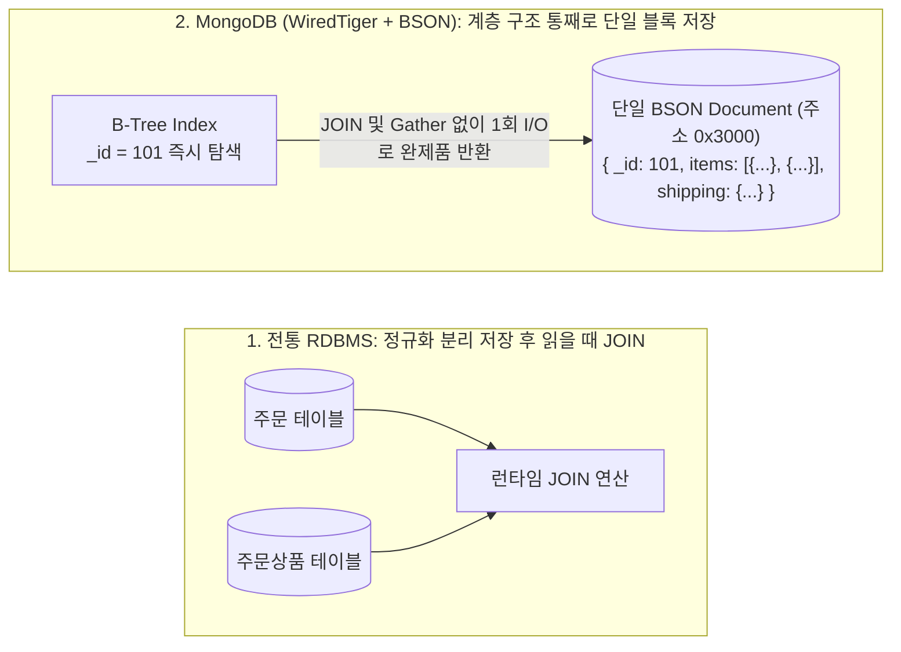
<p align="center"><em>Figure 11: RDBMS의 정규화 및 런타임 JOIN 구조와 MongoDB의 BSON 문서 단위 Pre-Joined 저장 구조 비교</em></p>

### 5.1 저장 및 메모리 구조: Columnar도 일반 Row도 아닌 `BSON` 문서 덩어리

하나의 주문 데이터(주문 기본 정보 + 주문한 상품 3개 + 배송지 정보)를 다룰 때 각 엔진의 물리적 저장 방식은 완전히 다르다.
- 전통 RDBMS(Oracle, MySQL): `주문 테이블`, `주문상품 테이블(3줄)`, `배송지 테이블`로 쪼개어 따로 저장하고 읽을 때 `JOIN`한다.
- Columnar 분석 엔진(Parquet, ClickHouse, Snowflake): 모든 필드를 세로 컬럼 배열로 분해해서 저장한다. 전체 매출 합계(`SUM`)는 초고속이지만, 특정 주문 1건의 전체 정보를 다시 모으려면(Gather) 메모리 수십 군데를 점프해야 한다.
- MongoDB(`WiredTiger` 엔진 + `BSON` 포맷): JSON 텍스트를 그대로 쓰지 않고, 내부적으로 `BSON(Binary JSON)`이라는 이진 포맷으로 변환해 저장한다. 앞서 본 Spark의 `UnsafeRow`처럼 `BSON` 역시 각 필드 앞에 데이터 타입과 바이트 길이(Length Prefix)를 숫자로 적어두어, 원하는 필드를 찾을 때 문자열 파싱 없이 바이트 길이만큼 포인터를 건너뛰며 빠르게 읽는다. 무엇보다 주문 1건에 딸린 상품 배열과 배송지 객체를 쪼개지 않고 디스크와 메모리의 연속된 한 덩어리에 통째로 붙여 둔다.

### 5.2 조인과 재조립 병목을 피하는 MongoDB의 해법과 3대 특장점

MongoDB의 핵심 설계 철학은 "읽을 때 비싼 JOIN이나 배열 재조립(Gather)을 하지 말고, 애초에 디스크에 쓸 때 화면(API)에서 함께 보여줄 데이터들을 하나의 문서(Document) 안에 중첩 배열과 객체로 미리 합쳐서(Pre-Joined / Embedding) 저장하자"는 것이다.

1. 무조인(Zero-Join) 단건 조회(Point Lookup) 및 쓰기 속도:
   애플리케이션 코드(Java, Node.js, Python)에서 다루는 객체(Object/List/Map) 모양과 디스크에 저장되는 `BSON` 문서 모양이 1:1로 일치한다. 상품 상세 페이지를 띄울 때 RDBMS처럼 4-5개 테이블을 조인할 필요 없이, `product_id`를 B-Tree 인덱스로 딱 한 번 찌르면 단 1번의 메모리/디스크 접근만으로 옵션 배열과 브랜드 정보가 완제품 형태로 반환된다(1-5ms 이내 응답).
2. 유연한 스키마(Dynamic Schema)와 중첩 배열 인덱싱(Multikey Index):
   이커머스 상품처럼 화장품(`피부타입/용량`), 의류(`소재/세탁법`), 가전(`소비전력`)마다 속성(컬럼)이 수백 개씩 다른 도메인을 RDBMS나 Parquet, ClickHouse에 넣으려면 수백 개의 `NULL` 컬럼을 만들거나 스키마 변경 작업을 반복해야 한다. 반면 MongoDB는 문서마다 서로 다른 필드를 자유롭게 가질 수 있으면서도, 문서 내부의 중첩 배열 원소(`items.name`)에 바로 B-Tree 인덱스(Multikey Index)를 걸어 고속 검색을 수행한다.
3. 엔진에 내장된 수평 확장성(Auto-Sharding):
   단일 서버 디스크 한계를 넘어설 때 애플리케이션이 직접 분산을 구현해야 하는 일반 RDBMS와 달리, MongoDB는 `Shard Key` 기준으로 여러 대의 서버에 데이터를 자동 분산하고 라우팅(`mongos`)하는 구조가 엔진 코어에 내장되어 있다.

### 5.3 반대로 대용량 통계 분석(Spark, ClickHouse 영역)에서 MongoDB가 느린 이유

그렇다면 왜 MongoDB 하나로 모든 통계 분석까지 다 처리하지 않고 Spark나 Snowflake, ClickHouse를 따로 두는 것일까? 앞서 살펴본 디스크 I/O와 CPU Cache Line, Shuffle 체크포인트 원리를 대입하면 그 한계가 바로 드러난다.

1. Column Projection 불가로 인한 디스크 I/O 낭비:
   MongoDB의 `WiredTiger` 스토리지 엔진은 문서(`BSON`) 전체를 하나의 단위로 묶어 디스크 페이지에 저장한다. 만약 1억 건의 주문 문서에서 4바이트짜리 `배송비` 숫자 하나만 평균 내고 싶어도, 필요한 컬럼만 골라 읽는 Column Projection이 불가능하여 주문자 이름, 상품 배열, 주소 텍스트가 다 들어있는 수 킬로바이트짜리 무거운 `BSON` 문서 1억 개 전체를 디스크에서 다 읽어들여야 한다.
2. CPU Cache Line 오염과 하드웨어 SIMD 불가:
   메모리(WiredTiger Cache)에 올라온 뒤에도 64바이트 CPU Cache Line 안에 온갖 텍스트 필드가 섞여 들어오며(Cache Pollution), 문서마다 필드 위치가 달라 ClickHouse처럼 특정 숫자만 배열로 모아 CPU SIMD로 16개씩 동시 계산하는 것이 물리적으로 불가능하다.
3. Shuffle 파일 체크포인트 부재로 인한 대규모 분산 조인(`$lookup`)의 한계:
   MongoDB에도 조인 연산자(`$lookup`)가 존재하지만, 이는 소량의 문서를 결합할 때 쓰는 용도다. 앞서 `3.3절`에서 살펴본 Spark의 Shuffle 파일 체크포인트(`.data`/`.index` 디스크 세이브)나 외부 정렬 병합(External Sort-Merge) 체계가 없기 때문에, 수억 건짜리 두 컬렉션을 조인하면 메모리 제한에 걸려 작업이 중단된다.

---

## 6. 요약 및 전체 데이터 파이프라인 역할 분담

지금까지 살펴본 모든 엔진의 내부 메커니즘과 실무 아키텍처상의 역할을 한눈에 비교하면 다음과 같다.

| 구분 | MongoDB (Document OLTP) | Apache Spark (분산 배치/ETL) | Snowflake (클라우드 MPP DW) | ClickHouse (실시간 OLAP) |
| :--- | :--- | :--- | :--- | :--- |
| 기본 데이터 단위 | 계층형 문서 (`BSON` 통째 저장) | 행 단위 이진 포맷 (`UnsafeRow`) | 불변 컬럼 파일 (`Micro-partition`) | 물리 정렬 컬럼 블록 (`MergeTree`) |
| 인메모리 연산 방식 | B-Tree 탐색 및 문서 단위 조작 | Row 루프 (Photon/Gluten 시 SIMD) | C++ Columnar Vectorized (SIMD) | C++ Columnar Vectorized (SIMD) |
| 조인 및 Shuffle | 소량 `$lookup` (대규모 Shuffle 불가) | 로컬 디스크 `.data/.index` 체크포인트 | 인메모리 스트리밍 (부족 시 S3 Spill) | 인메모리 해시 조인 (대규모 시 OOM 위험) |
| 가장 빠른 작업 | 특정 ID 1건의 복합 객체 즉시 조회/수정 | 수십 TB 비정형 정제 및 다단계 대규모 조인 | 복잡한 다중 테이블 조인 및 전사 BI 분석 | 단일/소수 넓은 테이블 초고속 실시간 집계 |
| 가장 취약한 작업 | 전체 문서를 다 읽어야 하는 컬럼 통계 | 0.1초 내 응답해야 하는 짧은 단건 조회 | 비정형 코드 제어 및 초단기 포인트 조회 | 무거운 다중 테이블 조인 및 빈번한 단건 수정 |

결국 각 엔진의 메모리 레이아웃과 디스크 저장 구조가 곧 그 엔진이 가장 잘하는 역할을 결정한다. 현대 데이터 플랫폼이 하나의 만능 DB만 쓰지 않고 아래와 같이 파이프라인을 구성하는 이유가 바로 여기에 있다.

1. 실시간 서비스 계층 (`MongoDB` / `RDBMS`):
   고객이 앱에서 상품을 조회하고 장바구니에 담아 주문하는 실시간 트랜잭션은 무조인 단건 조회(`BSON`)와 스키마 유연성이 뛰어난 MongoDB나 RDBMS가 1-5ms 내에 처리한다.
2. 스토리지 및 테이블 포맷 계층 (`Parquet` + `Apache Iceberg` / `Delta Lake`):
   운영 DB에서 발생한 데이터 변경 내역(CDC)을 추출해 S3의 컬럼형 파일(Parquet)로 쌓고, 그 위에 파일별 통계 목차(Manifest)와 트랜잭션 기능을 제공하는 Iceberg나 Delta Lake 계층을 얹는다.
3. 대규모 정제 및 배치 조인 계층 (`Apache Spark` + `Photon` / `Gluten`):
   수십 테라바이트의 원본 로그와 여러 도메인 테이블을 묶는 무거운 다단계 조인·집계·머신러닝 전처리는, 로컬 디스크 Shuffle 파일 체크포인트(`.data`/`.index`)를 통해 노드 장애나 메모리 한계에도 끝까지 배치를 완주해 내는 Spark가 담당한다.
4. 고속 분석 및 서빙 계층 (`Snowflake` / `ClickHouse`):
   Spark가 정제해 둔 마트 테이블을 바탕으로, 복잡한 다중 테이블 전사 BI 분석은 Snowflake가, 대고객 실시간 통계 대시보드와 로그 집계는 C++ SIMD와 로컬 SSD Sparse Index를 극대화한 ClickHouse가 서브초(Sub-second) 단위로 응답한다.
