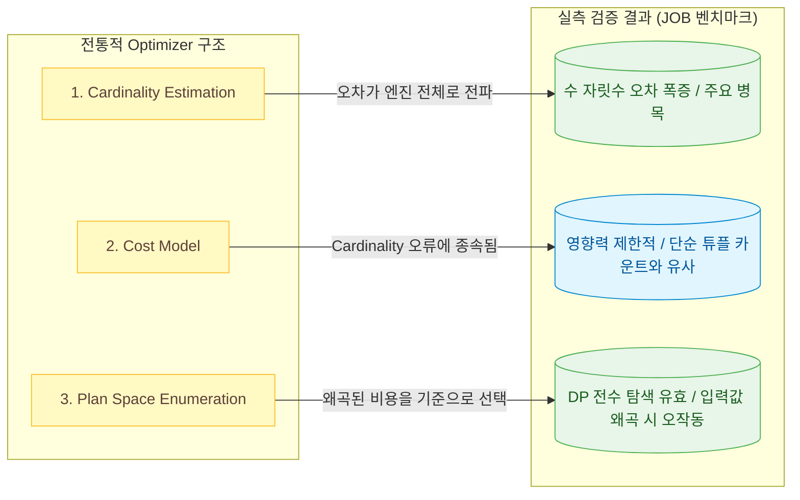
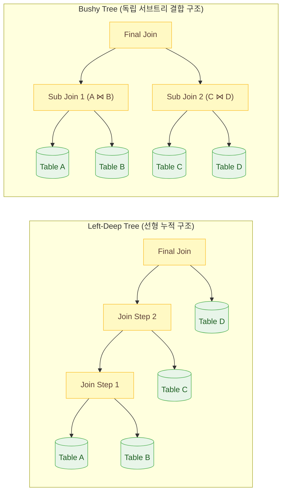
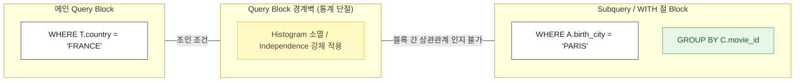

현업에서 복잡한 SQL을 튜닝하다 보면 실행 계획이 비효율적으로 수립되는 현상을 자주 마주한다. 관계형 데이터베이스의 Query Optimizer는 가능한 실행 경로를 모두 수치화하여 최적의 경로를 선택하도록 설계되었으나, 실제 운영 환경에서는 기대와 다르게 동작하는 경우가 많다.

2015년 VLDB에 발표된 Viktor Leis et al.의 연구(*How Good Are Query Optimizers, Really?*)와 2025년 10주년 회고 논문은 관계형 데이터베이스 Optimizer의 핵심 컴포넌트를 분리하여 실측한 결과를 다룬다. 본 글에서는 두 편의 논문에서 확인된 Optimizer의 구조적 한계와 Plan Space의 트리 형상(Left-Deep Tree 대 Bushy Tree)을 정리하고, 이러한 한계가 두드러지게 나타나는 Subquery와 WITH 절(CTE)의 물리적 동작 원리를 살펴본다.


---

## 1. 2편의 VLDB 논문 정리: Optimizer 실측 결과


<p align="center"><em>Figure 1: 전통적인 Optimizer 구성 요소와 실측 검증 결과</em></p>

### 1.1 기존 Benchmark의 문제점과 Join Order Benchmark(JOB)
연구진은 TPC-H, TPC-DS 같은 기존 표준 Benchmark가 실행 엔진의 연산 처리량을 평가하는 데는 적합하지만, Optimizer의 경로 탐색을 검증하는 데는 한계가 있다고 분석했다.
- 기존 Benchmark의 데이터 생성기는 데이터 스케일링을 위해 Uniformity와 Independence를 기본 전제로 채택한다.
- Optimizer 역시 동일한 가정을 바탕으로 모델링하므로, 기존 Benchmark 환경에서는 Optimizer의 추정 결함이 수치상 드러나지 않는 편이다.
- 연구진은 컬럼 간 Correlation과 Skew가 존재하는 실세계 데이터셋인 IMDB를 기반으로 113개 쿼리로 구성된 Join Order Benchmark(JOB)를 설계하여 실제 동작을 검증했다.

### 1.2 논문의 3대 핵심 실측 결과

#### (1) Cardinality Estimation의 지수적 오차
Cardinality Estimation은 전체 최적화 과정에서 가장 큰 오차를 발생시키는 구간이다.
- 단일 테이블의 단일 조건은 샘플링을 적용하면 Q-error 중앙값이 1.0 수준으로 비교적 정확하다.
- 그러나 검색 조건(WHERE 절 술어)이 여러 개로 늘어나거나 조인이 3~5개를 넘어가면 추정치와 실제 행 수 간에 1,000배에서 1억 배에 달하는 오차가 일상적으로 발생했다.
- 특히 다중 조건 및 다중 조인 환경에서는 Independence 가정을 반복 적용하여 결과 행 수를 실제보다 훨씬 작게 계산하는 **체계적인 Underestimation 경향**이 지배적이었다.

**[검색 조건 누적 시 과소평가 발생 메커니즘과 수치 예시]**

복수의 조건이 `AND`로 연결될 때, 옵티마이저는 각 조건의 Selectivity를 단순 곱연산한다.
`예상 행 수 = 전체 행 수 * Selectivity(조건 1) * Selectivity(조건 2) * Selectivity(조건 3) * Selectivity(조건 4)`

1,000만 행이 저장된 차량 테이블에서 4개의 검색 조건이 들어온 상황을 가정한다.
- `제조사 = '현대'` (Selectivity: 0.1 -> 100만 행)
- `차종 = '아반떼'` (Selectivity: 0.05 -> 50만 행)
- `연료 = '가솔린'` (Selectivity: 0.6 -> 600만 행)
- `연식 = 2024` (Selectivity: 0.1 -> 100만 행)

1. **실제 데이터 수치**:
   - 아반떼는 모두 현대 자동차이므로 두 조건 간에는 완전한 상관관계(Correlation)가 존재한다.
   - 아반떼 모델 중 가솔린 비중 역시 일반 차량 평균보다 훨씬 높다.
   - 4개 조건을 모두 충족하는 실제 행 수는 약 **40,000행**이다.
2. **옵티마이저의 계산**:
   - 옵티마이저는 4개 조건이 서로 완전히 독립적이라고 가정하고 확률을 단순 곱연산한다.
   - `10,000,000 * 0.1 * 0.05 * 0.6 * 0.1 = 300행`
3. **결과 및 실행 계획 왜곡**:
   - 실제 40,000행인 결과를 단 300행으로 계산하여 **130배 이상의 Underestimation**이 발생한다.
   - 만약 여기에 조건이 1~2개 더 추가되면 추정치는 1행 수준으로 떨어지며 오차율은 수천 배 이상으로 폭증한다.
   - 옵티마이저는 300행이라는 숫자를 신뢰하고 인덱스 스캔 후 다음 테이블과 Nested-Loop Join을 체결하지만, 실제 40,000번의 루프가 돌면서 Random I/O 급증과 응답 지연이 발생한다.

**[Hash Join 환경에서의 Rehash 및 메모리 할당 이슈]**
설령 옵티마이저가 Nested-Loop Join을 피해 Hash Join을 선택하더라도 과소평가 문제에서 자유롭지 못하다.
- Hash Join은 Build Input의 카디널리티 추정치를 기준으로 메모리 내 해시 테이블의 버킷(Bucket) 수를 사전 할당한다.
- 실제 행 수가 추정치보다 훨씬 많으면, 할당된 해시 버킷 수가 턱없이 부족하여 동일 버킷에 수많은 데이터가 매달리는 극단적인 Hash Collision Chain이 발생한다.
- 런타임에 해시 테이블 크기를 동적으로 늘리는 Rehashing 과정을 거치면서 과도한 메모리 재할당 오버헤드가 발생하거나, `work_mem` 한도를 초과하여 중간 데이터를 디스크로 내려쓰는 Spill to Disk가 발생해 I/O 병목으로 이어진다.
- 2015년 논문에서도 PostgreSQL 9.4에서 카디널리티 과소평가로 발생한 해시 테이블 병목을 해결하기 위해, 런타임에 실제 저장된 행 수에 맞춰 동적으로 해시 테이블을 리사이징하는 패치(Rehashing)를 적용한 뒤에야 성능이 안정화되었음을 실측으로 입증했다.

#### (2) Cost Model의 부차적 영향
주요 DBMS는 디스크 랜덤 I/O, 순차 I/O, CPU 연산 가중치 등을 계산하는 수천 줄의 복잡한 비용 공식을 가지고 있다.
- 연구진은 복잡한 기본 모델 대신 연산자를 통과하는 튜플 수만 세는 단순 비용 함수를 비교군으로 설정했다.
- 실측 결과, 정교한 비용 모델과 단순 비용 모델이 선택한 최종 플랜 간의 성능 차이는 크지 않았다. 비용 모델이 잘못된 플랜을 선택하는 근본 원인은 비용 공식 자체의 결함이라기보다 입력값으로 전달된 Cardinality Estimation 수치가 왜곡되었기 때문이다.

#### (3) Plan Space 탐색과 트리 형상: Left-Deep Tree 대 Bushy Tree
조인 탐색 공간(Plan Space)을 전수 탐색하는 방식은 휴리스틱 알고리즘보다 우수한 플랜을 도출한다.
그러나 Cardinality Estimation 수치가 크게 틀리면, 전수 탐색을 수행하더라도 잘못된 플랜을 최적으로 판단한다. 실제 행 수가 수만 건임에도 1행으로 과소평가하여 O(n^2) 복잡도의 비인덱스 Nested-Loop Join을 선택하고 실행 시간이 늘어나는 현상이 모든 엔진에서 관찰되었다.

논문에서 언급되는 "Cross Product를 제외하고 Bushy Tree를 포함한 Plan Space를 Dynamic Programming으로 탐색한다"는 물리적 메커니즘과 트리 구조의 특성은 다음과 같다.


<p align="center"><em>Figure 2: Left-Deep Tree와 Bushy Tree의 데이터 파이프라인 구조 비교</em></p>

* **상향식 Dynamic Programming (DP-Size) 단계**:
  - `Cross Product 제외`: 조인 조건으로 직접 연결되지 않은 테이블 쌍은 중간 단계 탐색 후보에서 배제하여 불필요한 조합을 줄인다.
  - Size 1(단일 테이블 접근) -> Size 2(연결된 2개 테이블 최적 조인) -> Size 3(부분결과 결합) -> Size 4 순서로 확장된다.
  - Size 4에서 `(Size 1 + Size 3)`의 선형 결합뿐만 아니라, **`(Size 2 + Size 2)`처럼 서브 조인 결과를 서로 결합하는 Bushy Tree 대안**까지 함께 계산하여 최종 최저 비용 플랜을 확정한다.
* **실제 Optimizer의 트리 채택 현황**:
  - 전통적 DBMS(Oracle 등)는 탐색 공간 크기 제어와 메모리 파이프라이닝의 단순성을 위해 단일 쿼리 블록 내에서 **Left-Deep Tree 중심**으로 탐색을 제한했다. 테이블 수가 늘어날 때 Bushy Tree를 허용하면 계산해야 할 경우의 수가 급격히 늘어나기 때문이다(다만 Oracle에서도 서브쿼리 언네스팅, 스타 변환, `LEADING` 힌트 적용 시 Bushy 구조가 생성된다).
  - 현대 오픈소스(PostgreSQL) 및 분산 쿼리 엔진(Trino, Spark)은 병렬 처리를 위해 Bushy Tree를 기본 탐색 공간에 포함하여 활용한다.
* **Bushy Tree 전환 시의 물리적 이점**:
  1. **중간 데이터 크기 축소**: `(A ⋈ B)`와 `(C ⋈ D)` 양 갈래에서 먼저 데이터를 거른 후 작은 결과셋끼리 결합하므로 상위 연산자로 유입되는 행 수가 크게 줄어든다.
  2. **독립 서브트리의 동시 병렬 실행 (Parallel Execution)**: 좌우 독립된 서브트리를 서로 다른 CPU 코어나 분산 노드에서 동시에 처리할 수 있다.
  3. **Hash Join 메모리(Build Input) 절약**: 사전에 축소된 결과셋을 해시 테이블로 올릴 수 있어 디스크 쓰기(Spill to Disk) 빈도를 낮춘다.
* **트레이드오프**: 탐색 공간이 넓어져 파싱 시간이 길어질 수 있으며, 우측 서브트리의 결과를 임시 메모리 공간에 구체화(Materialization)해야 하는 비용이 수반된다.

---

### 1.3 2025년 회고: Machine Learning Optimizer의 한계와 추세
2015년 이후 딥러닝과 강화학습을 활용한 Learned Optimizer 연구가 다수 진행되었다. 그러나 2025년 회고 논문에서는 학습 기반 모델이 상용 DBMS 프로덕션에 폭넓게 안착하지 못했다고 설명한다.
- 모델 훈련 및 추론 비용이 높고, 데이터 변경 시 재학습 부담이 크며, 내부 동작을 예측하기 어려운 점이 한계로 작용했다.
- 특히 전체 쿼리 평균이 개선되더라도 특정 쿼리의 응답 시간이 급증하는 Performance Regression이 발생하면 시스템 배포가 어렵다.
- 이에 따라 현대 DBMS는 정적 컴파일 단계의 추정에만 의존하지 않고, 런타임에 실제 행 수를 측정하여 조인 방식을 동적으로 변경하는 Adaptive Execution 기법을 확대하는 추세다.


---

## 2. Optimizer의 추정 한계가 두드러지는 영역: Subquery와 WITH 절

일반적인 단일 블록 조인에 비해 Subquery와 WITH 절(CTE)이 포함된 SQL은 Query Block 경계가 생기므로 Optimizer의 오판 빈도가 높아진다.


<p align="center"><em>Figure 3: Query Block 경계벽에 의한 통계 및 상관관계 단절 구조</em></p>

### 2.1 Subquery 처리 방식: Filter와 가상 View
Subquery는 Query Transformation 과정을 거쳐 처리된다.
- **Filter 연산**: Unnesting이 적용되지 않으면 메인 테이블의 행 수만큼 Subquery를 반복 실행한다. 내부적으로 Filter Cache를 활용하지만 메인 테이블의 고유 키가 많아지면 캐시 적중률이 낮아져 실행 횟수가 급증한다.
- **가상 View 생성**: Subquery를 조인으로 변환할 때 View Merging이 불가능하면 시스템 내부적으로 `VW_NSO_1` 같은 가상 View를 생성하여 조인한다. 이 가상 View의 파생 컬럼에는 수집된 Histogram 통계가 없기 때문에 단순 균등 분포 수식에 의존하여 비용을 계산한다.

### 2.2 WITH 절(CTE) 처리 방식: Materialize와 Inline
WITH 절은 엔진에 따라 Materialize 또는 Inline 방식으로 처리된다.

```sql
WITH SUB_DATA AS (
    SELECT deptno, SUM(sal) AS total_sal
    FROM emp
    GROUP BY deptno
)
SELECT *
FROM dept d
JOIN SUB_DATA s ON d.deptno = s.deptno
WHERE d.loc = 'SEOUL';
```

1. **Materialize**:
   - WITH 절의 결과를 임시 테이블 공간에 물리적으로 기록한 뒤 메인 쿼리와 조인한다.
   - 메인 쿼리에서 필요한 데이터가 소수라 하더라도 WITH 절 내부 데이터를 전체 집계해야 하므로 I/O가 증가하며, 임시 테이블에는 인덱스가 없으므로 Full Table Scan이 수반된다.
2. **Inline**:
   - WITH 절을 메인 쿼리 내부의 인라인 서브쿼리로 풀어 넣는다.
   - 동일한 WITH 절을 쿼리 내에서 여러 번 참조할 경우 동일한 연산이 중복 실행되어 CPU 소모가 늘어난다.

Optimizer는 WITH 절의 처리 비용을 정확히 예측하기 어렵기 때문에 데이터 규모에 맞지 않는 Materialize 또는 Inline 방식을 선택하는 사례가 발생한다.

### 2.3 Query Block 경계와 Join-Crossing Correlation
Optimizer는 부모 Query Block과 자식 Query Block을 분리하여 비용을 평가한다.
- 서로 다른 쿼리 블록에 위치한 컬럼 간에 강한 상관관계(Join-Crossing Correlation)가 존재할 경우, 블록 경계로 인해 통계가 연계되지 않는다.
- 예를 들어 메인 쿼리에 프랑스 제작 영화 조건이 있고 서브쿼리 뷰에 파리 출생 배우 조건이 있을 때, 실제 데이터는 높은 확률로 일치하지만 Optimizer는 두 조건을 독립 사건으로 간주하여 결합 선택도를 0에 가깝게 곱연산한다.
- 그 결과 최종 카디널리티를 1건으로 계산하여 대용량 처리에 적합한 Hash Join 대신 Nested-Loop Join을 선택하는 오류가 발생한다.

### 2.4 JPPD(Join Predicate Push Down)의 제약과 주의점
뷰 전체를 먼저 집계하는 부하를 줄이기 위해 메인 쿼리의 조인 조건을 뷰 내부 WHERE 절로 전달하는 기법이 JPPD다.
- **의미론적 제약에 의한 차단**: 뷰 내부에 ROWNUM, Top-N 구문, 특정 Window Function, CONNECT BY, UNION 등이 포함되면 집합의 결과가 달라지므로 JPPD가 차단된다.
- **잘못된 JPPD 선택의 문제**: 메인 테이블의 실제 행 수가 많은데 Cardinality가 과소평가되어 JPPD가 적용되면, 서브쿼리 뷰가 Nested-Loop 방식으로 수십만 번 반복 호출되어 응답 시간이 늘어난다.

---

## 3. 엔지니어링 관점의 정리

두 편의 논문과 내부 메커니즘이 제시하는 내용은 다음과 같다.  
Query Optimizer는 단순화된 통계 모델과 독립성 가정에 기반하여 작동하는 계산 엔진이다.

특히 Subquery와 WITH 절처럼 Query Block 경계가 생기는 구간에서는 Cardinality 계산 오차가 커질 확률이 높다. 따라서 다음과 같은 접근이 권장된다.

1. **실행 계획의 오퍼레이션 분석**:
   - 실행 계획에 `FILTER`가 나타나면 반복 호출 횟수를 점검하고, `VIEW`가 나타나면 중간 결과 카디널리티 추정치와 실제 처리 건수(A-Rows vs E-Rows)를 비교한다.
2. **WITH 절의 명시적 제어**:
   - 데이터 건수가 작고 메인 조건으로 축소 가능하다면 `/*+ INLINE */`을 적용하고, 결과 건수가 크고 다중 참조된다면 `/*+ MATERIALIZE */`를 지정하여 엔진의 불필요한 연산을 제한한다.
3. **블록 간 상관관계 해소**:
   - 서로 다른 블록의 조건 간에 강한 상관관계가 존재한다면 `/*+ MERGE */` 힌트를 적용하거나 일반 조인 형태로 쿼리를 리팩토링하여 단일 블록 내에서 조인 순서가 결정되도록 유도한다.
4. **힌트(Hint)의 보조적 활용**:
   - 데이터 도메인 지식과 실제 모수를 파악하고 있는 엔지니어가 힌트(`PUSH_PRED`, `NO_PUSH_PRED`, `LEADING`)를 통해 Optimizer의 계산 오차를 보정하는 것은 안정적인 시스템 운영을 위해 유효한 방법이다.
