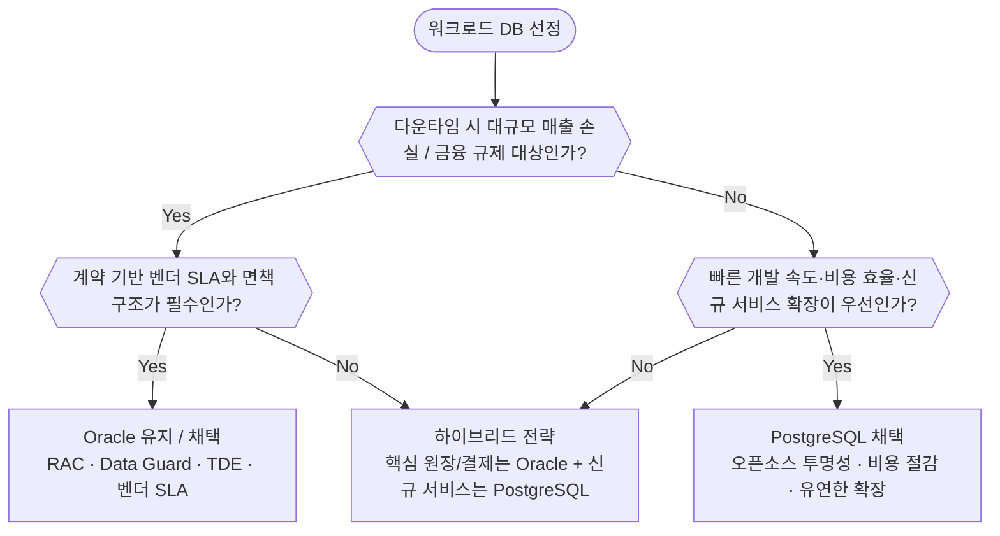
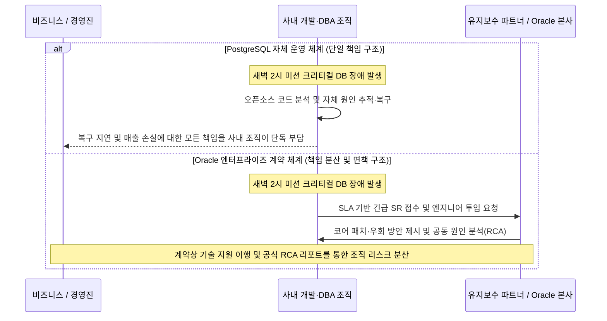

최근 Jaydeep Shamdasani의 Medium 아티클("Why Enterprises Still Choose Oracle Over PostgreSQL in 2026")을 읽었다. 오픈소스이면서 기능과 생태계 모두 양호한 PostgreSQL이 있음에도 왜 은행,통신사,글로벌 대기업은 여전히 수백만 달러를 지불하며 Oracle을 유지하는가에 대한 글이었다.

개발자에서 Oracle DBA로 직무를 전환해 현업에서 데이터베이스 내부를 파고들며 느꼈던 생각과 그리고 PostgreSQL 스터디를 진행하며 품었던 의문들과 맞닿아 있는 지점이 많았다. 원문의 핵심 논지를 정리하고 개발조직 차원에서 느낀 개인적인 생각을 덧붙여 보았다.

---

## 1. 아티클 요약: 대기업이 Oracle을 선택하는 8가지 이유

원문은 대기업이 DB를 선택할 때 단순한 라이선스 비용 절감보다 안정성, 규제 준수, 장기적 리스크 최소화를 최우선 기준으로 둔다고 짚는다. 구체적인 8가지 이유는 다시 크게 세 가지 축으로 요약할 수 있다.

### 1.1 책임 소재와 다운타임 리스크 관리
1. 엔터프라이즈 지원과 명확한 책임 소재:
   24시간 기술 지원, SLA, 전담 매니저 체계를 통해 새벽 2시에 치명적인 장애가 발생해도 Oracle이 계약상 해결 의무를 진다. 반면 PostgreSQL은 커뮤니티 기반이므로 단일 책임 주체가 부재하며, 미션 크리티컬 시스템에서는 이 책임 소재가 라이선스 비용보다 무겁게 작용한다.
2. 비용보다 큰 다운타임 리스크:
   금융이나 대규모 커머스 시스템이 1시간 멈추면 라이선스 비용을 훌쩍 넘는 매출 손실이 발생한다. 따라서 대기업은 Oracle 비용을 단순 IT 지출이 아니라 비즈니스 연속성을 위한 보험료로 간주한다.
3. 벤더 신뢰도와 예측 가능한 로드맵:
   보수적인 경영진은 수십 년간 검증된 벤더와 장기 로드맵을 선호한다. PostgreSQL은 개발자 친화적이지만, 전통적인 엔터프라이즈 의사결정 구조에서는 여전히 Oracle의 신뢰도가 높게 평가된다.

### 1.2 검증된 코어 아키텍처, 고가용성(HA), 보안
4. 초대규모 환경에서 검증된 성능:
   수십 년간 은행 원장, 통신 과금, 공공 시스템의 극한 워크로드를 처리하며 고급 Query Optimizer, Partitioning, Parallel Execution 기능이 다듬어졌다. PostgreSQL도 강력하지만 수동 튜닝과 내부 운영 인력의 역량에 따른 성능 편차가 큰 편이다.
5. 성숙한 고가용성(HA)과 재해 복구(DR):
   RAC(Real Application Clusters), Data Guard, 자동 Failover 등 단일 벤더 차원에서 긴밀하게 통합된 솔루션을 기본 제공하여 다운타임을 최소화한다.
6. 고급 보안 및 규제 준수:
   TDE(Transparent Data Encryption), 세밀한 접근 제어, 내장 감사 기능을 기본 제공해 GDPR, HIPAA, 금융권 규제 요건을 충족하기 수월하다. PostgreSQL은 서드파티 도구나 추가 구성에 의존하는 경우가 많다.

### 1.3 레거시 Lock-in과 통합 운영 도구
7. 레거시 시스템과 마이그레이션 비용:
   10-20년 이상 Oracle 기반으로 구축된 핵심 시스템을 PostgreSQL로 이전하려면 애플리케이션 재작성, 전수 회귀 테스트, 전환 과정의 다운타임 리스크를 모두 감당해야 한다. 이 마이그레이션 총비용이 수년 치 Oracle 라이선스 비용을 초과하는 사례가 흔하다.
8. 통합된 엔터프라이즈 운영 도구:
   Enterprise Manager, AWR/ASH, SQL Developer 등 진단과 모니터링 도구가 엔진과 하나로 묶여 있는 반면, PostgreSQL 생태계는 여러 오픈소스 도구를 직접 조합해 운영해야 하는 파편화가 존재한다.

<em>Figure 1: 워크로드 특성과 리스크 수준에 따른 엔터프라이즈 DB 선택 의사결정 트리</em>

---

## 2. 개발자에서 Oracle DBA로 전환하며 마주한 Closed Source의 벽

직접 개발자에서 Oracle DBA로 직무를 전환하면서 가장 크게 얻은 수확은 시야의 확장이다. 애플리케이션 개발자 레벨에서는 블랙박스로만 여겼던 데이터베이스 내부의 메모리 구조, Buffer Cache 경합, Optimizer의 실행 계획 수립 원리를 파고들 수 있었고, 이를 바탕으로 훨씬 심도 깊은 튜닝과 아키텍처 개선을 주도할 수 있었다.

하지만 현업에서 문제를 추적할 때마다 따라붙는 답답함이 하나 있었다. 내부 동작을 정확히 이해하는 데 드는 시간이 지나치게 길다는 점이다.

Java나 Kotlin으로 개발할 때는 의문이 생기면 곧바로 JVM Heap 덤프를 분석하거나 JDK 원시 라이브러리 소스 코드를 열어보며 동작을 100% 검증할 수 있었다. 반면 Oracle은 철저한 Closed Source다. 내부 함수나 대기 이벤트의 정확한 분기 조건을 코드 레벨에서 직접 확인할 수 없으니, 공식 문서와 트레이스 로그, 선배 DBA들이 쌓아둔 실험 결과를 조각조각 맞추며 역추론하는 수밖에 없었다.

반면 PostgreSQL을 스터디할 때는 경험 자체가 완전히 달랐다. 모든 소스 코드가 GitHub에 투명하게 공개되어 있고, 전 세계 엔지니어들이 코어 내부 동작을 소스 라인 단위로 해부해 둔 고품질 자료가 넘쳐났다. 코드를 직접 확인하며 구조를 이해하다 보니, "이 정도 투명성과 자료라면 운영 환경에서 어떤 장애가 나더라도 충분히 자체적으로 원인을 찾고 해결할 수 있겠다"는 자신감이 생기기도 했다.

---

## 3. 그럼에도 놓칠 수 없는 본질: 면책과 종점 장애의 경제학

기술적 투명성과 자신감만으로 PostgreSQL 전환을 주장하기 전에, 엔지니어링 조직 수준에서 반드시 짚고 넘어가야 할 현실적인 변수가 있다. 바로 면책(Accountability)이다.

대규모 트래픽과 거래액이 오가는 대기업 환경에서 핵심 데이터베이스가 수십 분 이상 지연되거나 멈추면, 그로 인한 매출 손실과 대외 신뢰 하락은 개발 조직이나 DBA 팀 혼자서 감당할 수 있는 수준을 넘어선다. 그렇기 때문에 대기업은 단순히 소프트웨어만 사서 쓰는 것이 아니라, 중간 유지보수 업체와 Oracle 본사까지 이어지는 다층 계약을 맺고 장애 대응 책임을 제도적으로 분산한다.

<em>Figure 2: 새벽 장애 발생 시 자체 오픈소스 운영 체계와 벤더 SLA 계약 체계의 책임 및 대응 흐름 비교</em>

여기서 자연스럽게 한 가지 반문이 든다. "Oracle 라이선스와 유지보수 계약에 쓸 막대한 비용으로, 차라리 뛰어난 PostgreSQL 코어 전문가를 여러 명 채용해 사내 전문성을 높이면 되지 않을까?"

나 역시 이 방향을 진지하게 고민해 봤다. 하지만 두 가지 현실적인 벽을 따져보면 계산이 달라진다.

1. 인건비 대 계약비의 총소유비용(TCO):
   엔진 코어 레벨의 버그나 극한 동시성 장애를 새벽에 단독으로 해결할 수 있는 최상위 DB 전문가를 확보하고, 24시간 365일 교대 대응이 가능하도록 팀 규모를 유지하는 데 드는 고정 인건비와 채용·이탈 리스크는 결코 작지 않다. 이 비용이 과연 중간 계약비와 면책 보험 성격의 라이선스 비용보다 확실히 저렴한지 따져보면 쉽게 장담하기 어렵다.
2. 종점(Endpoint) 장애의 저빈도·고충격 특성:
   데이터베이스는 시스템 아키텍처의 가장 끝단에 위치한 종점이다. 데이터베이스 코어 장애는 매일 발생하는 일상적인 이벤트가 아니다. 평시에는 아무 문제 없이 조용히 돌아가지만, 단 한 번 치명적인 장애가 터지면 서비스 전체가 멈추는 저빈도·고충격(Low-frequency, High-impact) 특성을 가진다. 평소에는 일이 없다가 몇 년에 한 번 터질지 모를 치명적 장애를 막기 위해 최상위 코어 인력을 상시 대규모로 유지하는 것은 기업 입장에서 비효율적인 자원 배분이 되기 쉽다.

---

## 4. 정리하며

결국 기술자의 시각과 조직의 시각 사이에는 분명한 관점의 차이가 존재한다.

엔지니어 개인의 학습과 트러블슈팅 효율만 놓고 보면, 모든 소스 코드가 열려 있는 PostgreSQL이 훨씬 매력적이고 투명하다. 하지만 수천억 원 단위의 거래를 떠받치는 조직의 리스크 관리 관점에서 보면, 장애 시의 면책 구조와 검증된 고가용성 솔루션을 일괄 제공하는 Oracle이 여전히 기업용 데이터베이스의 선두 주자 자리를 지킬 수밖에 없는 구조적 이유가 명확하다.

원문이 결론으로 제시한 하이브리드 전략이 현업에서 가장 현실적인 답안으로 자리 잡는 이유도 여기에 있다. 멈추면 안 되는 핵심 원장과 결제 시스템은 Oracle로 안정성과 책임 구조를 유지하고, 빠른 변화와 비용 효율이 중요한 신규 마이크로서비스와 분석·보조 워크로드에는 PostgreSQL을 적극 도입하는 방식이 현재로서는 가장 균형 잡힌 아키텍처 선택이다.
