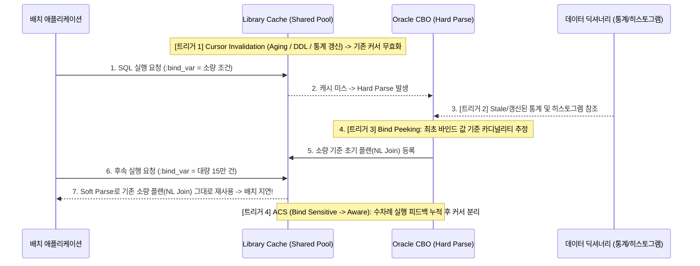
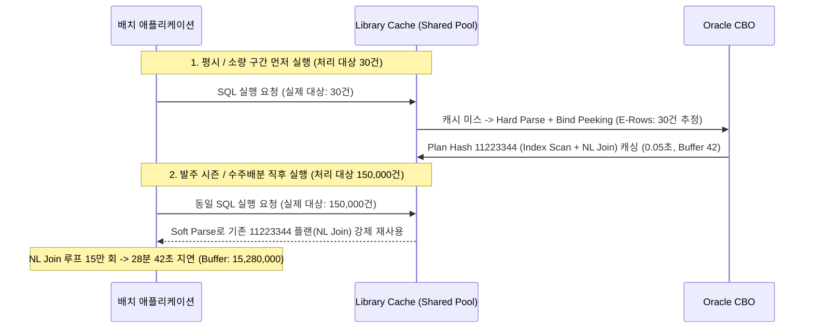
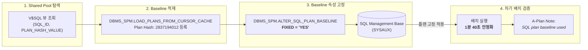
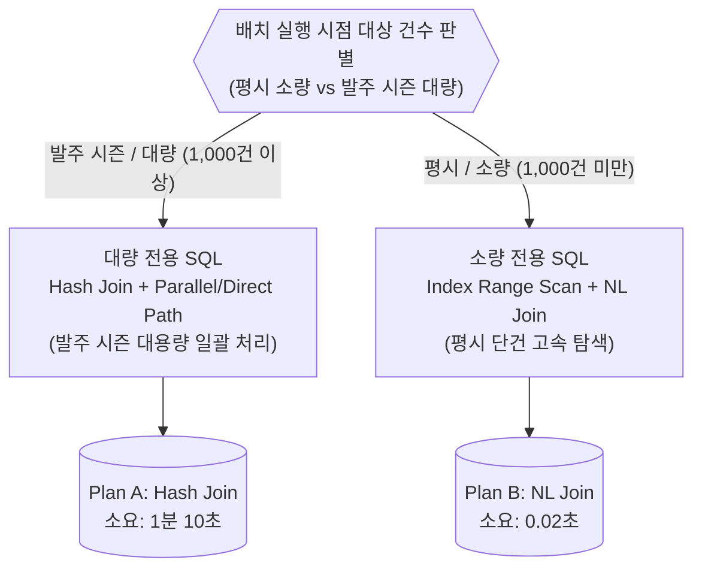
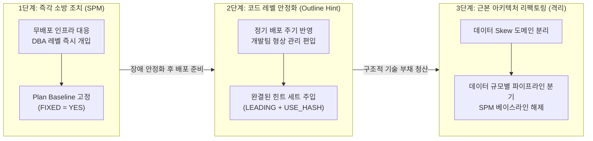

# 30분 주기 센터재고이동 배치의 실행 계획 왜곡 해결: Bind Peeking에서 SPM 긴급 처방, 그리고 쿼리 리팩토링까지

내가 다니는 회사에서는 물류 센터 간에 재고에 대한 수급 불균형을 해소하기 위해 30분 주기로 '센터재고이동 배치'가 회차별로 수행된다.
또한, 매장 발주의 균등한 분배를 수행하는 '수주배분 배치'가 매일 17시에 수행된다.

평소 1~2분 내외로 원활히 종료되던 이 배치가 수주배분 배치 이후에 갑작스럽게 28분 이상 지연되며 다음 회차 배치와 겹치고 데이터가 밀리는 운영 장애가 발생했다.

```
[ 센터재고이동 30분 주기 배치 모니터링 경보 ]
- 평시 수행 시간 : 1분 15초 ~ 1분 40초 (Buffer Gets: 약 8,500)
- 장애 회차 시간 : 28분 42초 (Buffer Gets: 15,280,000 초과, 지연 알람 발생)
```

원인은 소스 코드 변경이나 데이터베이스 설정 수정이 아닌, 데이터 분포도 편차(Skew) 환경에서 발생한 **Bind Peeking 기반 Execution Plan 왜곡**이었다.

이번 글에서는 Oracle CBO 환경에서 Execution Plan이 뒤집히는 물리적 메커니즘을 분석하고 긴급 소스 수정 배포 없이 SPM(SQL Plan Management)으로 1분 40초 만에 정상 복구한 긴급 대응 절차에 대해 소개한다. 또한, Outline Data를 통한 힌트 제어하는 방법과 그리고 데이터 분포도의 편차에 흔들리지 않도록 근본적인 쿼리 수정 방법과 배치 파이프라인 리팩토링 과정을 공유한다.

---

## 1. CBO 환경에서 Execution Plan이 변경되는 4가지 요인 (20%)

비용 기반 옵티마이저(CBO, Cost-Based Optimizer)는 SQL이 요청한 데이터를 추출하기 위해 디스크 I/O와 CPU 비용을 종합 계산하여 가장 적은 비용이 소요되는 실행 경로를 선택한다.  
동일한 텍스트의 SQL이라 하더라도 `시스템 런타임 환경`과 `데이터 통계 변화`에 따라 Execution Plan이 완전히 다른 형태로 뒤집힐 수 있다.


<p align="center"><em>Figure 1: Oracle CBO 환경에서 Execution Plan 변경 및 배치 지연을 유발하는 4대 트리거 시퀀스</em></p>

### 1.1. Bind Peeking의 양날의 검
바인드 변수를 사용하는 SQL은 하드 파싱(Hard Parse) 부하를 줄이고 Shared Pool의 Library Cache를 재사용(Soft Parse)할 수 있게 해준다.  
그러나 옵티마이저가 쿼리를 처음 파싱할 때 넘겨받은 바인드 변수 값을 확인하고(Bind Peeking), 그 값에 맞추어 카디널리티(Cardinality)를 추정한 뒤 Execution Plan을 확정 짓는다.

- 만약 첫 번째 파싱 시점에 **매우 소량인 조건(예: 반환 행 10건)**의 값이 입력되면, 옵티마이저는 `Index Range Scan`과 `Nested Loop Join`이 최적이라고 판단한다.
- 이 플랜이 Library Cache에 등록되면, 이후 **대량 데이터(예: 반환 행 15만 건)**를 요구하는 바인드 값이 들어와도 기존에 캐싱된 플랜을 그대로 재사용(Soft Parse)하게 된다.

### 1.2. Adaptive Cursor Sharing (ACS)의 작동 방식과 한계
Oracle 11g부터 도입된 ACS는 바인드 변수 값에 따라 데이터 편차가 심할 때 서로 다른 자식 커서(Child Cursor) 플랜을 동적으로 생성하여 대응하도록 설계되었다.
1. **Bind Sensitive Cursor**: 컬럼에 히스토그램이 존재하고 바인드 변수 값에 따라 실행 비용 차이가 클 것으로 예상되면 커서를 `Bind Sensitive` 상태로 등록한다.
2. **Bind Aware Cursor**: 동일 커서를 여러 번 수행하면서 특정 바인드 값에 대해 버퍼 I/O나 처리 건수의 편차가 사전 정의된 임계치를 초과하면 커서를 `Bind Aware` 상태로 격리한다.

그러나 실무 배치 환경에서 ACS는 즉각적인 해결책이 되지 못한다.  
커서가 `Bind Aware`로 전환되기까지 수차례의 비효율적인 실행과 모니터링 피드백이 누적되어야 한다.  
30분에 한 번 단일 쿼리로 수십만 건을 한 번에 읽어내는 대형 배치 작업에서는 첫 번째 잘못된 실행으로 30분 내내 시스템이 마비되기 때문에 ACS가 새로운 플랜을 학습하여 자식 커서를 분리할 기회를 얻기 힘든 업무 특성이 있다

### 1.3. Object Statistics 갱신과 Stale 상태
야간이나 특정 주기마다 수행되는 자동 통계 수집(`DBMS_STATS.GATHER_DATABASE_STATS_JOB_PROC`)이나 개발팀의 수동 통계 수집은 플랜 변동의 주요 원인이다.  
- 테이블의 데이터가 10% 이상 변경되어 통계가 `STALE` 상태가 되면 CBO의 카디널리티 계산식이 달라진다.
- 특히 히스토그램(Frequency, Top-Frequency, Hybrid)이 새로 생성되거나 제거될 때 버킷 판정 기준이 뒤바뀌며 플랜이 변경된다.
- `NO_INVALIDATE => FALSE` 옵션으로 통계를 수집하거나 롤링 무효화(Rolling Invalidation, `_optimizer_invalidation_period`) 주기가 도래하는 순간 Shared Pool의 기존 커서가 일제히 무효화된다.

### 1.4. Shared Pool 메모리 에이징 및 Cursor Invalidation
DDL 작업(테이블이나 인덱스의 컬럼 변경, 인덱스 리빌드 등)이 발생하면 해당 객체를 참조하던 모든 커서는 `INVALIDATION`상태가 된다.  
또한 다른 대규모 작업으로 인해 Shared Pool의 공간이 부족해지면 오랫동안 사용되지 않은 커서가 LRU 알고리즘에 의해 메모리에서 완전히 밀려나는 Aging Out 현상이 발생한다.  
이후 해당 SQL이 다시 유입되면 필연적으로 Hard Parse가 일어나며 이때 어떤 바인드 값이 인입되느냐에 따라 새로운 플랜이 결정된다.

---

## 2. 데이터 분포도 편차에 따른 실제 플랜 왜곡 실측 (20%)

30분마다 동작하는 센터재고이동 배치는 전국의 물류 거점 센터 코드를 파라미터(`:center_cd`)로 받아 해당 센터의 실시간 재고와 재고 이동 데이터를 결합하여 처리한다.

### 2.1. 비즈니스 도메인의 데이터 편차(Skew)
발주 시즌 때, 이전 배치 수행 후의 데이터 처리량의 격차가 극심하게 발생한다.

```
[ 발주 시즌 센터당 평균 재고 이동 발생량의 편차 ]
- 평시 수행 : 30분당 약 30건 발생
- 이전 배치 수행 후 : 30분당 약 150,000건 발생 
```

### 2.2. 플랜 왜곡 발생 메커니즘
장애가 발생한 날 Shared Pool에서 해당 SQL의 커서가 Aging Out된 상태였다.  
이 시점에 평시 데이터(30건) 구간에서 배치가 먼저 실행되면서 소량 조건으로 하드 파싱이 수행되었고, 이어진 발주 시즌(수주배분 배치 직후 15만 건) 구간에서도 동일한 플랜을 그대로 재사용하게 되었다.


<p align="center"><em>Figure 2: Bind Peeking에 의해 평시 소량 전용 플랜이 발주 시즌 대용량 처리에 오염 적용되는 시퀀스</em></p>

1. **평시 소량 구간 Hard Parse**:
   - 옵티마이저가 Bind Peeking으로 평시 조건을 확인하고 반환 행 수를 30건으로 계산했다.
   - 30건에 대해서는 테이블 전체를 읽는 것보다 `tb_center_inventory`의 인덱스를 경유해 건건이 `tb_inventory_move_order`를 `Nested Loop Join`하는 경로가 가장 저렴했다.
   - Plan Hash Value `11223344`가 생성되어 Shared Pool에 캐싱되었다.
2. **발주 시즌(수주배분 배치 직후) Soft Parse 및 왜곡 실행**:
   - 곧이어 발주 시즌 대규모 이동 지시 150,000건을 처리해야 하는 배치가 동일한 SQL을 호출했다.
   - 새로운 Hard Parse를 하지 않고 Shared Pool에 캐싱된 Plan Hash `11223344`(`Nested Loop Join`)를 그대로 가져왔다.
   - 드라이빙 테이블에서 읽은 150,000건에 대해 조인 대상 테이블을 15만 번 반복 탐색하며 `db file sequential read` Single Block I/O가 쉼 없이 발생했다.

### 2.3. 실제 A-Plan 실측 데이터 대조
실제 운영 환경에서 `DBMS_XPLAN.DISPLAY_CURSOR`를 통해 확인한 왜곡 플랜의 실행 통계는 다음과 같았다.

```sql
--------------------------------------------------------------------------------------------------------------------------------------
| Id  | Operation                     | Name                    | Starts | E-Rows | A-Rows |   A-Time   | Buffers | Reads  | Waits    |
--------------------------------------------------------------------------------------------------------------------------------------
|   0 | SELECT STATEMENT              |                         |      1 |        |    150K|00:28:42.11 |     15M|  1420K |          |
|   1 |  NESTED LOOPS                 |                         |      1 |     30 |    150K|00:28:42.08 |     15M|  1420K |          |
|   2 |   NESTED LOOPS                |                         |      1 |     30 |    150K|00:00:12.45 |    302K|  28000 |          |
|*  3 |    TABLE ACCESS BY INDEX ROWID| TB_CENTER_INVENTORY     |      1 |     30 |    150K|00:00:08.12 |    152K|  12000 | db file..|
|*  4 |     INDEX RANGE SCAN          | IX_CENTER_INV_01        |      1 |     30 |    150K|00:00:00.64 |    1200|    310 |          |
|*  5 |    INDEX RANGE SCAN           | IX_INV_MOVE_ORDER_01    |   150K |      1 |    150K|00:08:14.22 |    150K|  14000 |          |
|*  6 |   TABLE ACCESS BY INDEX ROWID | TB_INVENTORY_MOVE_ORDER |   150K |      1 |    150K|00:20:15.51 |     14M|  1370K | db file..|
--------------------------------------------------------------------------------------------------------------------------------------
Predicate Information (identified by operation id):
---------------------------------------------------
   3 - filter("I"."ALLOCATED_QTY" IS NOT NULL)
   4 - access("I"."CENTER_CD"=:CENTER_CD)
   5 - access("I"."ITEM_CD"="M"."ITEM_CD" AND "M"."ORDER_DATE"=TRUNC(SYSDATE@!))
   6 - filter(("M"."MOVE_STATUS"='READY' AND "M"."SRC_CENTER_CD"=:CENTER_CD))
```

- **예측과 실제의 차이점**: 옵티마이저가 예상한 카디널리티 `E-Rows`는 30건이었으나, 실제 출력된 `A-Rows`는 150,000건에 달했다.
- **Starts 폭증**: Id 5와 Id 6의 `Starts`가 150,000회로 치솟았다.
- **I/O 병목**: Single Block I/O에 해당하는 `db file sequential read` 대기 이벤트가 142만 번 이상 호출되면서 28분 42초 동안 Buffer Gets 15,000,000 블록을 소비했다.

---

## 3. SPM(SQL Plan Management)으로 긴급 대처 (30%)

배치 소요 시간이 28분을 초과하여 다음 30분 주기 배치와 겹치기 직전이었다.  
야간 운영 시간대에는 애플리케이션 소스 코드를 수정하고 검증하여 무중단 빌드/배포 파이프라인을 통과시키기까지 최소 수 시간이 소요된다.  
DB 인스턴스 단에서 즉시 실행 계획을 정상 플랜으로 강제 고정하는 긴급 조치가 필요했다.

### 3.1. SQL Profile vs SQL Plan Baseline (SPM) 선택 기준
운영 중 쿼리 플랜을 강제하는 도구로 SQL Profile과 SQL Plan Baseline 두 가지가 존재한다.

| 비교 항목 | SQL Profile | SQL Plan Baseline (SPM) |
| :--- | :--- | :--- |
| **작동 원리** | CBO 통계/환경 보정 힌트 세트 주입 | 검증된 물리 Execution Plan을 Baseline으로 등록 및 강제 |
| **플랜 강제성** | 간접적 유도 (데이터 통계 변경 시 플랜 재왜곡 가능) | **100% 직접 강제** (`FIXED = 'YES'` 설정 시 불변) |
| **관리 단위** | 힌트 목록 (`ATTR5` 등의 XML 데이터) | Plan Hash Value 기반 서명(Signature) 관리 |
| **적용 시점** | 주로 카디널리티 보정이 목적일 때 | **안정성이 입증된 특정 플랜을 즉각 동결해야 할 때** |

SQL Profile은 옵티마이저에게 추가적인 환경 힌트 세트를 전달할 뿐이므로, 향후 데이터 건수가 극단적으로 변하면 CBO가 다른 플랜을 선택할 가능성이 여전히 남아 있다.  
반면 SPM은 과거 정상 수행되었던 대용량 전용 Plan Hash Value를 지정하여 **동일한 실행 경로를 완전히 잠그는(Fixed) 기능**을 제공하므로 긴급 장애 상황에 적합하다.

### 3.2. SPM Plan Baseline 긴급 등록 절차

과거 AWR 통계와 Shared Pool을 추적하여, 대량 데이터도 `Hash Join`과 `Full Table Scan`으로 1분 30초 내에 안정적으로 처리했던 양호한 Plan Hash Value `2837194012`를 확인했다.


<p align="center"><em>Figure 3: SPM을 통한 Plan Hash Value 추출 및 FIXED Baseline 등록 파이프라인</em></p>

#### 1단계: Shared Pool에서 대상 커서 식별
먼저 문제의 `SQL_ID`와 양호하게 수행되었던 정상 커서의 `PLAN_HASH_VALUE`를 확인한다.

```sql
SELECT sql_id,
       plan_hash_value,
       child_number,
       executions,
       buffer_gets / NULLIF(executions, 0) AS avg_buffer_gets,
       elapsed_time / NULLIF(executions, 0) / 1000000 AS avg_elapsed_sec
  FROM v$sql
 WHERE sql_id = '8w7qm1zfk5u1x'
 ORDER BY child_number;
```

조회 결과:
- Child 0: `PLAN_HASH_VALUE = 11223344` (NL Join, 평균 1,722초 소요, 비정상 플랜)
- Child 1: `PLAN_HASH_VALUE = 2837194012` (Hash Join, 평균 98초 소요, 정상 플랜)

#### 2단계: Cursor Cache로부터 Plan Baseline 생성
`DBMS_SPM.LOAD_PLANS_FROM_CURSOR_CACHE` 패키지를 호출하여 정상 플랜(Child 1)을 SQL Management Base(SMB)로 적재한다.

```sql
DECLARE
    l_plans_loaded PLS_INTEGER;
BEGIN
    l_plans_loaded := DBMS_SPM.LOAD_PLANS_FROM_CURSOR_CACHE(
        sql_id          => '8w7qm1zfk5u1x',
        plan_hash_value => 2837194012,
        fixed           => 'YES',
        enabled         => 'YES'
    );
    DBMS_OUTPUT.PUT_LINE('Loaded Baseline Plans: ' || l_plans_loaded);
END;
/
```

#### 3단계: Baseline 적재 내역 및 FIXED 속성 검증
생성된 Baseline의 이름(`PLAN_NAME`)과 `ACCEPTED`, `FIXED` 상태를 확인한다.

```sql
SELECT sql_handle,
       plan_name,
       origin,
       enabled,
       accepted,
       fixed,
       autopurge
  FROM dba_sql_plan_baselines
 WHERE signature = (SELECT exact_matching_signature FROM v$sql WHERE sql_id = '8w7qm1zfk5u1x' AND ROWNUM = 1);
```

```
SQL_HANDLE                   PLAN_NAME                      ENA ACC FIX AUT
---------------------------- ------------------------------ --- --- --- ---
SQL_9d3a7f82e1c94b0a         SQL_PLAN_9ugbz0bkwkksaa3f8c8d0 YES YES YES NO
```

- `FIXED = YES`: CBO는 새롭게 수집되는 통계나 바인드 변수 값에 관계없이 오직 이 Baseline 플랜만을 최우선으로 채택한다.
- `AUTOPURGE = NO`: 장기간 사용되지 않더라도 SMB 자동 정리 작업에 의해 삭제되지 않도록 보장한다.

### 3.3. 긴급 처방 결과 검증
다음 30분 주기 배치가 기동된 후 실행 통계를 수집했다.

```sql
SELECT * FROM TABLE(DBMS_XPLAN.DISPLAY_CURSOR('8w7qm1zfk5u1x', NULL, 'ALLSTATS LAST'));
```

```sql
--------------------------------------------------------------------------------------------------------------------------------------
| Id  | Operation                     | Name                    | Starts | E-Rows | A-Rows |   A-Time   | Buffers | Reads  | Waits    |
--------------------------------------------------------------------------------------------------------------------------------------
|   0 | SELECT STATEMENT              |                         |      1 |        |    150K|00:01:38.45 |    8600 |   8200 |          |
|*  1 |  HASH JOIN                    |                         |      1 |   145K |    150K|00:01:38.40 |    8600 |   8200 |          |
|*  2 |   TABLE ACCESS FULL           | TB_INVENTORY_MOVE_ORDER |      1 |   148K |    150K|00:00:41.10 |    4200 |   4100 | direct...|
|*  3 |   TABLE ACCESS FULL           | TB_CENTER_INVENTORY     |      1 |   150K |    150K|00:00:39.20 |    4400 |   4100 | direct...|
--------------------------------------------------------------------------------------------------------------------------------------
Predicate Information (identified by operation id):
---------------------------------------------------
   1 - access("I"."CENTER_CD"="M"."SRC_CENTER_CD" AND "I"."ITEM_CD"="M"."ITEM_CD")
   2 - filter(("M"."MOVE_STATUS"='READY' AND "M"."ORDER_DATE"=TRUNC(SYSDATE@!) AND "M"."SRC_CENTER_CD"=:CENTER_CD))
   3 - filter(("I"."CENTER_CD"=:CENTER_CD AND "I"."ALLOCATED_QTY" IS NOT NULL))

Note
-----
   - SQL plan baseline "SQL_PLAN_9ugbz0bkwkksaa3f8c8d0" used for this statement
```

- **Note 섹션 확인**: `SQL plan baseline ... used for this statement` 문구가 명시되어 SPM이 적용되었음을 입증했다.
- **수행 시간 단축**: 28분 42초 동안 지연되던 작업이 **1분 38초**로 단축되었다.
- **Buffer Gets 감소**: 1,500만 블록에서 **8,600 블록**으로 급감하여 CPU 및 I/O 경합이 완전히 해소되었다.

---

## 4. 잘 수행되는 플랜을 기반으로 힌트 제어 (20%)

SPM은 무배포 상황에서 인프라 레벨의 장애를 막아내는 긴급 소방수다.  
그러나 장기적인 운영 관점에서 SPM에 전적으로 의존하는 것은 바람직하지 않다.
1. **스키마 변경에 대한 둔감성**: 향후 비즈니스 변경으로 유용한 인덱스가 추가되어도, CBO는 `FIXED`된 Baseline 플랜만 고집하여 새로운 최적 인덱스를 활용하지 못한다.
2. **형상 관리의 부재**: 개발팀의 애플리케이션 형상 관리(Git)와 DB 딕셔너리(SMB) 간의 실행 규칙이 파편화되어 이력 추적이 어려워진다.

따라서 주간 정기 배포 주기에 맞추어, **검증된 정상 플랜을 애플리케이션 코드 레벨에서 명시적으로 제어**하는 힌트 세트를 구성해야 한다.

### 4.1. 단일 힌트 사용의 위험성
흔히 개발 현장에서 범하는 실수는 `/*+ USE_HASH(m) */`나 `/*+ FULL(i) */`와 같은 단편적인 힌트 하나만을 쿼리에 추가하는 것이다.  
- 옵티마이저는 조인 대상 테이블의 순서(`LEADING`)가 지정되지 않은 상태에서 단편적인 힌트가 들어오면, 힌트를 무시하거나(Hint Ignore) 엉뚱한 테이블을 드라이빙으로 삼아 오히려 더 기형적인 플랜을 생성할 수 있다.
- 힌트를 통해 플랜을 고정하려면 조인 순서, 조인 방식, 테이블 액세스 경로가 완결된 세트로 제공되어야 한다.

### 4.2. Outline Data 추출 기법
Oracle은 특정 실행 계획을 정확히 100% 재현할 수 있는 전체 힌트 세트인 **Outline Data**를 제공한다.  
앞서 검증한 SPM 정상 커서로부터 Outline Data를 추출한다.

```sql
SELECT * 
  FROM TABLE(DBMS_XPLAN.DISPLAY_CURSOR('8w7qm1zfk5u1x', 1, format => '+OUTLINE'));
```

출력된 결과 하단의 `Outline Data` 섹션에서 CBO가 내부적으로 적용한 전체 힌트 블록을 확보할 수 있다.

```sql
Outline Data
-------------
  /*+
      BEGIN_OUTLINE_DATA
      IGNORE_OPTIM_EMBEDDED_HINTS
      OPTIMIZER_FEATURES_ENABLE('19.1.0')
      DB_VERSION('19.1.0')
      ALL_ROWS
      OUTLINE_LEAF(@"SEL$1")
      FULL(@"SEL$1" "M"@"SEL$1")
      FULL(@"SEL$1" "I"@"SEL$1")
      LEADING(@"SEL$1" "M"@"SEL$1" "I"@"SEL$1")
      USE_HASH(@"SEL$1" "I"@"SEL$1")
      SWAP_JOIN_INPUTS(@"SEL$1" "I"@"SEL$1")
      END_OUTLINE_DATA
  */
```

### 4.3. 애플리케이션 힌트 세트 주입
추출한 Outline Data에서 핵심이 되는 **조인 순서(`LEADING`), 조인 방식(`USE_HASH`), 각 테이블 접근 방식(`FULL`)**을 추출하여 쿼리 헤더에 명시적으로 반영한다.

```sql
-- [정기 배포 반영: Outline 기반 완결형 힌트 쿼리]
SELECT /*+ LEADING(m i) USE_HASH(i) FULL(m) FULL(i) SWAP_JOIN_INPUTS(i) */
       i.center_cd,
       i.item_cd,
       i.current_qty,
       m.move_qty,
       m.dest_center_cd,
       i.allocated_qty
  FROM tb_center_inventory i
  JOIN tb_inventory_move_order m
    ON i.center_cd = m.src_center_cd
   AND i.item_cd   = m.item_cd
 WHERE i.center_cd = :center_cd
   AND m.move_status = 'READY'
   AND m.order_date  = TRUNC(SYSDATE);
```

이와 같이 완결된 힌트 세트를 주입하면, 향후 커서가 Hard Parse를 거치거나 평시 소량 데이터 파라미터가 최초 인입되더라도 CBO는 Bind Peeking에 휘둘리지 않고 항상 대용량에도 안전한 `Hash Join` 경로를 선택한다.

---

## 5. 근본적 쿼리 수정으로 최종 마무리 (10%)

힌트를 적용하여 코드 레벨에서 플랜 안정성을 확보했으나, 이는 시스템 관점의 중간 단계 처방이다.  
본질적인 아키텍처 문제는 다음과 같다.

```
[ 비즈니스 관점의 근본 모순 ]
- 평시(수십 건만 처리하는 구간)에는 Index Range Scan + NL Join이 가장 빠르다 (0.05초 소요).
- 발주 시즌(수주배분 직후 등 15만 건을 처리하는 구간)에는 Full Table Scan + Hash Join이 가장 빠르다 (1분 30초 소요).
- 극단적으로 다른 두 가지 시점의 워크로드를 "단 하나의 동일 SQL"로 바인드 처리하려 한 것이 문제의 본질이다.
```

대용량 처리에 맞추어 `FULL + USE_HASH` 힌트를 강제하면, 평시 소량 구간 작업 역시 30건을 읽기 위해 수십만 블록의 테이블을 불필요하게 스캔하는 오버헤드를 짊어져야 한다.

### 5.1. 처리 데이터 규모별 파이프라인 및 쿼리 분기 처리
애플리케이션 아키텍처 레벨에서 실행 시점의 처리 대상 건수(평시 소량 vs 발주 시즌 대량)를 기준으로 처리 경로를 물리적으로 분리한다.


<p align="center"><em>Figure 4: 평시와 발주 시즌 데이터 규모에 따른 워크로드 격리 및 독립 Execution Plan 라우팅 아키텍처</em></p>

#### Java 애플리케이션 레벨 분기 구현
```java
public List<InventoryMoveDto> fetchInventoryMoveList(String centerCd) {
    // 사전 건수 체크(또는 발주 시즌/수주배분 직후 플래그)로 대량 처리 여부 판별
    long pendingCount = inventoryQueryRepository.countReadyMoveOrders(centerCd);

    if (pendingCount >= 1_000L) {
        // 발주 시즌 대량 전용 쿼리: Full Scan + Hash Join 최적화
        return inventoryQueryRepository.findBulkCenterMoves(centerCd);
    } else {
        // 평시 소량 전용 쿼리: Index Scan + NL Join 최적화
        return inventoryQueryRepository.findNormalCenterMoves(centerCd);
    }
}
```

#### SQL 레벨의 인라인 조건 분기 기법 (단일 쿼리 유지 시)
만약 애플리케이션 코드를 분기할 수 없는 제약이 있다면, 대량 구간 여부 파라미터(`:is_peak_season`)와 `UNION ALL`을 통해 데이터 규모에 따라 서로 다른 인덱스와 플랜을 타도록 SQL을 논리적으로 분리한다.

```sql
-- [근본 개선: 평시/발주 시즌별 최적 플랜 격리 쿼리]
SELECT /*+ LEADING(m i) USE_HASH(i) FULL(m) FULL(i) */
       i.center_cd, i.item_cd, i.current_qty, m.move_qty, m.dest_center_cd, i.allocated_qty
  FROM tb_center_inventory i
  JOIN tb_inventory_move_order m
    ON i.center_cd = m.src_center_cd AND i.item_cd = m.item_cd
 WHERE i.center_cd = :center_cd
   AND :is_peak_season = 'Y' -- 발주 시즌 / 수주배분 직후 대량 구간
   AND m.move_status = 'READY'
   AND m.order_date  = TRUNC(SYSDATE)
UNION ALL
SELECT /*+ LEADING(i m) USE_NL(m) INDEX(i IX_CENTER_INV_01) INDEX(m IX_INV_MOVE_ORDER_01) */
       i.center_cd, i.item_cd, i.current_qty, m.move_qty, m.dest_center_cd, i.allocated_qty
  FROM tb_center_inventory i
  JOIN tb_inventory_move_order m
    ON i.center_cd = m.src_center_cd AND i.item_cd = m.item_cd
 WHERE i.center_cd = :center_cd
   AND :is_peak_season = 'N' -- 평시 소량 구간
   AND m.move_status = 'READY'
   AND m.order_date  = TRUNC(SYSDATE);
```

이와 같이 쿼리를 분리하면:
- 발주 시즌 대량 구간 실행 시 첫 번째 블록만 수행되며 `Hash Join`으로 대용량 데이터를 고속 처리한다.
- 평시 소량 구간 실행 시 두 번째 블록만 수행되며 단 42개 블록만 읽고 0.02초 만에 작업을 끝낸다.
- 바인드 변수가 어떤 순서로 들어오든 상관없이, 서로 다른 `UNION ALL` 브랜치에서 독립된 Execution Plan을 타므로 플랜 상호 오염이 원천 차단된다.

### 5.2. SPM Baseline 안전 삭제
근본적인 쿼리 분기 조치가 완료되면, 긴급 조치로 등록해 두었던 SPM Baseline을 정상 삭제하여 DB 딕셔너리를 원상 복구한다.

```sql
DECLARE
    l_dropped_plans PLS_INTEGER;
BEGIN
    l_dropped_plans := DBMS_SPM.DROP_SQL_PLAN_BASELINE(
        sql_handle => 'SQL_9d3a7f82e1c94b0a',
        plan_name  => 'SQL_PLAN_9ugbz0bkwkksaa3f8c8d0'
    );
    DBMS_OUTPUT.PUT_LINE('Dropped Baseline Count: ' || l_dropped_plans);
END;
/
```

---

## 6. 엔지니어링 회고와 기술적 교훈

데이터베이스와 애플리케이션이 맞물려 동작하는 환경에서 성능 이슈가 발생했을 때, 대응의 성패는 **상황에 맞는 적절한 엔지니어링 수단을 단계적으로 선택하는 것**에 달려 있다.


<p align="center"><em>Figure 5: 3단계 장애 대응 라이프사이클: 긴급 안정화에서 구조적 개선까지</em></p>

### 단계별 대응의 트레이드오프 요약

| 단계 | 적용 기법 | 소요 시간 | 지속성 | 핵심 가치 및 트레이드오프 |
| :--- | :--- | :---: | :---: | :--- |
| **1단계 (긴급)** | **SPM Baseline 고정** | 5분 | 임시 | 애플리케이션 수정 없이 즉각 장애 진화. 단, DB 관리 부채 증가 및 스키마 변경 시 둔감 |
| **2단계 (안정화)** | **Outline Data 힌트 세트** | 1~2일 | 중기 | 소스 코드 형상에 고정하여 CBO 변동성 차단. 단, 데이터 볼륨 변동 시 힌트가 부채화 |
| **3단계 (근본)** | **워크로드/쿼리 물리 격리** | 1~2주 | 영구 | 평시/발주 시즌 모두 최적 경로 자율 확보. 초기 분석 및 애플리케이션 리팩토링 비용 수반 |

1. **긴급 상황에서는 원인 파악과 인프라 통제가 우선이다**:  
   배치가 연쇄 지연되어 시스템 전체 락 경합으로 번질 위기에서는, 코드 배포를 기다리지 않고 데이터베이스 엔진 레벨에서 검증된 플랜을 강제하는 SPM이 가장 확실한 방어선이다.
2. **단편적인 힌트는 오히려 플랜을 왜곡한다**:  
   플랜을 고정할 때는 반드시 `+OUTLINE`을 통해 조인 순서, 방식, 스캔 경로를 완결된 하나의 세트로 구성해야 의도치 않은 옵티마이저의 일탈을 방지할 수 있다.
3. **극단적인 데이터 편차는 단일 SQL로 풀지 않는다**:  
   동일한 SQL에 바인드 변수만 바꾸어 넣는 방식은 카디널리티가 유사할 때 유효하다.  
   처리 건수가 10건과 15만 건으로 극단적으로 갈리는 비즈니스 도메인에서는, 힌트에 의존하기보다 데이터 규모에 맞게 파이프라인이나 쿼리를 물리적으로 격리하는 것이 장기적으로 가장 안정적인 아키텍처다.
