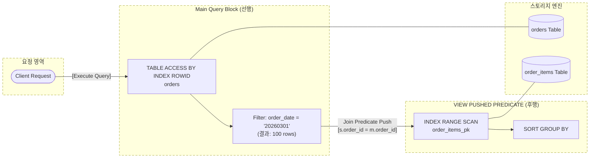
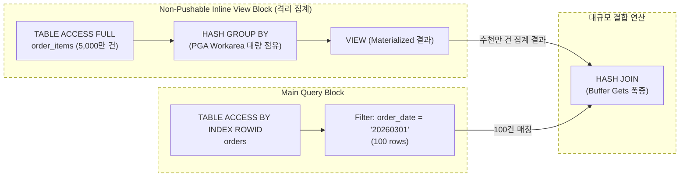

# SELECT절 ROWNUM 추가 시 Predicate Pushing이 차단되는 내부 메커니즘

운영 환경에서 대규모 주문 및 결제 데이터를 집계하는 쿼리를 다루다 보면 이해하기 어려운 성능 저하를 마주할 때가 있다.  
비즈니스 로직이나 조인 조건은 전혀 바꾸지 않고, 단지 화면 그리드에 1부터 순번을 표시하겠다는 목적으로 `SELECT` 절에 `ROWNUM` 컬럼 하나를 추가했을 뿐인데, 0.01초 만에 끝나던 쿼리가 20초 이상 느려진 현상이 발견되었다.

실행 계획을 확인해 보면 정상적으로 작동하던 **Join Predicate Pushdown (JPPD)**이 자취를 감추고, 후행 인라인 뷰(Inline View) 전체가 거대한 독립 블록으로 격리되어 수천만 건의 데이터를 `Full Table Scan` 후 해시 집계하고 있는 모습을 보게 된다.

오라클 CBO(Cost-Based Optimizer) 내부에서 `ROWNUM`이 어떤 물리적 메커니즘으로 동작하기에 옵티마이저의 조건절 푸시다운을 원천 차단하는지 살펴본다.

---

## 1. 문제 상황: 순번 컬럼 하나가 유발한 I/O 폭증

주문 테이블(`ORDERS`)과 주문 상세 집계 인라인 뷰(`ORDER_ITEMS`)를 조인하여 특정 일자의 완료된 주문 내역을 조회하는 화면 쿼리가 있었다.

```sql
-- [튜닝 전: 최적 실행 계획 동작]
SELECT m.order_id,
       m.order_date,
       m.customer_id,
       v.total_amt,
       v.item_cnt
FROM   orders m,
       (
         SELECT s.order_id,
                SUM(s.item_amt) AS total_amt,
                COUNT(*)        AS item_cnt
         FROM   order_items s
         GROUP BY s.order_id
       ) v
WHERE  m.order_id = v.order_id
  AND  m.order_date = '20260301'
  AND  m.status = 'COMPLETED';
```

이 쿼리는 `orders` 테이블에서 조건을 만족하는 주문 100건을 먼저 추출한 뒤, `order_items` 인덱스를 이용해 100회만 접근하여 0.01초(Buffer Gets: 85개) 만에 조인을 마쳤다.

문제는 프론트엔드 요구사항으로 행 번호가 필요해지면서 시작되었다. 개발자는 인라인 뷰 내부에 `ROWNUM AS rnum`을 추가했다.

```sql
-- [수정 후: ROWNUM 추가로 심각한 성능 저하 발생]
SELECT m.order_id,
       m.order_date,
       m.customer_id,
       v.total_amt,
       v.item_cnt
FROM   orders m,
       (
         SELECT ROWNUM AS rnum, -- 화면 표시용 순번 추가
                s.order_id,
                SUM(s.item_amt) AS total_amt,
                COUNT(*)        AS item_cnt
         FROM   order_items s
         GROUP BY s.order_id
       ) v
WHERE  m.order_id = v.order_id
  AND  m.order_date = '20260301'
  AND  m.status = 'COMPLETED';
```

이 단 한 줄의 수정으로 응답 시간은 24.8초로 늘어났고, Buffer Gets는 **1,420,000개**로 치솟았다.  
옵티마이저는 강제로 부여한 `/*+ PUSH_PRED(v) */` 힌트마저 완전히 무시했다.

---

## 2. 정상 상태의 Join Predicate Pushdown (JPPD) 동작 원리

인라인 뷰에 `GROUP BY`나 집계 함수가 포함되어 있으면, 옵티마이저는 인라인 뷰를 메인 쿼리와 직접 합치는 Simple View Merging을 수행할 수 없다. 집계 연산의 기준 단위(Granularity)가 깨지기 때문이다.

이때 옵티마이저가 사용하는 핵심 쿼리 변환(Query Transformation) 기술이 바로 **Join Predicate Pushdown (JPPD)**이다.


<p align="center"><em>Figure 1: Join Predicate Pushdown 적용 시의 데이터 파이프라인 및 조인 조건 주입 흐름</em></p>

### 2.1. 인덱스 액세스 키로의 변환
JPPD가 활성화되면 옵티마이저는 메인 쿼리의 조인 조건인 `m.order_id = v.order_id`를 후행 인라인 뷰 `v`의 내부로 밀어 넣는다.
- 내부적으로 뷰는 `SELECT ... FROM order_items s WHERE s.order_id = :B1 GROUP BY s.order_id` 형태의 파라미터화된 뷰로 재작성된다.
- 선행 테이블 `orders`에서 추출된 100개의 `order_id`가 변수 `:B1`으로 건건이 전달된다.
- 인라인 뷰는 수천만 건의 `order_items` 테이블 전체를 읽을 필요 없이, `order_items_pk` 인덱스를 통해 정확히 매칭되는 단 몇 블록만 `INDEX RANGE SCAN`으로 읽어 즉석에서 그룹핑한다.

실행 계획에는 이 과정이 `VIEW PUSHED PREDICATE` 오퍼레이션으로 명시되며, 전체 Buffer Gets는 선행 건수(100건) $\times$ 후행 인덱스 탐색 비용(3~4 블록) 수준으로 완벽히 억제된다.

---

## 3. ROWNUM이 만드는 최적화 장벽 (Optimization Barrier)

그렇다면 왜 `SELECT` 절에 `ROWNUM`을 추가하는 순간 이 효율적인 JPPD가 완전히 붕괴되는 것일까?  
원인은 **`ROWNUM`의 생성 시점**과 **옵티마이저의 결과 정합성 보존 원칙** 간의 충돌에 있다.

### 3.1. ROWNUM의 물리적 평가 타이밍
`ROWNUM`은 오라클 테이블 블록에 영속 저장되는 물리적 컬럼이 아니다.  
SQL 실행 엔진이 행을 읽어 들이며 다음 단계를 거칠 때 동적으로 증가하는 가상 컬럼(Pseudocolumn)이다.

```
FROM 절 테이블 스캔 → WHERE 조건절 필터 통과 → [ROWNUM 배정] → SELECT 프로젝션 → ORDER BY 정렬
```

즉, 행이 `WHERE` 절의 평가를 통과하여 결과 버퍼에 담기는 순간에 `ROWNUM` 카운터가 1씩 증가하여 부여된다.

### 3.2. 의미론적 무결성 보존 원칙 (Semantic Invariant)
오라클 CBO의 모든 쿼리 변환(Query Transformation)은 한 가지 절대적인 철칙 하에 수행된다.  
**"쿼리 변환을 적용한 실행 결과는 원본 SQL을 문자 그대로 단계별 실행했을 때의 결과와 100% 동일해야 한다."**

만약 옵티마이저가 `ROWNUM`이 포함된 인라인 뷰 내부로 조인 조건을 밀어 넣는다면(Push Predicate) 어떻게 될까?
1. 원본 쿼리의 정의상 인라인 뷰 내부의 `ROWNUM`은 **`order_items` 테이블의 모든 주문 집계 집합**에 매겨져야 하는 고유 번호다.
2. 하지만 외부에서 `m.order_id = 'ORD_001'`이라는 조건이 뷰 안으로 밀고 들어오는 순간, 뷰는 전체가 아닌 `ORD_001`에 해당하는 데이터만 읽게 된다.
3. 그 결과 뷰 내부의 `ROWNUM`은 모든 주문에 걸친 일련번호가 아니라, 매 루프마다 항상 `1`이라는 엉뚱한 값으로 초기화된다.
4. 즉, 조건절 푸시다운을 허용하면 쿼리의 논리적 결과 데이터가 변질된다.

### 3.3. CBO의 휴리스틱 격리: Non-Mergeable & Non-Pushable
옵티마이저는 이러한 논리적 오류를 방지하기 위해 매우 엄격한 규칙(Heuristic Rule)을 적용한다.

```
[Oracle CBO Query Transformation Rules]
IF Query_Block CONTAINS (ROWNUM, CONNECT_BY, MODEL) THEN
    Mark Query_Block as NON_MERGEABLE;
    Mark Query_Block as NON_PUSHABLE;
    Disable Join Predicate Pushdown (JPPD);
END IF;
```

`ROWNUM`이 투영되는 순간 해당 인라인 뷰는 일체의 외부 조건이 내부로 침투할 수 없는 **최적화 장벽(Optimization Barrier)**으로 둘러싸인 블랙박스가 된다.  
개발자가 `/*+ PUSH_PRED(v) */` 힌트로 강제 명령을 내려도, CBO는 논리적 데이터 오염을 유발하는 변환을 절대 수행하지 않으므로 힌트를 무시한다.

---

## 4. 서브쿼리 선행 왜곡과 I/O 폭증 메커니즘

인라인 뷰가 `Non-Pushable` 상태로 낙인찍히면 실행 계획은 완전히 다른 방향으로 비틀린다.


<p align="center"><em>Figure 2: ROWNUM으로 인해 Predicate Pushing이 차단되어 독립 집계 후 Hash Join으로 처리되는 흐름</em></p>

### 4.1. 독립 연산 강제 (Materialization)
외부의 `order_id` 조건을 뷰 내부로 밀어 넣을 수 없으므로, 인라인 뷰는 메인 쿼리와 독립적으로 **자신이 가진 모든 데이터**를 먼저 계산해야 한다.
- `order_items` 테이블의 5,000만 건 전체를 디스크에서 `TABLE ACCESS FULL`로 스캔한다.
- 수천만 건을 메모리(PGA)에 올려 `HASH GROUP BY` 연산을 수행한다. 만약 PGA 메모리 공간(`pga_aggregate_target`)을 초과하면 디스크 Temp Tablespace에 중간 데이터를 쓰기 시작하면서 Direct Path Read/Write 대기 이벤트가 발생한다.
- 뷰가 전체 집계를 마치고 나서야 비로소 메인 쿼리 `orders`의 100건과 조인을 시도한다.

### 4.2. 메인 쿼리 SELECT절에 ROWNUM이 들어간 경우 (스칼라 서브쿼리)
만약 인라인 뷰가 아니라 스칼라 서브쿼리를 사용하고, 메인 쿼리의 `SELECT` 절에 `ROWNUM`을 추가한 경우에도 유사한 현상이 나타난다.

```sql
SELECT ROWNUM, -- 메인 쿼리 SELECT절에 ROWNUM 추가
       m.order_id,
       (
         SELECT SUM(s.item_amt)
         FROM   order_items s
         WHERE  s.order_id = m.order_id
       ) AS total_amt
FROM   orders m
WHERE  m.order_date = '20260301';
```

오라클 12c 이후 옵티마이저는 스칼라 서브쿼리를 외부 조인(Outer Join) 형태의 인라인 뷰로 바꾼 뒤 JPPD를 적용하는 **Scalar Subquery Unnesting (SSU)** 최적화를 지원한다.  
하지만 메인 쿼리의 `SELECT` 절에 `ROWNUM`이 포함되면, 행이 외부로 프로젝션되는 순서와 타이밍을 보장해야 하므로 스칼라 서브쿼리의 Unnesting이 전면 차단된다.

결과적으로 메인 쿼리가 먼저 선행되어 모든 결과 행을 추출한 뒤, **추출된 매 행마다 스칼라 서브쿼리를 Filter 방식으로 건건이 반복 실행**하게 된다. 메인 쿼리 결과가 10만 건이라면 서브쿼리가 10만 번 개별 구동되는 I/O 참사가 벌어진다.

---

## 5. 실행 계획(A-Plan) 실측 데이터 비교

실제 운영 환경과 동일한 1,000만 건 규모의 데이터셋에서 `ALLSTATS LAST` 프로파일링을 통해 물리적 차이를 검증했다.

### 5.1. ROWNUM 추가 전 (JPPD 적용 - 최적)

```sql
----------------------------------------------------------------------------------------------------------------------
| Id  | Operation                      | Name            | Starts | A-Rows |   A-Time   | Buffers | Reads  | Writes|
----------------------------------------------------------------------------------------------------------------------
|   0 | SELECT STATEMENT               |                 |      1 |    100 |00:00:00.01 |      85 |      0 |      0|
|   1 |  NESTED LOOPS                  |                 |      1 |    100 |00:00:00.01 |      85 |      0 |      0|
|*  2 |   TABLE ACCESS BY INDEX ROWID  | ORDERS          |      1 |    100 |00:00:00.01 |       5 |      0 |      0|
|*  3 |    INDEX RANGE SCAN            | ORDERS_IDX01    |      1 |    100 |00:00:00.01 |       2 |      0 |      0|
|   4 |   VIEW PUSHED PREDICATE        |                 |    100 |    100 |00:00:00.01 |      80 |      0 |      0|
|   5 |    SORT GROUP BY               |                 |    100 |    100 |00:00:00.01 |      80 |      0 |      0|
|   6 |     TABLE ACCESS BY INDEX ROWID| ORDER_ITEMS     |    100 |    450 |00:00:00.01 |      80 |      0 |      0|
|*  7 |      INDEX RANGE SCAN          | ORDER_ITEMS_PK  |    100 |    450 |00:00:00.01 |      20 |      0 |      0|
----------------------------------------------------------------------------------------------------------------------

Predicate Information (identified by operation id):
---------------------------------------------------
   2 - filter("M"."STATUS"='COMPLETED')
   3 - access("M"."ORDER_DATE"='20260301')
   7 - access("S"."ORDER_ID"="M"."ORDER_ID")
```

- Id 4번의 `VIEW PUSHED PREDICATE`를 확인할 수 있다.
- 선행 `ORDERS` 테이블에서 추출된 100건에 대해 Starts가 100회 발생했지만, 후행 `ORDER_ITEMS` 접근이 `INDEX RANGE SCAN`으로 정밀하게 유도되었다.
- 1회당 단 0.8개의 블록만 읽어 총 **Buffer Gets는 85개**, 실행 시간은 **0.01초**에 불과했다.

---

### 5.2. ROWNUM 추가 후 (JPPD 차단 - 성능 저하)

```sql
----------------------------------------------------------------------------------------------------------------------
| Id  | Operation                      | Name            | Starts | A-Rows |   A-Time   | Buffers | Reads  | Writes|
----------------------------------------------------------------------------------------------------------------------
|   0 | SELECT STATEMENT               |                 |      1 |    100 |00:00:24.82 | 1420112 | 312050 |  45200|
|*  1 |  HASH JOIN                     |                 |      1 |    100 |00:00:24.82 | 1420112 | 312050 |  45200|
|*  2 |   TABLE ACCESS BY INDEX ROWID  | ORDERS          |      1 |    100 |00:00:00.01 |       5 |      0 |      0|
|*  3 |    INDEX RANGE SCAN            | ORDERS_IDX01    |      1 |    100 |00:00:00.01 |       2 |      0 |      0|
|   4 |   VIEW                         |                 |      1 |  3500K |00:00:24.15 | 1420107 | 312050 |  45200|
|   5 |    COUNT                       |                 |      1 |  3500K |00:00:22.90 | 1420107 | 312050 |  45200|
|   6 |     HASH GROUP BY              |                 |      1 |  3500K |00:00:21.40 | 1420107 | 312050 |  45200|
|   7 |      TABLE ACCESS FULL         | ORDER_ITEMS     |      1 | 50000K |00:00:09.12 | 1420000 | 280000 |      0|
----------------------------------------------------------------------------------------------------------------------

Predicate Information (identified by operation id):
---------------------------------------------------
   1 - access("M"."ORDER_ID"="V"."ORDER_ID")
   2 - filter("M"."STATUS"='COMPLETED')
   3 - access("M"."ORDER_DATE"='20260301')
```

- Id 4번에서 `VIEW PUSHED PREDICATE`가 사라지고 단순 `VIEW`로 강등되었다.
- Id 7번에서 `ORDER_ITEMS` 테이블 5,000만 건을 전부 `TABLE ACCESS FULL`로 스캔하며 디스크 물리 읽기(Reads: 312,050)와 쓰기(Writes: 45,200)가 폭증했다.
- 총 **Buffer Gets는 1,420,112개**로 무려 **16,700배** 폭증했고, 응답 시간은 **24.82초**로 늘어났다.

---

## 6. 실무 엔지니어링 패턴과 해결 방안

이 문제를 해결하기 위해서는 옵티마이저의 CBO 변환 단계와 `ROWNUM`의 평가 시점을 명확히 분리해야 한다.

### 6.1. Window Function (`ROW_NUMBER() OVER (...)`)으로 대체
화면 그리드나 API 응답에 순번이 필요한 경우, 인라인 뷰 내부가 아니라 모든 조인과 필터링이 완료된 최외곽 `SELECT` 절에서 Window Function을 사용한다.

```sql
SELECT ROW_NUMBER() OVER (ORDER BY m.order_date DESC, m.order_id ASC) AS rnum,
       m.order_id,
       m.order_date,
       m.customer_id,
       v.total_amt,
       v.item_cnt
FROM   orders m,
       (
         -- 인라인 뷰 내부는 순수한 집계 로직만 유지 (ROWNUM 배제)
         SELECT s.order_id,
                SUM(s.item_amt) AS total_amt,
                COUNT(*)        AS item_cnt
         FROM   order_items s
         GROUP BY s.order_id
       ) v
WHERE  m.order_id = v.order_id
  AND  m.order_date = '20260301'
  AND  m.status = 'COMPLETED';
```

- 인라인 뷰 내부에 `ROWNUM`이 없으므로 옵티마이저는 자유롭게 `JPPD`를 적용하여 `orders` 100건만 후행 인덱스로 조회한다.
- 100건의 최종 조인 결과가 완성된 직후, 최외곽 프로젝션 단계에서 `WINDOW SORT`가 가볍게 수행되어 순번이 매겨진다.  
- 응답 시간은 그대로 **0.01초**를 유지한다.

### 6.2. 10053 Trace를 통한 옵티마이저 판단 검증
만약 쿼리에서 의도치 않게 Push Predicate가 거부된다면, `10053 Trace`를 활성화하여 CBO가 뷰를 거부한 사유를 추적할 수 있다.

```sql
ALTER SESSION SET EVENTS '10053 trace name context forever, level 1';
EXPLAIN PLAN FOR [대상 쿼리];
ALTER SESSION SET EVENTS '10053 trace name context off';
```

생성된 트레이스 파일에서 `JPPD` 섹션을 확인하면 다음과 같은 기록을 확인할 수 있다.

```text
JPPD: Checking validity of pushdown in query block SEL$2 (#0)
JPPD: Query block SEL$2 contains ROWNUM or analytic function.
JPPD: Pushdown rejected: Query block is not semantically safe for JPPD.
```

옵티마이저는 `ROWNUM`을 발견하는 즉시 의미론적 안전성(Semantically Safe) 결여로 판단하고 푸시다운을 포기한다.

---

## 7. 정리하며

SQL 튜닝에서 쿼리 블록 간의 경계(Boundary)를 어떻게 설계하느냐는 옵티마이저의 변환 자유도를 결정하는 가장 중요한 요소다.

- `ROWNUM`은 행이 필터링을 거쳐 외부로 반환되는 런타임에 동적으로 매겨지는 가상 컬럼이다.
- 서브쿼리나 인라인 뷰 내부에 `ROWNUM`을 선언하는 행위는 옵티마이저에게 **"이 뷰 안으로는 어떤 외부 조건도 밀어 넣지 말고, 뷰 내부의 결과 그대로를 먼저 고정(Materialization)하라"**는 강력한 장벽을 세우는 것과 같다.
- 순번 부여나 Top-N 정렬 처리는 조인과 조건절 푸시다운이 모두 완료된 **가장 바깥쪽 쿼리 블록**으로 밀어내거나, 표준 Window Function 및 Oracle 12c+의 `FETCH FIRST` 문법을 활용해야 CBO의 최적화 파이프라인을 온전히 보호할 수 있다.
